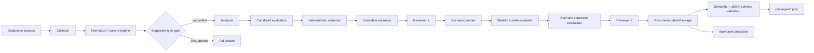

# Reference Architecture

The optimization policy is lexicographic: hard constraints/feasibility first, then the approved primary objective, then secondary objectives. Economics never overrides a failed hard constraint.

Constraint evaluation may be implemented as a dedicated class or deterministic pure functions. Keep the single-`publisher.py` core during fast iteration unless there is an approved reason to split it.

LLMs may help research/explain/challenge outside this runtime path; they must not be the authoritative decision engine.
