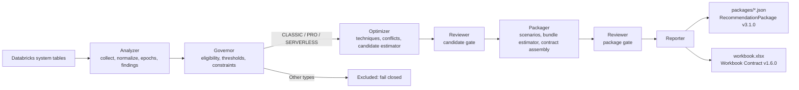

# Databricks SQL Warehouse Optimizer

Deterministic, read-only optimizer for Databricks SQL warehouses. The publisher uses **Reporter JSON Contract v3.1.0** as the machine source of truth and **Workbook Reporter Contract v1.6.0** as the professional human projection. The companion [Realizer](#realizer) reads those packages after a change is applied and measures what was realized.

## Install

Python 3.10 or newer.

```bash
python -m venv .venv && source .venv/bin/activate
pip install -r requirements.txt
pip install -e .
```

The install must be editable (`-e`): the package reads the committed `schema/` and `pricing/` folders from the checkout and refuses to import from a copied install. After the install, run the CLI with `python -m publisher`. Without an install, run `python scripts/run_publisher.py` from the checkout: it takes the same arguments.

## Canonical flow



`publish()` in `src/publisher/publisher.py` calls each capability once, in this order, and holds no domain logic; each capability lives in its own package under `src/publisher/` (`analyzer`, `governor`, `optimizer`, `reviewer`, `packager`, `reporter`, plus `contracts`, `config` and `common`). Architecture: [`docs/architecture/publisher/hld.md`](docs/architecture/publisher/hld.md).

The workbook never recalculates recommendations, confidence, IDs, or scenario economics.

## Supported optimization scope

Active warehouse types: `CLASSIC`, `PRO`, standard `SERVERLESS`. Any future/unknown warehouse type fails closed before optimization. Lakehouse Real-Time is not modeled by this release.

Active candidate domains (one candidate per domain/warehouse): warehouse size, max clusters, min clusters, auto-stop, and warehouse-type migration. Each warehouse is evaluated under a cost profile: **aggressive** for nonprod-tagged warehouses, **balanced** otherwise, or whatever `--cost-profile` sets (`--cost-profile conservative` for every warehouse, `--cost-profile aggressive=<warehouse-id>[,...]` for some). The profile moves only how much performance risk a cut may take; values in `docs/reference/publisher/thresholds.md` (Cost profiles). Photon (observed from billing) and the warehouse channel (from the configuration) are reported but never recommended. Query rewrite, storage, schedule, Spot-policy, and statement-timeout optimization are outside this release.

## Run scope

By default a run assesses every scenario and technique for every warehouse. A run can be restricted to some of them:

| Scenario | Techniques |
|---|---|
| `current` (Plan A, optimize the current warehouse type) | `size`, `max-clusters`, `min-clusters`, `auto-stop` |
| `migration` (Plan B, warehouse-type migration experiment) | `warehouse-type` |

```bash
publisher --from-evidence ./out/run_date=2026-10-05/run_ts=20261005T143012Z/evidence.json \
  --scope current:auto-stop --warehouse wh-demo-001 --output-dir ./out
publisher --demo --scope current:auto-stop,min-clusters --scope migration --output-dir ./demo_out
publisher --demo --scope-file examples/scopes/current-auto-stop.json --output-dir ./demo_out
```

`--scope current` enables all four current-type techniques. `--warehouse` takes `all` (the default), a warehouse ID or `<workspace_id>/<warehouse_id>`, and can be repeated. `--scope-file` holds the same choices as JSON toggles plus the warehouses (`schema/run-scope.schema.json`; presets in `examples/scopes/`) and is not combined with the flags. An unknown name or a warehouse that is not in the evidence stops the run with exit status 2.

Scope decides what is built, not only what is shown: out-of-scope candidates are never produced, Plan A is built and priced from the enabled techniques only, starting from the current configuration (out-of-scope knobs keep their current values), and each candidate is identical to the same candidate in a full run. A canary rollback is always published, even outside the scope. When `current` is not in scope, the recommended scenario is "No change" and any migration stays an alternative experiment. The packages record the scope in `run_scope` (null for a full run; [`docs/contracts/shared/reporter-json-contract.md`](docs/contracts/shared/reporter-json-contract.md) section 14.4), and the workbook and manifest show it. Evidence is collected the same way in every scope, so one `evidence.json` can be replayed with any scope.

## Output directory

Each run writes to its own folder under `--output-dir`, named from the run's UTC start time (Hive-style, so Spark and Databricks read `run_date` and `run_ts` as partition columns):

```text
<output-dir>/
└── run_date=YYYY-MM-DD/
    └── run_ts=YYYYMMDDTHHMMSSZ/
        ├── packages/
        │   └── <workspace_id>__<warehouse_id>.json
        ├── workbook.xlsx
        ├── evidence.json          # versioned replay input for --from-evidence (a live run writes it right after collection, so a later refusal or crash keeps it)
        ├── manifest.json
        └── publisher.log
```

The timestamp is only in the folder name, never inside a file, so identical replays write identical files. A second run in the same second gets a `-01` suffix; nothing is overwritten. `--flat-output` writes directly into `--output-dir` instead, and refuses (exit 2, before anything is collected) a folder that already holds a previous run, meaning a non-empty `packages/` or a `manifest.json`, so two runs never mix files: choose a new folder. The scripts that read a run (`scripts/validate_workbook.py`, `scripts/compare_with_ref.py`) accept a run folder or the root, where they read the newest run.

Each package validates against Python semantic/hash invariants and the committed Draft 2020-12 JSON Schema before publication. `evidence.json` is validated the same way (`schema/evidence.schema.json`); see [`docs/contracts/publisher/evidence-format.md`](docs/contracts/publisher/evidence-format.md).

## Professional workbook

The workbook contains exactly four sheets:

1. **Executive Summary** — coverage, baseline cost, signed portfolio impact, confidence and top warehouse impacts.
2. **Warehouse Portfolio** — one row per recommendation package.
3. **Scenario Plans** — one row per scenario.
4. **Recommendation Registry** — one row per candidate/technique decision.

Economic cells are numeric whenever available. Positive annual impact means savings; negative annual impact means cost increase and uses accounting-style parentheses/red formatting. Separate `Currency` and `Impact Type` columns make the meaning explicit. Unavailable economics are never coerced to zero.

See [`docs/contracts/publisher/workbook-contract.md`](docs/contracts/publisher/workbook-contract.md).

## Synthetic golden-scenario fleet (end-to-end test)

```bash
publisher --demo --output-dir ./demo_out
python scripts/run_demo.py ./demo_out      # same run, no install
python scripts/validate_workbook.py ./demo_out   # checks the newest run under ./demo_out
```

The demo fleet has one simulated warehouse per golden scenario (each tagged `golden_scenario=<row id>` in its config tags). Each warehouse's evidence is simulated from a workload description: query windows by day rule (weekdays, all days, month-end, half-year-end) with concurrent or periodic queries, auto-stop deciding running time and restarts, and clusters following concurrency within min/max. Billed DBU is cluster-hours times the published DBU/hour per size (with small daily noise) and cost is DBU times the SKU list price. The simulated rows are turned into collector query results and normalized by the real evidence extraction, so the run enters the same downstream pipeline as live evidence. `--demo-count N` (1..41) runs the first N warehouses.

Expected output: one immutable package per simulated warehouse, one `workbook.xlsx`, replay evidence, manifest and log. The output directory is not tracked; regenerate it with the command above.

## Live collector execution

Authenticate with a Databricks CLI OAuth profile. Static PAT profiles are rejected.

SQL warehouse / Serverless execution target:

```bash
databricks auth login --host https://<workspace> --profile WHOPT
publisher \
  --profile WHOPT \
  --serverless-warehouse-id <warehouse-id> \
  --source-region us-east-1 \
  --output-dir ./out
```

Every flag, its default and its meaning: [`docs/architecture/publisher/lld.md`](docs/architecture/publisher/lld.md) section 5.2. `--sql-warehouse-id` is also supported. A validated all-purpose cluster may be used with `--all-purpose-cluster-id`; jobs compute is rejected. REST interactions are read-only and limited to execution-target resolution/validation and optional compatibility evidence. Authoritative optimizer configuration and metrics remain system-table driven.

`--source-region` must be an AWS region in `pricing/aws_ec2_on_demand.json` when the fleet has Pro/Classic warehouses: otherwise a live run stops after collection, before writing packages or the workbook; `evidence.json` and `publisher.log` are already in the run folder, and the message names the file and `--from-evidence` to replay it. A WARNING at the start of the run announces the gap before any SQL runs. Add `--allow-missing-aws-price` to publish anyway, with Pro/Classic AWS cost unavailable. Serverless-only fleets and `--from-evidence` replays are not affected.

To reproduce an earlier collection despite later billing corrections, add `--billing-ingested-through YYYY-MM-DD`: every billing query then reads only records ingested on or before that date. A UTC day enters the cost basis only after the `billing_settle_hours` buffer following its end and once its workspace's billing watermark has passed it.

## Weekly scheduled run

Run the publisher once a week as a Databricks job: a Python task or a notebook that calls `python -m publisher` in live mode (the flags above) with an OAuth CLI profile available to the job (static PAT profiles are rejected, and the Databricks CLI must be on the job's `PATH`) and `--output-dir` on a Volume, for example `/Volumes/<catalog>/<schema>/<volume>/whopt`. Each run writes its own `run_date=/run_ts=` folder there; keep them: every run reads the system tables afresh, and the folders are the audit trail.

What each run shows, per warehouse package:

- `observed_change`: the configuration change since the previous epoch, that is, a plan step that was applied;
- steps that became ready once the new configuration was ready, that is, had enough settled billed days (`execution_state` `READY` or `READY_FOR_CANARY` in `recommended_plan`);
- canary guards and rollback recommendations: after a canary-type change (one size down or a lower minimum), a candidate with `CANARY_GUARDRAIL_BREACHED` restores the previous value when the new epoch's own evidence trips a guard;
- `recommended_plan.reevaluation` with `earliest_reevaluation_time` while nothing is ready yet and the plan is waiting for the configuration to be ready or for cost history to clear.

`carried_forward_plan` (the earlier epoch's plan carried forward) is reserved in the contract and not produced yet ([`docs/reference/publisher/known-limitations.md`](docs/reference/publisher/known-limitations.md)).

Weekly is enough: readiness needs only a few settled billed days (`readiness_min_billed_days`), the cost history clears within a week, and a canary's guards are read on every run, so a rollback recommendation appears on the first run after the evidence trips one. The job is read-only and never applies a change: owners apply approved steps in the Databricks UI or API themselves, and the next run measures the epoch that follows.

## Realizer

The Realizer is the companion to the publisher: it answers what happened after a RecommendationPackage was published. It reads the package (Reporter JSON Contract 3.1.0 only), observes the package's warehouse after the owner applied a change, appends immutable ledger facts and projects a realization package and snapshot, with the realized saving where it can be measured. It is read-only: it never changes a recommendation package or a warehouse. The observation comes from one of four sources: a live measurement from system tables (OAuth profile, read-only), a replay of the evidence such a measurement wrote, a simulated demo world (`--demo`) or a normalized observation file.

```bash
realizer --package <PKG.json> --observation <observation.json> --output-dir ./realizer_out
realizer --package <PKG.json> --demo                        # a demo-fleet package, measured in its simulated world
python -m realizer --package <PKG.json> --demo-modified     # the same CLI without the console script
python scripts/run_realizer.py --package <PKG.json> --demo  # from a checkout, no install
realizer --package <PKG.json> --profile <oauth-profile> --sql-warehouse-id <collector-warehouse> --output-dir ./realizer_out  # live
realizer --package <PKG.json> --from-evidence ./realizer_out/state/realization/measurements/<file>.json  # replay a live or demo measurement
realizer --publisher-run ./demo_out --demo --output-dir ./realizer_out  # fleet: every warehouse of the newest Publisher run
realizer --publisher-run <publisher run folder or root> --profile <oauth-profile> --sql-warehouse-id <collector-warehouse> [--warehouse <id>]  # fleet, live
realizer --backtest --profile <oauth-profile> --sql-warehouse-id <collector-warehouse> [--warehouse <id>] --source-region <region>  # past auto-stop changes, no package
```

Every flag, the exit codes and the output layout: [`docs/architecture/realizer/lld.md`](docs/architecture/realizer/lld.md) section 14 (`realizer --help`, `realizer --backtest --help`). The default `--output-dir` is `./realizer_out` for every form.

**Runs.**

- A **package run** (`--package`) realizes one package. Without an observation source it only records the lineage. `--observation` takes a normalized observation file (format 3.1.0).
- A **live run** (`--profile` with `--sql-warehouse-id`, never the measured warehouse) measures the package's warehouse from system tables with the Publisher's collector SQL, writes the measurement evidence to the state under `realization/measurements/` and realizes it. It measures a changed auto-stop, a size change and a minimum-cluster cut, observes a maximum-cluster change by its guards and a migration without claiming it, and needs at least one whole settled week after the change. The owner applies the change; the Realizer only reads. `--from-evidence` replays that file offline. Optional live flags: `--source-region`, `--aws-price-registry`, `--as-of`, `--billing-ingested-through`, `--databricks-config-file`, and `--approvals` to confirm a change's origin. What is measured and how: [`docs/contracts/realizer/source-evidence-contract.md`](docs/contracts/realizer/source-evidence-contract.md) sections 16 to 19.
- `--demo` takes a package of a Publisher demo-fleet warehouse (`publisher --demo`; any other package is refused) and measures it the same way in that warehouse's simulated world, 28 settled days after the package's first eligible step was applied (`--demo-modified`: a size step to MEDIUM applied as SMALL). It is the world the end-to-end golden cases measure, never a measurement of a real warehouse.
- A **fleet run** (`--publisher-run <dir>`, instead of `--package`) realizes every warehouse of a Publisher run folder, or of the newest `run_date=*/run_ts=*` folder under a root (never a folder the Realizer wrote), or those named by repeatable `--warehouse`. It runs one warehouse at a time under a lock in the state, realizes each open lineage kept there and then the run's package, and writes a run manifest (`manifest.json`) and the realization workbook (`realization_workbook.xlsx`). A failure stays with its warehouse. Exit status: 1 when any warehouse crashed, else 2 when any was refused, else 0.
- `realizer --backtest` measures the auto-stop changes that already happened in `system.compute.warehouses`, each with the prediction the Publisher's replay would have made on the days before it, the realized saving on the days after it and the billed cross-check. It uses no package and writes no ledger; its evidence and report go under `realization/backtest/`.

**Output.** Each package or fleet run writes into a new run folder `<output-dir>/run_date=YYYY-MM-DD/run_ts=YYYYMMDDTHHMMSSZ/`: the realization packages and snapshots (`realization/packages/`, `realization/snapshots/`) and the run log `realizer.log`. The history lives in one long-lived state directory, `--state-dir`, by default `<output-dir>/state` (ledgers, evidence, regeneration requests, measurements, policies, source package copies, state index), so a scheduler that keeps one `--output-dir` never forks it. `--flat-output` writes both under `--output-dir` itself. Inputs are checked before anything is written, and a refused input exits with status 2 and a one-line message. Several packages of one warehouse can share a state directory (daily Publisher runs, profile alternatives, the package after a change): one change belongs to one lineage and the others report it as observable only ([`docs/contracts/realizer/ledger-contract.md`](docs/contracts/realizer/ledger-contract.md) sections 18, 19 and 24). A run holds a lock on its package's ledger until it has written its files, and a ledger line cut short by an interrupted write is quarantined (same contract, section 9).

**Code.** `realize_request()` in `src/realizer/realizer.py` (and `realize()`, its positional form) calls each capability once (Analyzer, Governor, Reconciler, Estimator, Reviewer, Packager, Reporter) and holds no domain logic; the CLI in `src/realizer/cli/` is an adapter in front of it. `python scripts/compare_realizer_with_ref.py --ref <git ref>` diffs its outputs against any git ref over the stored scenarios. Its contracts: realization package 1.2.0, ledger 1.1.0, observation 3.1.0 (`schema/realization-*.json`), documented in [`docs/README.md`](docs/README.md); what it cannot measure yet: [`docs/reference/realizer/known-limitations.md`](docs/reference/realizer/known-limitations.md). A synthetic Publisher-to-Realizer example with its expected identities and outcomes is in [`examples/realizer/`](examples/realizer/README.md); the real-data run: [`docs/proposals/realizer/real-data-run.md`](docs/proposals/realizer/real-data-run.md).

## Source policy

- `system.compute.warehouses` — configuration snapshots/epochs (an epoch is a period of unchanged type, channel, size, min/max clusters and auto-stop; name/tag-only snapshots do not start one).
- `system.compute.warehouse_events` — scaling/resource-state evidence, including a daily resource series for the current epoch (last 120 UTC days) that drives the AWS baseline and recent time at min/max.
- `system.query.history` — latency, queueing, spill, workload source/client evidence.
- `system.billing.usage` — DBU usage/cost, Photon observation, owner attribution.
- `system.billing.list_prices` — Databricks list pricing.
- `pricing/aws_ec2_on_demand.json` — versioned regional forward AWS price registry for Pro/Classic modeled infrastructure cost.

## Documentation

[`docs/README.md`](docs/README.md) indexes every document by audience: product, architecture, contracts, reference, skills, proposals and archive. Start with [`docs/architecture/publisher/context.md`](docs/architecture/publisher/context.md) for the domain language, then the two contract docs under `docs/contracts/`.

## Reusable Databricks publisher skill suite

This repo also contains a reusable ten-skill system under `.claude/skills/` for building equivalent deterministic publishers for other Databricks services without copying SQL-Warehouse domain assumptions.

Start with `databricks-publisher-orchestrator`. It coordinates service discovery, source contracts, technique catalog, economics, public contracts, implementation, independent validation, and release sealing through explicit artifact gates. The generic reporter vocabulary uses `resource`, not `warehouse`, so Job Cluster/Lakeflow implementations rediscover their own identity/configuration/economics while reusing the proven publisher architecture.

See [`docs/reference/shared/skills.md`](docs/reference/shared/skills.md). Validate the suite with:

```bash
python scripts/validate_skill_suite.py
```

The suite version is declared in `.claude/skills/suite.yaml`; the validator reports the current eval counts. The optimization reasoning model is explicit: First Principles → Causal Mechanism → Constraints-First Optimization → Counterfactual → Second-Order Effects → Validation & Learning (`.claude/skills/databricks-publisher-orchestrator/references/optimization-thinking-framework.md`).

## Tests

```bash
python -m unittest discover -s tests -v
```

The suite is layered: unit tests per capability (`tests/unit/<capability>/`), component tests that chain capabilities, golden scenarios, regression checks and live integration tests (skipped without a Databricks profile). It covers collector/normalization/model/optimizer behavior, deterministic identities, golden scenarios (`tests/golden/cases/`), Reporter Contract validation, exact workbook columns/grains, numeric economic presentation, unsupported-type fail-closed behavior and the synthetic golden-scenario fleet flow.
