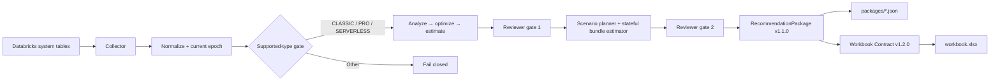

# Databricks SQL Warehouse Optimizer — v2.8.0

Deterministic, read-only optimizer for Databricks SQL warehouses. The sealed testing baseline uses **Reporter JSON Contract v1.1.0** as the machine source of truth and **Workbook Reporter Contract v1.2.0** as the professional human projection.

## Canonical flow



The workbook never recalculates recommendations, confidence, IDs, or scenario economics.

## Supported optimization scope

Active warehouse types: `CLASSIC`, `PRO`, standard `SERVERLESS`. Any future/unknown warehouse type fails closed before optimization. Lakehouse Real-Time is not modeled by this release.

Active candidate domains (one candidate per domain/warehouse): warehouse channel guardrail, warehouse size, max clusters, min clusters, auto-stop, and warehouse-type migration. Photon is observed from billing but left at its default (never recommended). Query rewrite, storage, schedule, Spot-policy, and statement-timeout optimization are outside this release.

## Output directory

```text
<output-dir>/
├── packages/
│   └── <workspace_id>__<warehouse_id>.json
├── workbook.xlsx
├── evidence.json
├── manifest.json
└── publisher.log
```

Each package validates against Python semantic/hash invariants and the committed Draft 2020-12 JSON Schema before publication.

## Professional workbook

The workbook contains exactly four sheets:

1. **Executive Summary** — coverage, baseline cost, signed portfolio impact, confidence and top warehouse impacts.
2. **Warehouse Portfolio** — one row per recommendation package.
3. **Scenario Plans** — one row per scenario.
4. **Recommendation Registry** — one row per candidate/technique decision.

Economic cells are numeric whenever available. Positive annual impact means savings; negative annual impact means cost increase and uses accounting-style parentheses/red formatting. Separate `Currency` and `Impact Type` columns make the meaning explicit. Unavailable economics are never coerced to zero.

See [`docs/workbook-contract-v1.2.0.md`](docs/workbook-contract-v1.2.0.md).

## Synthetic 15-warehouse end-to-end test

```bash
python publisher.py --demo --demo-count 15 --output-dir ./demo_out
```

Expected output: 15 immutable packages, 30 scenarios, 90 candidate recommendations, one `workbook.xlsx`, replay evidence, manifest and log. The committed example is under `examples/demo_output/`.

## Live collector execution

Authenticate with a Databricks CLI OAuth profile. Static PAT profiles are rejected.

SQL warehouse / Serverless execution target:

```bash
databricks auth login --host https://<workspace> --profile WHOPT
python publisher.py \
  --profile WHOPT \
  --serverless-warehouse-id <warehouse-id> \
  --source-region us-east-1 \
  --output-dir ./out
```

`--sql-warehouse-id` is also supported. A validated all-purpose cluster may be used with `--all-purpose-cluster-id`; jobs compute is rejected. REST interactions are read-only and limited to execution-target resolution/validation and optional compatibility evidence. Authoritative optimizer configuration and metrics remain system-table driven.

## Source policy

- `system.compute.warehouses` — configuration snapshots/epochs.
- `system.compute.warehouse_events` — scaling/resource-state evidence.
- `system.query.history` — latency, queueing, spill, workload source/client evidence.
- `system.billing.usage` — DBU usage/cost, Photon observation, owner attribution.
- `system.billing.list_prices` — Databricks list pricing.
- `pricing/aws_ec2_on_demand.json` — versioned regional forward AWS price registry for Pro/Classic modeled infrastructure cost.

## Documentation

Canonical approved documents:

- [`docs/prd.md`](docs/prd.md) — product requirements.
- [`docs/hld.md`](docs/hld.md) — high-level architecture.
- [`docs/lld.md`](docs/lld.md) — implementation/contract design.
- [`docs/context.md`](docs/context.md) — domain language and invariants.
- [`docs/reporter-json-contract-v1.1.0.md`](docs/reporter-json-contract-v1.1.0.md) — machine contract.
- [`docs/workbook-contract-v1.2.0.md`](docs/workbook-contract-v1.2.0.md) — workbook contract.

Supporting current references: `source-mapping.md`, `technique-catalog.md`, `thresholds.md`, `aws-cost-model.md`, `known-limitations.md`.

## Reusable Databricks publisher skill suite — v1.1.0

This repo also contains a reusable nine-skill system under `.claude/skills/` for building equivalent deterministic publishers for other Databricks services without copying SQL-Warehouse domain assumptions.

Start with `databricks-publisher-orchestrator`. It coordinates service discovery, source contracts, technique catalog, economics, public contracts, implementation, independent validation, and release sealing through explicit artifact gates. The generic reporter vocabulary uses `resource`, not `warehouse`, so Job Cluster/Lakeflow implementations rediscover their own identity/configuration/economics while reusing the proven publisher architecture.

See [`docs/skill-system-design.md`](docs/skill-system-design.md). Validate the suite with:

```bash
python tools/validate_skill_suite.py
```

The suite contains 180 trigger/non-trigger eval queries, 39 functional eval cases, and SQL Warehouse / Job Cluster / Lakeflow cross-service control cases.

v1.1.0 makes the optimization reasoning model explicit: First Principles → Causal Mechanism → Constraints-First Optimization → Counterfactual → Second-Order Effects → Validation & Learning. See `docs/optimization-thinking-framework.md` and `docs/sql-warehouse-v2.7-thinking-framework-audit.md`.

## Tests

```bash
python -m unittest discover -s tests -v
```

The suite covers collector/normalization/model/optimizer behavior, deterministic identities, 10 golden scenarios, Reporter Contract validation, exact workbook columns/grains, numeric economic presentation, unsupported-type fail-closed behavior and the synthetic 15-warehouse flow.

## Economics semantics

- historical actual ≠ forward no-change baseline;
- candidate economics are independent/non-additive;
- scenario economics are stateful ordered bundle counterfactuals;
- package economics are an opportunity envelope across assessable scenarios;
- realization is measured post-change outcome and never mutates the original package identity.
