# Domain Context — Databricks SQL Warehouse Optimizer

**Document:** `docs/architecture/context.md`  
**Product:** Databricks SQL Warehouse Optimizer  
**Reporter JSON Contract:** v2.0.0  
**Workbook Contract:** v1.4.0

Role: domain language, semantics and invariants.

---

## 1. Purpose

This document defines the **domain language, business semantics, mental model, invariants, and operating assumptions** for the Databricks SQL Warehouse Optimizer.

It is intentionally different from the other product documents:

- `prd.md` defines **what the product must do and why**.
- `hld.md` defines **how the major architecture is organized**.
- `lld.md` defines **how the implementation works at code/contract level**.
- `context.md` defines **what the domain concepts mean and how they relate**.

The primary audience is a future engineer, reviewer, AI coding agent, FinOps analyst, SRE, or product owner who needs to understand the product correctly **before changing algorithms, contracts, thresholds, or reporting**.

The central domain rule is:

> **A recommendation is not a configuration suggestion in isolation. It is a deterministic, evidence-backed, current-epoch decision with explicit economics, confidence, dependencies, validation requirements, and provenance.**

---

## 2. Document precedence

Ownership of each topic and the precedence rule are defined once, in `docs/README.md`. In short: the code and its tests, then the locked contracts, settle behavior; the PRD settles product scope; every other document owns the topics listed there.

---

## 3. Domain in one picture

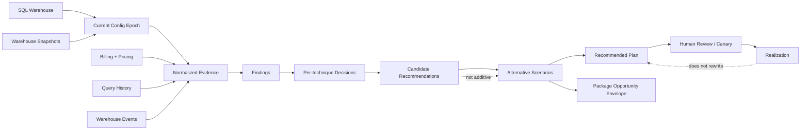

The product's aggregate root is **one recommendation package for one warehouse in one current configuration epoch**.

---

## 4. Product boundary

### 4.1 What the product is

The product is a **deterministic, read-only SQL warehouse infrastructure/configuration optimizer**.

It:

- discovers SQL warehouses visible through supported Databricks system tables;
- reconstructs configuration epochs;
- evaluates query pressure, resource behavior, billing, attribution, and pricing evidence;
- produces one decision per in-scope candidate domain;
- estimates independent candidate economics;
- assembles mutually exclusive execution scenarios;
- estimates scenario economics statefully to avoid double counting;
- produces a deterministic recommended scenario under the current policy;
- publishes one immutable JSON recommendation package per warehouse/current epoch;
- projects packages into a four-sheet workbook;
- defines a realization contract for later measured outcomes.

### 4.2 What the product is not

Phase 1 is **not**:

- a query rewriter;
- a SQL tuning assistant;
- a storage optimizer;
- a table-layout optimizer;
- a schedule optimizer;
- an autonomous configuration mutation system;
- a probabilistic LLM decision engine;
- a replacement for Databricks workload-management logic;
- a generic optimizer for all Databricks compute products.

Query telemetry is evidence for infrastructure decisions; it does not expand product scope into query optimization.

---

## 5. Supported SQL warehouse domain

The Phase-1 domain supports:

- **Classic SQL warehouses**;
- **Pro SQL warehouses**;
- **standard Serverless SQL warehouses**.

Databricks currently documents Serverless, Pro, and Classic as the standard SQL warehouse types. It also documents **Lakehouse Real-Time (Beta)** as a specialized serverless warehouse type for low-latency/high-concurrency read workloads. Lakehouse Real-Time has different operating semantics and is explicitly **out of scope** for this optimizer until a dedicated analyzer/optimizer/estimator model is designed.

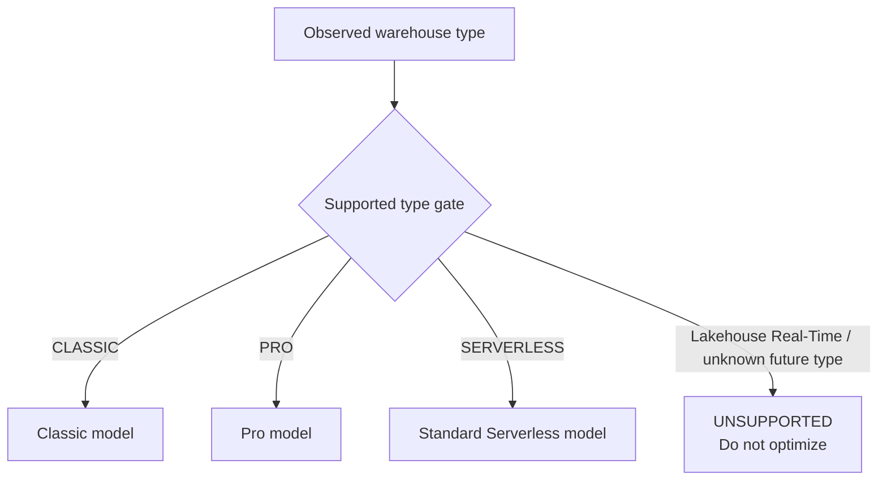

### 5.1 Current implementation alignment

The publisher enforces the fail-closed supported-type gate before active optimization. Unknown/future values cannot fall through into Pro/Classic logic.

---

## 6. Core aggregate and identities

### 6.1 Recommendation package

A `RecommendationPackage` is the canonical business object.

It represents exactly:

```text
one workspace
+ one SQL warehouse
+ one authoritative current configuration epoch
+ one normalized evidence set
+ one version set
= one immutable recommendation package
```

It is identified by `recommendation_package_id` (`PKG-*`).

### 6.2 Identity hierarchy

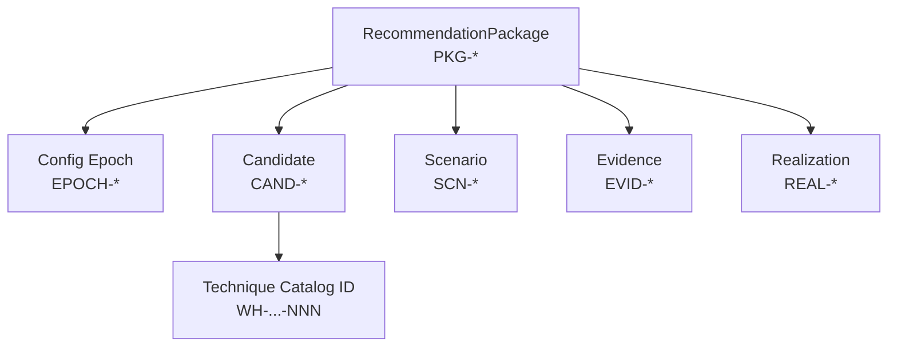

Each ID is content-addressed: it identifies one thing, and the same normalized inputs under the same versions always give the same ID, so an ID changes only when what it identifies changes. Public IDs come only from the contract helpers in `contracts/reporter_contract.py`. Hash inputs and ID formats: `docs/contracts/reporter-json-contract.md`.

### 6.3 Technique ID vs candidate ID

A **technique** is stable across all warehouses and runs.

Example:

```text
WH-SIZE-DOWNSIZE-001
```

A **candidate** is the warehouse/epoch-specific result of evaluating that technique.

Example:

```text
CAND-57CD...
```

This distinction is foundational:

- `technique_id` identifies **what optimization technique exists**;
- `candidate_id` identifies **what that technique decided here and now**.

---

## 7. Configuration epoch

A configuration epoch is a continuous period during which the authoritative warehouse configuration is unchanged for the fields that define the epoch: warehouse type, channel, size, min clusters, max clusters and auto-stop minutes.

The epoch is derived from snapshots in `system.compute.warehouses`. Databricks describes each row as a snapshot of warehouse properties, with a new snapshot created when any property changes, including the name and tags. Snapshots that change only cosmetic properties (name, tags) are folded into the surrounding epoch, so a rename or tag edit does not start a new epoch or reset epoch maturity, cost history or the forecast basis.

### 7.1 Why epochs matter

Without epochs, telemetry collected under an old configuration could justify a recommendation against a new configuration.

Example:

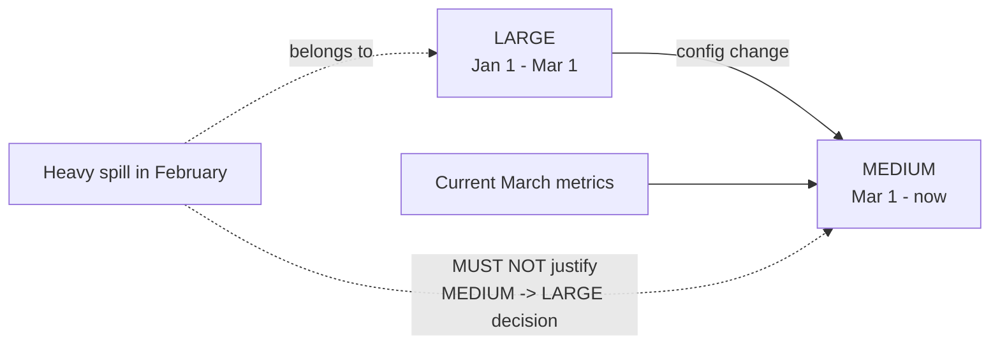

The optimizer therefore follows the rule:

> **Only current-epoch evidence may satisfy current decision thresholds.**

Historical epochs may be used for:

- calibration;
- empirical counterfactual evidence;
- backtesting;
- realized-outcome comparison.

They may not be used to pass current-state safety gates. They have three decision uses. A capacity cut waits when an older epoch of the same warehouse within the last 365 days had higher peak query concurrency than the current recent window. Evidence a configuration change cannot affect carries across that change inside the last 30 days (demand and per-query evidence across auto-stop, max- and min-cluster changes; capacity queueing across auto-stop changes), never across a size or type change; running time, idle time, cluster-minutes and billing never carry (the map: [LLD 10.2](lld.md)). A canary rollback restores the previous epoch's value when a fail-fast guard trips on the new epoch's own evidence (LLD 15.9). Otherwise older epochs never choose a change, its target or its economics.

### 7.2 Photon and epoch identity

Photon is deliberately **not** part of the authoritative epoch hash because the product observes Photon through billing attribution rather than reading an authoritative Photon config field from `system.compute.warehouses`.

---

## 8. Source-of-truth model

The domain separates **configuration authority**, **workload evidence**, **resource-state evidence**, and **financial evidence**.

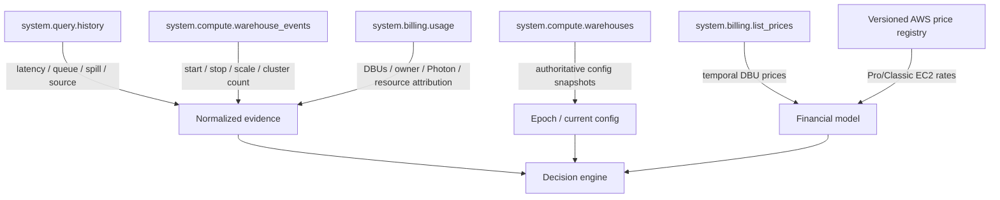

### 8.1 Regional vs global evidence

Current Databricks system-table topology matters operationally:

- `system.compute.warehouses` — regional;
- `system.compute.warehouse_events` — regional;
- `system.query.history` — regional;
- `system.billing.usage` — global/cross-regional;
- `system.billing.list_prices` — global.

Full account coverage therefore requires regional collection for warehouse/query/event evidence and deterministic merge by `(workspace_id, warehouse_id)`.

### 8.2 Source latency is not data quality failure

Typical availability differs by source:

- query-history records are typically available within roughly one hour;
- billing original records are typically available within roughly 12 hours.

The optimizer must therefore distinguish **normal source latency** from true missing/invalid data.

For billing, a UTC day enters the cost basis only after a settle buffer (`billing_settle_hours`, see `docs/reference/thresholds.md`) and once its own workspace's billing watermark has passed it; completeness is judged per workspace. A late day is excluded, not read as a zero-cost day.

---

## 9. Billing corrections and signed usage

`system.billing.usage` supports correction records. Retractions carry negative usage quantities and restatements carry corrected values.

The domain rule is:

> **Billing quantities are signed facts and must be aggregated as signed quantities.**

Do not:

- drop negative billing records;
- use absolute DBUs as cost truth;
- treat every billing row as an independent charge.

Corrected net usage is produced by aggregation so retractions cancel original records as intended.

---

## 10. Warehouse ownership

Warehouse owner is **attribution evidence**, not an optimization control.

The product obtains current-epoch owner evidence from:

```text
system.billing.usage.identity_metadata.owned_by
```

Databricks defines this field for SQL warehouse usage as the user or service principal that owns the SQL warehouse responsible for the usage.

Domain semantics:

- `owner` = latest usable current-epoch owner evidence;
- `observed_owners[]` = owners seen in relevant evidence when useful for audit;
- missing owner = unknown, never an optimizer blocker by itself unless a governance policy explicitly requires ownership;
- ownership evidence may lag recent owner changes because it is observed through billing.

---

## 11. Photon semantics

### 11.1 Observed state, not direct config state

Photon is inferred from:

```text
system.billing.usage.product_features.is_photon
```

Databricks documents the field as indicating whether Photon was enabled for the workload. The optimizer therefore calls the result **observed Photon state**, not authoritative configuration state.

### 11.2 State model

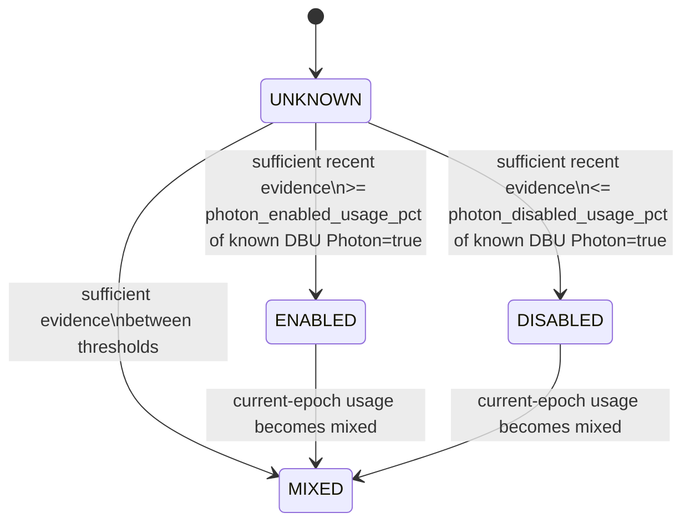

Allowed states:

- `ENABLED`
- `DISABLED`
- `MIXED`
- `UNKNOWN`

Sparse, stale, or low-coverage evidence yields `UNKNOWN` rather than a guessed state.

Coverage, share and freshness cutoffs for these states are the `photon_*` parameters in `docs/reference/thresholds.md`.

Photon is observation-only and never recommended: an observed `DISABLED` state generates no candidate (`docs/reference/known-limitations.md`).

---

## 12. Workload-source semantics

Workload-source attribution helps explain **how a warehouse is used**. It is not itself an optimization technique.

### 12.1 Databricks entity source

`system.query.history.query_source` can identify Databricks entities involved in statement execution, such as:

- jobs;
- dashboards / legacy dashboards;
- notebooks;
- alerts;
- Genie;
- SQL query/editor-related entities where exposed.

### 12.2 Client application

`system.query.history.client_application` identifies the client application. The product normalizes commonly useful categories such as:

- `SQL_EDITOR`;
- `POWER_BI`;
- `TABLEAU`;
- `LOOKER`;
- `OTHER`;
- `UNKNOWN`.

### 12.3 Multi-label rule

A query can simultaneously have a Databricks entity source and a client application.

Therefore:

> **Query-source percentages are multi-label and are not required to sum to 100%.**

`primary_query_source` is a deterministic presentation convenience, not a claim that other sources are absent.

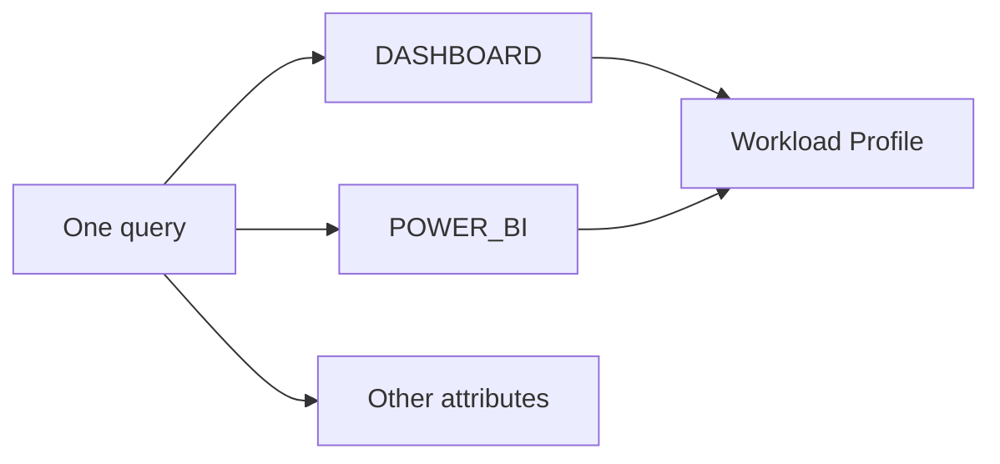

---

## 13. Evidence, finding, analysis, decision, candidate

These terms are related but not interchangeable.

### 13.1 Evidence

A normalized factual observation with provenance.

Examples:

- queued query percentage;
- p95 execution time;
- p95 spill bytes;
- percent time at minimum clusters;
- current-epoch DBUs;
- latest Photon-attributed billing timestamp.

Public evidence receives an `EVID-*` identity.

### 13.2 Finding

An analyzer record that ties one evidence value to the policy threshold it is read against, with its source table and field, epoch, window and a plain interpretation. A finding states a measured fact; it decides nothing and carries no blocker code.

Examples (finding metrics):

- `queued_query_pct_30`, read against the downsize-safe queue share;
- `spill_query_pct_30`, read against the upsize spill share;
- `time_at_max_pct`, read against the reduce-safe share of time at the maximum.

Blocker codes such as `COLD_START_BUDGET_EXCEEDED` and `INSUFFICIENT_QUERY_SAMPLE` are not findings: the optimizer places them on a decision or candidate (section 26.1). Meanings: `docs/reference/blocker-codes.md`.

### 13.3 Analysis result

The per-knob set of normalized facts/findings and blockers passed from Analyzer to Optimizer.

### 13.4 Optimization decision

The deterministic current→recommended configuration decision and status before economics are attached.

### 13.5 Candidate recommendation

The reviewed, economic, confidence-scored, traceable atomic recommendation for one technique/domain.

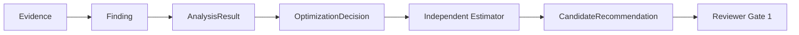

---

## 14. Candidate domains

Every supported warehouse is evaluated across the same five candidate domains. The result may be a change, no-change, blocker, not-applicable, or insufficient-evidence decision.

| Domain | Domain intent | Typical nature |
|---|---|---|
| Warehouse size | Right-size vertical capacity | Cost/performance |
| Max clusters | Right-size concurrency ceiling | Performance/cost guardrail |
| Min clusters | Remove unnecessary baseline capacity | Cost/performance |
| Auto-stop | Reduce avoidable idle running | Cost |
| Warehouse type | Evaluate Pro/Classic ↔ standard Serverless migration | Alternative scenario / architecture |

Photon and the warehouse channel are not candidate domains: they are observed and reported (section 11, 14.1) but never recommended.

Stable technique IDs live in `docs/reference/technique-catalog.md`.

### 14.1 Channel is observed, not recommended

`warehouse_channel` is reported in the current configuration and remains an epoch field: changing it starts a new epoch. It produces no candidate, plan step or invalidation, because a channel move has no priced effect and Preview-only dependencies are not visible in system tables. A warehouse on `PREVIEW` carries an informational evidence note.

---

## 15. Candidate status semantics

Candidate status answers **what the optimizer believes about this atomic recommendation**, not whether it is next in execution order.

| Status | Meaning |
|---|---|
| `ACTIONABLE` | Evidence supports the change and no mandatory canary status is required by policy |
| `TEST_REQUIRED` | Evidence supports testing the change, but controlled validation is required |
| `REVIEW` | Human interpretation/compatibility judgment is required before action |
| `BLOCKED` | Known blocker prevents execution |
| `NO_CHANGE` | Current setting is supported by evidence |
| `NOT_APPLICABLE` | Technique does not apply to this warehouse/state |
| `INSUFFICIENT_EVIDENCE` | Decision cannot be made safely from available evidence |

Candidate status is separate from **execution state**.

Example:

```text
Candidate status: ACTIONABLE
Execution state: PENDING_REEVALUATION
```

This is valid when an earlier scenario step invalidates the candidate and requires remeasurement first.

---

## 16. Execution-state semantics

Execution state answers **what can happen now in an ordered scenario**.

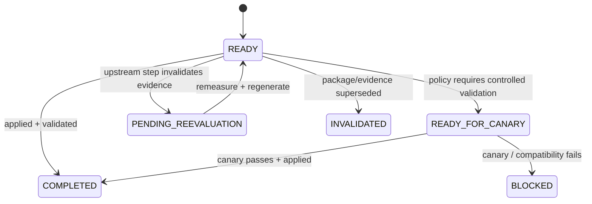

The diagram is conceptual. For candidate steps the planner emits `READY`, `READY_FOR_CANARY` and `PENDING_REEVALUATION` today, and compatibility-validation and re-measure steps are `REQUIRED`; the full state list is in `docs/contracts/reporter-json-contract.md`.

Core states include:

- `READY`
- `READY_FOR_CANARY`
- `PENDING_REEVALUATION`
- `BLOCKED`
- `REQUIRED`
- `COMPLETED`
- `INVALIDATED`

---

## 17. Threshold posture

Default thresholds are **balanced-to-conservative**, not universal Databricks recommendations. They are product policy defaults and must be versioned.

Posture per decision and exact values live in `docs/reference/thresholds.md` and the versioned policy/constants in code.

Do not tune thresholds based on one appealing warehouse. Calibrate using representative real workloads and false-positive/false-negative review.

---

## 18. Cost vocabulary

The product deliberately separates six economic layers.

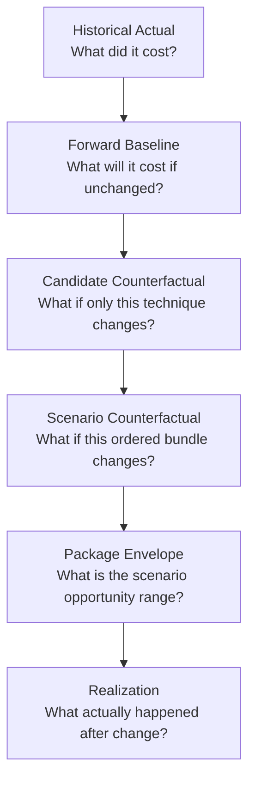

### 18.1 Historical actual

Observed trailing-period cost from billing/financial evidence.

It may span multiple configuration epochs and is therefore **not** the direct decision baseline for current recommendations.

### 18.2 Forward baseline

Expected next-365-day cost if the current configuration remains unchanged.

This is the primary comparison basis for counterfactual recommendations.

It is published only when known: every day in the current-epoch basis priced, enough billed days in the current epoch (`min_economics_cost_history_days`, see `docs/reference/thresholds.md`), and a positive run rate. Otherwise it is unavailable (null), never $0 or a run rate guessed from a few days, and savings estimates are withheld until it can be forecast. A workload that bills only periodically is forecast over whole billing cycles instead of a daily run rate (`docs/architecture/lld.md` section 11.2).

### 18.3 Candidate counterfactual

Independent economic estimate assuming **only one candidate** is applied.

Candidate estimates are useful for explainability and technique-level analysis.

They are **not additive**.

### 18.4 Scenario counterfactual

Stateful economic estimate for an ordered bundle of candidates.

This is the authoritative bundled estimate because each step operates on the state left by previous steps.

### 18.5 Package opportunity envelope

Cross-scenario opportunity summary:

- `low` = minimum LOW total-savings bound across economically assessable scenarios;
- `base` = BASE savings of the recommended scenario;
- `high` = maximum HIGH total-savings bound across economically assessable scenarios.

It is **not** a statistical confidence interval.

Low/base/high can come from different scenarios.

### 18.6 Realization

Measured post-change outcome, separate from modeled expectation.

---

## 19. Savings vs cost increase

The canonical JSON keeps **signed economics**.

Examples:

```text
+10,000 savings = modeled annual cost reduction of 10,000
-10,000 savings = modeled annual cost increase of 10,000
```

The workbook adds an impact label beside the number: `SAVINGS`, `COST_INCREASE`, `MIXED`, `NO_CHANGE` or `UNAVAILABLE`.

A cost increase is a negative annual-impact number (shown in red parentheses) with Impact Type `COST_INCREASE`; the sign is never flipped.

```text
Annual impact = 10,000 USD  → `SAVINGS`
Annual impact = -10,000 USD → `COST_INCREASE`
```

---

## 20. DBU cost vs AWS cost

For Pro/Classic, the product models two customer economic components:

```text
Databricks DBU cost
+
customer AWS infrastructure cost
=
total modeled cost
```

For standard Serverless, Databricks manages the underlying infrastructure; the product does not model a separate customer EC2 compute line for that serverless warehouse scenario.

### 20.1 AWS model

Pro/Classic AWS estimates use:

- observed current-epoch cluster minutes;
- Databricks-documented SQL warehouse topology/sizing assumptions;
- versioned regional on-demand EC2 prices from the repository registry.

If required regional AWS price evidence is unavailable, the product represents that component as unavailable rather than guessing.

### 20.2 Currency rule

One recommendation package cannot silently mix currencies.

Unknown cost components remain `null`/unavailable, never `$0`. This includes DBU usage with no matching list-price row: it is reported as unpriced DBU, and the actual or forward DBU cost it affects is unavailable rather than understated. A forward DBU cost with too few billed days in the current epoch (`min_economics_cost_history_days`) is likewise unavailable, not $0.

---

## 21. Candidate economics are not additive

This is one of the most important domain invariants.

Suppose a warehouse has:

- size-down candidate savings;
- min-cluster candidate savings;
- auto-stop candidate savings.

Adding those independent estimates double-counts shared runtime/resource effects.

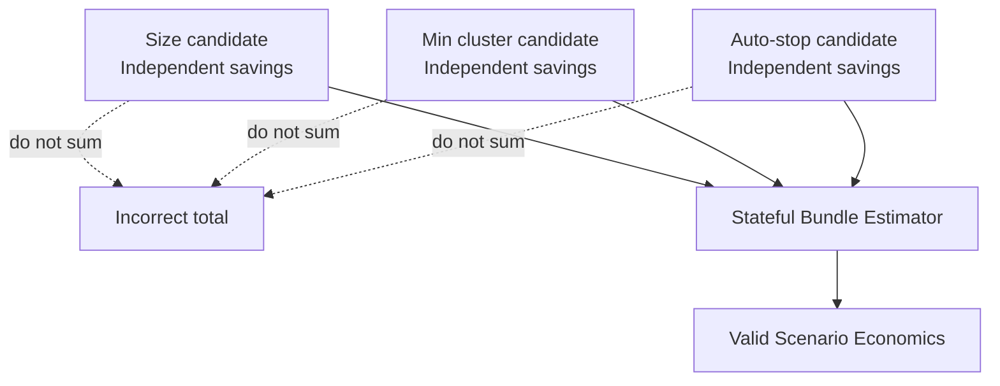

Only scenario economics may be treated as bundled savings.

---

## 22. Scenarios

A scenario is a **mutually exclusive execution path**, not a list of all candidates.

### 22.1 Plan A — optimize current type

Current Phase-1 policy constructs an in-place optimization path and treats it as the recommended scenario when valid.

Steps run in order of expected value (base savings × confidence ÷ risk); a step never precedes the step that invalidates it. Typical result for an idle, over-sized warehouse:

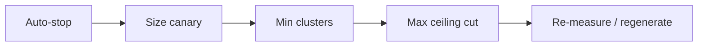

The exact inclusion/order is policy-driven and only relevant candidates enter the plan.

### 22.2 Plan B — warehouse-type migration

Migration is modeled as an alternative path requiring compatibility assessment and canary validation.

Examples:

- Pro/Classic → standard Serverless;
- Serverless → Pro where supported and economically assessable.

### 22.3 Current recommendation policy

The current product policy is intentionally conservative:

> **Plan A is selected as the recommended scenario; migration remains an alternative even when modeled migration economics appear better.**

This is a product-policy choice, not a mathematical limitation. Future auto-selection of migration requires explicit product approval and additional validation evidence.

---

## 23. Dependency and invalidation

A recommendation can make downstream evidence stale.

Example: changing warehouse size can alter queueing and cluster utilization. Therefore max- and min-cluster recommendations that were safe under the old size may no longer be valid after the size change. Auto-stop is evaluated independently and is not held.

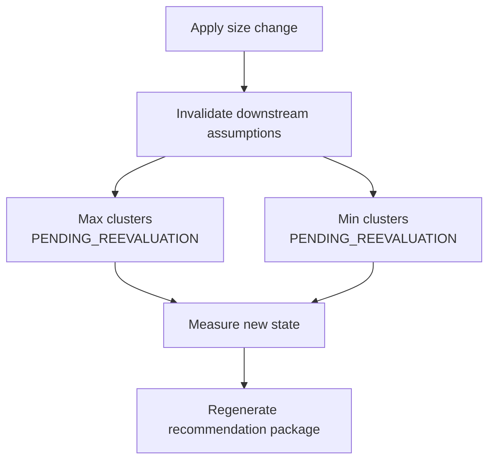

The product prefers **sequence → measure → regenerate** over applying a large bundle blindly.

---

## 24. Human-in-the-loop and canary semantics

Human review is a product invariant, not a UX option.

### 24.1 HITL

Every configuration change must remain reviewable and auditable.

### 24.2 Canary

A canary is mandatory where the recommendation can materially affect workload behavior or where the counterfactual cannot be known reliably from static evidence.

Examples:

- warehouse size down;
- warehouse-type migration.

### 24.3 Canary success measures

Depending on the technique, validation should compare:

- p95/p99 execution latency;
- queueing/capacity wait;
- failure rate;
- spill behavior;
- DBU cost;
- AWS cost where applicable;
- total cost;
- compatibility/business SLA outcomes.

The optimizer does not define success as “cost went down” if runtime or reliability guardrails regress materially.

---

## 25. Confidence semantics

Confidence is **evidence quality and decision support strength**, not the probability that savings will occur.

A candidate confidence may reflect deterministic components such as:

- source coverage;
- sample size;
- configuration readiness and epoch maturity;
- signal strength;
- freshness;
- feature-specific evidence quality.

Levels:

- `HIGH`
- `MEDIUM`
- `LOW`
- `UNKNOWN` where a score is unavailable by contract.

Scenario confidence uses a conservative bottleneck concept: a weak material step should not disappear inside several strong steps. A scenario with no steps has `UNKNOWN` confidence and no score. A candidate that changes nothing is never `HIGH`, and one without enough evidence is `LOW`; the formula and caps are in `docs/architecture/lld.md`, section 16.

Do not interpret:

```text
confidence score 0.80
```

as:

```text
80% probability that projected savings will be achieved
```

---

## 26. Blocker, unknown, unavailable, zero

These have distinct meanings.

### 26.1 Blocker

A known fact that prevents or pauses execution.

Example:

- compatibility requirement cannot be satisfied (for example `PRO_CLASSIC_WORKSPACE_CAPABILITY_NOT_CONFIRMED_FROM_SYSTEM_TABLES`);
- insufficient source coverage for a required decision (`INSUFFICIENT_QUERY_SAMPLE`);
- every auto-stop value that saves money would add more cold starts than the budget allows (`COLD_START_BUDGET_EXCEEDED`);
- unsupported warehouse type (`UNSUPPORTED_WAREHOUSE_TYPE`).

Meaning, trigger and gating parameter of every code: `docs/reference/blocker-codes.md`.

### 26.2 Unknown

The state could not be established from evidence.

Example:

```text
Photon status = UNKNOWN
```

### 26.3 Unavailable

A numeric/value component cannot be defensibly produced.

Example:

```text
aws_cost = null
availability = PARTIAL
```

The reason is recorded as an unavailability code such as `AWS_PRICE_REGION_NOT_IN_REGISTRY` (`docs/reference/blocker-codes.md`).

### 26.4 Zero

A known, measured/modeled zero.

Never coerce unknown/unavailable values to zero.

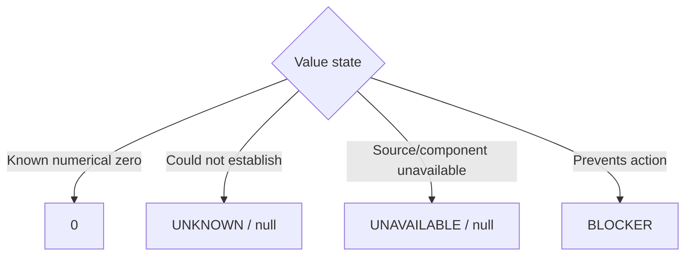

---

## 27. Reviewer gates

The product has two separate fail-closed review gates.

### 27.1 Reviewer Gate 1 — candidate integrity

Ensures atomic recommendations are internally valid before scenario construction.

Examples:

- unique candidate identity;
- correct warehouse/epoch references;
- valid status semantics;
- confidence in range;
- blockers consistent with status;
- cost ranges ordered correctly;
- current/recommended config differences valid;
- evidence references resolvable.

### 27.2 Reviewer Gate 2 — scenario integrity

Ensures bundled execution paths are valid before package publication.

Examples:

- scenario candidate references resolve;
- step confidence matches candidate confidence;
- invalidation/order rules are respected;
- portfolio range is ordered;
- only one recommended scenario;
- migration/in-place scenario boundaries are respected.

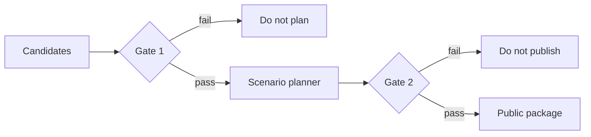

---

## 28. Determinism

For identical normalized inputs and decision-affecting versions, the product must produce identical:

- evidence identities;
- epoch identity;
- candidate decisions;
- candidate IDs;
- confidence values;
- scenario ordering;
- scenario IDs;
- cost estimates;
- package opportunity envelope;
- recommendation package ID.

Human-facing explanatory prose may be enhanced separately in the future, but it must not change deterministic decision semantics.

### 28.1 What does not belong in recommendation identity

Volatile presentation metadata must not affect decision IDs:

- generation timestamp;
- output filename;
- workbook style/layout;
- log path;
- arbitrary prose ordering.

---

## 29. Realization

Realization answers:

> **What actually happened after an approved recommendation was applied?**

The Reporter Contract already includes realization so future measurement can be attached without redesigning the public model.

Lifecycle:

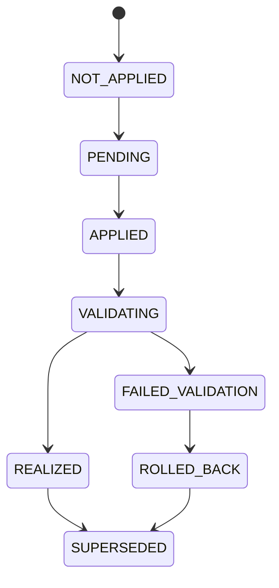

Realization record fields and lifecycle: `docs/contracts/reporter-json-contract.md`.

### 29.1 Immutability rule

Realization does **not** rewrite the original recommendation package identity. It references the recommendation/package/scenario/candidate that led to the change.

### 29.2 Current implementation status

The realization **contract exists**, but automatic ingestion of measured post-change realization is intentionally outside Phase 1; packages stay `NOT_APPLIED` (`docs/reference/known-limitations.md`).

---

## 30. Reporter JSON contract

The JSON package is the canonical product/API contract.

Top-level hierarchy, identities and field semantics: `docs/contracts/reporter-json-contract.md`.

One file represents one package. Multi-warehouse runs emit multiple package files.

Stable keys are retained; unavailable values use explicit `null` plus status/availability semantics.

---

## 31. Workbook contract

The workbook is a **human projection** of validated package JSON.

It has exactly four business views:

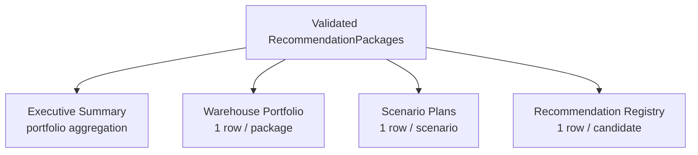

Sheet grains, columns and presentation: `docs/contracts/workbook-contract.md`.

### 31.1 Persona mapping

| Sheet | Primary persona | Primary question |
|---|---|---|
| Executive Summary | Executive / Finance | How much spend/opportunity and where is it concentrated? |
| Warehouse Portfolio | Platform / FinOps | Which warehouses should we focus on and why? |
| Scenario Plans | HITL approver / SRE | What are the alternatives, economics, order, and validation needs? |
| Recommendation Registry | Optimizer engineer / auditor | Why did each atomic technique decide what it did? |

### 31.2 Workbook rule

The workbook may:

- format;
- aggregate portfolio views using already-published package values;
- render signed impacts in human-safe labels;
- expose filters, conditional formatting, and readable summaries.

It may not:

- invent recommendation logic;
- re-estimate economics;
- recompute IDs;
- alter confidence;
- sum candidate savings into package savings.

---

## 32. Operational run modes

### 32.1 Live mode

Collects current evidence from Databricks using a read-only SQL execution target and limited read-only compatibility APIs.

### 32.2 Replay mode

Reads normalized evidence from files and reruns deterministic decision logic without querying live systems.

Use replay for:

- debugging;
- regression;
- reproducibility;
- threshold review;
- incident analysis.

### 32.3 Synthetic/demo mode

Generates deterministic synthetic collector evidence for a fleet of simulated warehouses (one per golden scenario) and runs it through the same downstream publisher pipeline.

Synthetic mode is for product validation and demonstration; it is not a source of product truth.

---

## 33. Read-only API boundary

System tables remain authoritative for tunable source configuration and telemetry.

Read-only APIs are allowed only for bounded purposes such as:

- resolving/validating the SQL execution target;
- validating an all-purpose cluster target is not jobs compute;
- obtaining compatibility evidence where system tables are insufficient;
- resolving workspace context needed for a connection path.

They must not silently override authoritative system-table configuration used by the optimizer.

---

## 34. Scale model

The product scales by **pushing aggregation to Databricks SQL**, not by loading raw account telemetry into local pandas/dataframes.

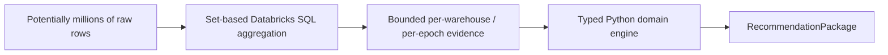

The Python core is intentionally dataclass/structured-object oriented because the downstream workload is decision-graph processing rather than large vectorized analytics.

Pandas may be useful for exploratory threshold research but is not part of the production optimization core.

---

## 35. Security and privacy context

The product is designed to avoid exporting unnecessary sensitive workload content.

Principles:

- read-only data access;
- no warehouse mutation in Phase 1;
- no token logging;
- no raw SQL text required in published packages/workbook;
- aggregate/query-source metrics instead of exporting full query histories;
- owner attribution is included because it is operationally required for routing/accountability;
- compatibility API payloads should be minimized/redacted and must not become authoritative config.

Access to system tables must follow Databricks/organization governance policies.

---

## 36. Product personas and accountability

Personas, their needs and primary surfaces: `docs/product/prd.md` section 5. The PRD does not state what each persona is accountable for; that is recorded here.

| Persona | Owns |
|---|---|
| Executive / product sponsor | Portfolio outcome: spend coverage, opportunity envelope, realized value, risk posture, adoption |
| FinOps / platform leader | Prioritization: high-value warehouses, owner routing, economic quality, excluded/unassessed coverage, policy tuning proposals |
| Platform engineer / SRE / HITL approver | Execution safety: compatibility, canary, sequencing, guardrails, rollback, remeasurement |
| Optimization engineer | Deterministic correctness: analyzers, techniques, thresholds, counterfactual models, confidence, reviewers, golden tests |
| Warehouse owner | Workload/business acceptance: SLA impact, business timing, correctness/compatibility, acceptance or rejection of a change |

---

## 37. Domain invariants

These are non-negotiable unless the PRD/contract is explicitly revised.

1. One public package = one warehouse + one current config epoch.
2. Current-state decisions use current-epoch evidence only.
3. Older epochs may calibrate but may not satisfy current safety thresholds; their decision uses are the capacity-cut hold, carried evidence a change cannot affect, and the canary rollback (7.1).
4. System tables are authoritative for supported tunable config/evidence.
5. Unsupported warehouse types fail closed / remain non-optimizable.
6. Candidate economics are independent and non-additive.
7. Only the stateful scenario estimator may produce bundled economics.
8. Package economics is an envelope across economically assessable scenarios, not a probability interval.
9. Missing/unavailable cost is not zero.
10. Signed billing corrections remain signed.
11. Confidence is evidence/decision confidence, not probability of savings.
12. Candidate status is separate from execution state.
13. Upstream changes can invalidate downstream recommendations.
14. Material behavior-changing changes require canary validation.
15. HITL remains mandatory for configuration change.
16. JSON is authoritative; workbook is projection-only.
17. Deterministic IDs exclude volatile presentation metadata.
18. Realization does not rewrite the recommendation that produced it.
19. Read-only APIs do not override authoritative optimizer configuration.
20. Decision-affecting code changes require corresponding version changes and regression evidence.

---

## 38. Common misunderstandings / anti-patterns

### 38.1 “Just sum all candidate savings”

**Wrong.** Candidate estimates overlap. Use scenario economics.

### 38.2 “Historical 365-day actual cost is the forecast baseline”

**Wrong.** Historical actual may span multiple configurations. Use the current-epoch-aware forward baseline.

### 38.3 “Photon billing evidence is the authoritative config API”

**Wrong.** It is observed workload state with explicit evidence confidence.

### 38.4 “Negative savings means a bug”

**Wrong.** A scenario may be a modeled cost increase. JSON preserves signed economics; workbook labels the impact correctly.

### 38.5 “No billing evidence means zero cost”

**Wrong.** It means unavailable/unknown unless a known zero can be proven.

### 38.6 “High confidence means the savings will definitely occur”

**Wrong.** Confidence measures evidence/decision support, not realization probability.

### 38.7 “All SQL warehouse types are covered”

**Wrong.** Phase 1 supports Classic, Pro, and standard Serverless. Lakehouse Real-Time Beta is out of scope.

### 38.8 “The workbook can fix or refine recommendation logic”

**Wrong.** The workbook is presentation-only.

### 38.9 “Plan B should automatically win if its base savings is higher”

**Not in current policy.** Migration remains an alternative until product policy explicitly allows auto-selection.

### 38.10 “A fresh package can stay valid after a config change”

**Wrong.** A change to a decision field (type, channel, size, min/max clusters, auto-stop) creates a new epoch and requires re-evaluation.

---

## 39. Worked domain example

Consider a Pro warehouse:

```text
Warehouse: BI - Sales
Current type: PRO
Size: LARGE
Min clusters: 2
Max clusters: 4
Auto-stop: 120 min
Observed Photon: ENABLED
Primary source: DASHBOARD
```

Current-epoch evidence shows:

```text
high query sample
low queueing
negligible spill
safe p95/p99 latency
warehouse spends significant time at minimum clusters
material idle running time
```

The product may produce:

```text
Size         LARGE -> MEDIUM        TEST_REQUIRED
Max clusters 4 -> 3                 ACTIONABLE
Min clusters 2 -> 1                 TEST_REQUIRED
Auto-stop    120 -> 30              ACTIONABLE
Type         PRO -> SERVERLESS      TEST_REQUIRED / alternative
```

But it does **not** apply them all together.

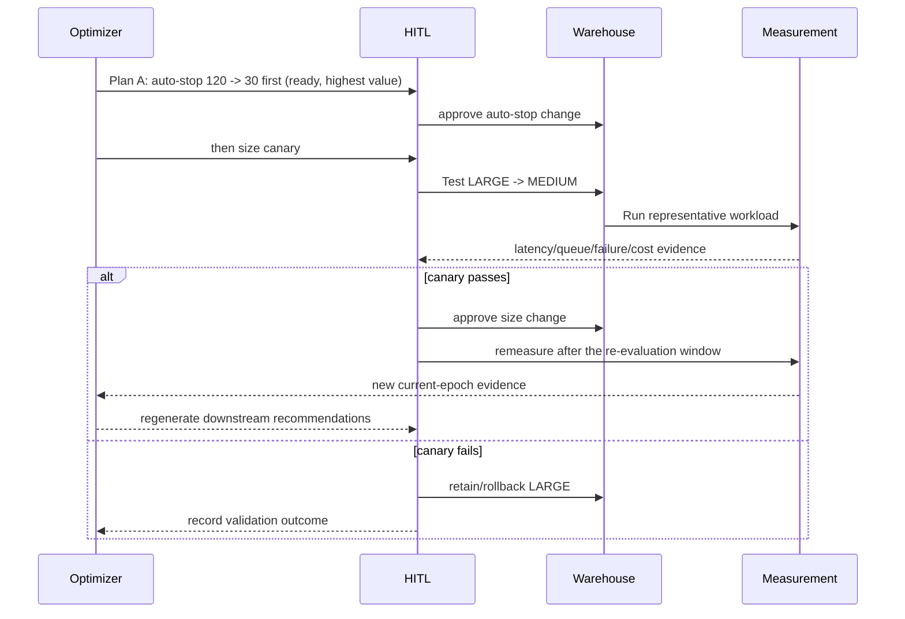

Auto-stop is ready immediately because no other change invalidates it. The max- and min-cluster candidates are explainable opportunities, but their scenario execution state becomes `PENDING_REEVALUATION` because the size change invalidates their capacity evidence.

---

## 40. Current known gaps and debt

### 40.1 Supported-type gate

Supported types and the fail-closed gate: `docs/reference/known-limitations.md`.

### 40.2 Internal orchestration

The decision pipeline uses a minimal `WarehouseOptimization` orchestration object for reviewed candidate/scenario state and assembles the public `RecommendationPackage` directly. Internal orchestration objects are not serialization contracts.

### 40.3 Realization ingestion

Realization ingestion status: `docs/reference/known-limitations.md`.

### 40.4 Threshold calibration

Threshold calibration status: `docs/reference/known-limitations.md`.

---

## 41. Change-management rules for future engineers/agents

Before changing the product, classify the change.

### 41.1 Product-scope change

Examples:

- add Lakehouse Real-Time;
- add query optimization;
- auto-apply recommendations;
- automatically select migration based on economics.

Required action: update/approve PRD first.

### 41.2 Architecture change

Examples:

- move optimization into distributed jobs;
- replace system-table authority;
- introduce a new service boundary.

Required action: update/approve HLD.

### 41.3 Algorithm/contract implementation change

Examples:

- change a threshold;
- change confidence formula;
- add candidate technique;
- change scenario order;
- change hash inputs.

Required action: update LLD/versioned policy/contract as applicable, golden tests, and evidence.

### 41.4 Presentation-only change

Examples:

- workbook width;
- number formatting;
- conditional formatting.

May change Workbook Contract patch version if semantics are unchanged. Must not modify JSON semantics.

---

## 42. Glossary

| Term | Meaning in this product |
|---|---|
| Active warehouse | Warehouse included by collector/product activity criteria and visible in source scope |
| Analyzer | Converts normalized evidence into knob-specific facts/findings/blockers |
| Blocker | Known condition preventing or pausing a recommendation/action |
| Candidate | One atomic per-technique recommendation instance for a warehouse/epoch |
| Canary | Controlled validation of a behavior-affecting recommendation before broad application |
| Config epoch | Continuous interval during which the decision fields of the authoritative warehouse configuration are unchanged |
| Counterfactual | Modeled outcome under a hypothetical configuration change |
| DBU | Databricks Unit used in platform billing |
| Evidence | Normalized factual observation with source/provenance |
| Finding | Analyzer interpretation of one or more evidence signals |
| Forward baseline | Expected 365-day cost if current configuration remains unchanged |
| HITL | Human-in-the-loop review/approval/validation |
| Independent economics | Candidate-level one-change counterfactual; non-additive |
| Lakehouse Real-Time | Specialized Serverless SQL warehouse Beta; out of Phase-1 scope |
| Modeler | Produces deterministic projections used by estimators/decisions |
| Observed Photon state | Billing-evidence inference of Photon workload usage, not direct config state |
| Optimizer | Applies deterministic policy to analysis and emits config decisions |
| Package economics | Low/base/high total opportunity envelope across assessable scenarios |
| Plan A | In-place/current-type optimization scenario; currently recommended by policy |
| Plan B | Warehouse-type migration alternative |
| Realization | Measured outcome after an approved recommendation is applied |
| RecommendationPackage | Canonical immutable public object for one warehouse/current epoch |
| Reviewer | Fail-closed invariant validator before planning/publication |
| Scenario | Ordered mutually exclusive execution path with stateful economics |
| Stateful bundle estimator | Applies ordered changes to a changing state to avoid savings double counting |
| Technique | Stable cataloged optimization method independent of warehouse/run |
| Workload profile | Attribution/activity description explaining how the warehouse is used |

---

## 43. External Databricks reference points

The Databricks pages that anchor the platform concepts in this document are listed in `docs/product/prd.md` section 28. They describe Databricks behavior; product-specific thresholds and algorithms are defined by the PRD, the LLD and `docs/reference/thresholds.md`.

---

## 44. Domain-context acceptance checklist

This document is complete when a new engineer/agent can correctly answer all of the following without reading implementation code first. Acceptance criteria for the product increment itself: `docs/product/prd.md` section 23.

- What is the canonical aggregate root?
- What warehouse types are supported and excluded?
- Why does a config epoch exist?
- Which source is authoritative for which domain fact?
- Why is Photon called observed state?
- Why can query-source percentages exceed 100%?
- What is the difference between evidence, finding, decision, candidate, and scenario?
- Why can candidate savings not be summed?
- What is the difference between historical actual, forward baseline, scenario counterfactual, and realization?
- What does negative savings mean?
- What does confidence mean—and not mean?
- Why can an actionable candidate be pending re-evaluation?
- Why is Plan A currently recommended over a potentially cheaper migration scenario?
- What does HITL/canary protect?
- What does the workbook have permission to do?
- What must happen after a configuration change?
- What are the known implementation gaps/debts?
- Which document/contract is authoritative for a proposed change?

If any answer is ambiguous, the corresponding domain concept is not sufficiently specified.
