# High-Level Design — Databricks SQL Warehouse Optimizer

**Document:** `docs/architecture/hld.md`  
**Product:** Databricks SQL Warehouse Optimizer  
**Reporter JSON Contract:** v2.0.0 (locked)  
**Workbook Contract:** v1.4.0 (locked)

Role: component architecture, runtime flows and trade-offs.

---

## 1. Purpose

This document defines the high-level architecture for the Databricks SQL Warehouse Optimizer described in the PRD (`docs/product/prd.md`). It establishes the system boundaries, component responsibilities, data flows, source authority, deterministic decision path, scenario/economic model, publication architecture, runtime modes, security posture, scale model, and failure behavior.

This HLD intentionally remains above implementation-level class/field detail. Exact public field contracts, hash payloads and schemas belong in the locked contract artifacts (`docs/contracts/`); SQL projections and method behavior belong in `docs/architecture/lld.md`; numeric defaults belong in `docs/reference/thresholds.md`.

The architecture is designed around one central rule:

> **The product is a deterministic, read-only decision engine. Databricks system evidence is normalized into one immutable recommendation package per warehouse/current configuration epoch, and every presentation surface is derived from that package.**

---

## 2. Architecture goals

The architecture shall provide:

1. **Deterministic recommendation generation** from normalized evidence and versioned policy/model inputs.
2. **Current-epoch correctness**, preventing pre-change workload evidence from justifying post-change recommendations.
3. **Source authority separation**, keeping warehouse configuration and optimization telemetry system-table-first.
4. **Read-only operation** with no Phase-1 production mutation path.
5. **Candidate/scenario separation**, preventing independent savings estimates from being incorrectly summed.
6. **Financial traceability** across Databricks DBU and customer AWS cost components.
7. **Fail-closed validation** before a public recommendation package can be emitted.
8. **Human-in-the-loop execution planning** with canaries, dependencies, invalidation, and remeasurement.
9. **Scale through source aggregation**, not through loading raw query history into local memory.
10. **Contract-first publication**, where JSON is authoritative and the workbook is projection-only.
11. **Replayability**, allowing previously normalized evidence to be reprocessed without querying live systems.
12. **Independent contract versioning**, so publisher implementation changes do not automatically break consumers.

---

## 3. Scope boundary

### 3.1 Supported optimization domain

Phase 1 supports infrastructure/configuration optimization for:

- Classic SQL warehouses,
- Pro SQL warehouses,
- standard Serverless SQL warehouses.

Query telemetry is used as evidence, but SQL rewrite/query optimization is outside the product boundary.

### 3.2 Explicit warehouse-type boundary

Lakehouse Real-Time (Beta) is **not** part of the Phase-1 optimization model. It has distinct sizing and autoscaling semantics and requires a dedicated analyzer, optimizer, estimator, compatibility contract, and golden-test suite before activation.

The architecture therefore requires a **Supported-Type Gate** immediately after normalization:

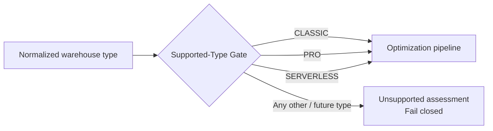

An unsupported type must never be silently processed using Pro/Classic assumptions.

**Implementation conformance:** the publisher enforces this gate before analyzer invocation; unsupported/future types fail closed. The exclusion is per warehouse: the rest of the fleet is still evaluated, and each excluded warehouse is recorded in `manifest.json` `excluded_warehouses`.

### 3.3 Active candidate domains

Each supported warehouse/current epoch is assessed across five candidate domains (Photon and the warehouse channel are observed but are not candidate domains):

1. `warehouse_size`
2. `max_clusters`
3. `min_clusters`
4. `auto_stop_minutes`
5. `warehouse_type`

The domains are cost, performance, compatibility, or mixed optimization techniques.

---

## 4. System context

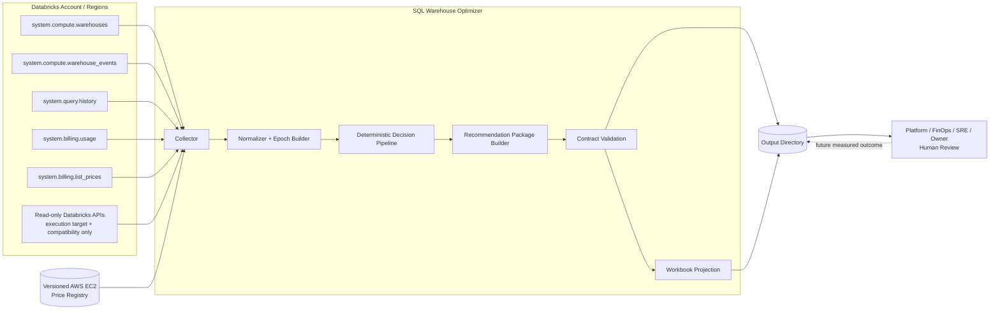

### 4.1 External actors

- **Databricks account/workspaces** provide configuration, workload, event, billing, and price evidence.
- **AWS price registry** provides explicit regional on-demand EC2 reference rates for modeled Pro/Classic forward infrastructure cost.
- **Platform/FinOps/SRE/workload owners** review package/workbook outputs and perform external changes/canaries.
- **Future realization workflow** supplies applied-change and measured-outcome evidence back to the reporting contract without changing the original package identity.

### 4.2 No mutation boundary

There is no Phase-1 edge from the optimizer to a Databricks warehouse update API. Any apply/rollback automation is explicitly outside this HLD.

---

## 5. Logical architecture

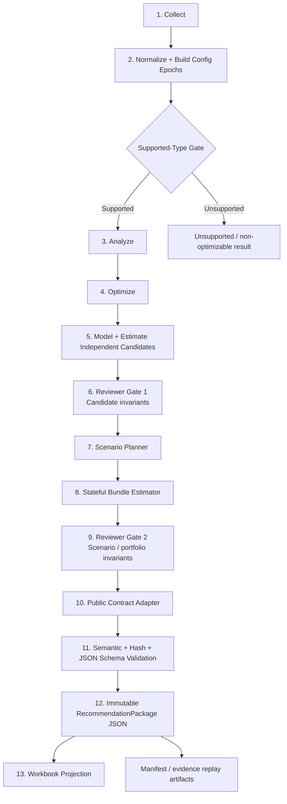

The numbered stages define the high-level architecture contract. A stage may be composed of multiple implementation classes/functions, but responsibility must not cross the boundaries below.

---

## 6. Component responsibilities

### 6.1 Collector

**Responsibility:** Execute set-based source queries and return bounded, per-warehouse/per-epoch evidence rather than raw event/query histories.

The collector reads:

- `system.compute.warehouses`
- `system.compute.warehouse_events`
- `system.query.history`
- `system.billing.usage`
- `system.billing.list_prices`

and approved read-only compatibility/execution-target APIs where required.

It must:

- aggregate expensive telemetry in Databricks,
- preserve workspace/warehouse identity,
- preserve regional source context,
- preserve signed billing corrections,
- read a daily resource series for the current epoch on the same window and calendar as the DBU forecast,
- measure per-minute query concurrency per epoch, idle gaps intersected with the warehouse's running time, and spilled bytes per statement source, as bounded aggregates (never raw query rows),
- judge billing completeness per workspace, using a settle buffer (`billing_settle_hours`) and that workspace's billing watermark, and optionally pin billing reads to an ingestion date so a re-collection reproduces an earlier run,
- run in a UTC-pinned SQL session, verified at connect (fails closed otherwise), so date logic matches UTC billing dates,
- order window functions with deterministic tie-breakers,
- avoid exporting raw SQL text,
- retain enough source metadata for audit and replay.

Collector SQL semantics: `docs/architecture/lld.md` section 7.2 and `docs/reference/source-mapping.md`. Defaults: `docs/reference/thresholds.md`.

It must not:

- make optimization decisions,
- modify warehouse configuration,
- allow REST configuration values to override authoritative system-table configuration.

### 6.2 Normalizer and configuration-epoch builder

**Responsibility:** Convert source-shaped rows into normalized evidence and reconstruct immutable configuration regimes.

A configuration epoch is a period of unchanged decision fields (warehouse type, channel, size, min/max clusters, auto-stop) in the warehouse configuration history; snapshots that change only the name or tags are folded into the surrounding epoch. It includes:

- deterministic epoch identity,
- start/end boundary,
- authoritative configuration snapshot,
- query aggregates,
- event/resource aggregates,
- cost evidence,
- current/historical designation.

Only one current epoch may exist for a warehouse in a valid normalized evidence object.

Older epochs are calibration/backtest only, with three exceptions: a capacity cut is held when an older epoch of the same warehouse within the last 365 days had higher peak query concurrency than the current recent window; evidence a configuration change cannot affect carries across that change inside the last 30 days, never across a size or type change; and a canary rollback restores the previous epoch's value when a fail-fast guard trips on the new epoch's own evidence. The map and the guard rules are in the LLD (10.2, 15.9). Otherwise older epochs never choose a change, its target or its economics.

### 6.3 Supported-Type Gate

**Responsibility:** Ensure only explicitly modeled warehouse types enter the optimization pipeline.

Allowed Phase-1 types:

```text
CLASSIC
PRO
SERVERLESS
```

Unknown or future warehouse types must be handled as unsupported, not mapped implicitly to a supported type.

### 6.4 Analyzer

**Responsibility:** Convert normalized evidence into deterministic facts/findings for each candidate domain.

Analyzer outputs contain observations such as:

- queue percentage,
- wait percentiles,
- spill frequency/severity,
- execution latency percentiles,
- time at minimum/maximum scale,
- observed maximum clusters,
- running idle time and the restarts an auto-stop value would add or avoid,
- peak query concurrency and busy-period starts,
- spill concentration by statement source,
- Photon observation quality,
- workload/query-source mix,
- compatibility signals.

The analyzer does not produce final recommendations and does not perform configuration mutation.

### 6.5 Optimizer

**Responsibility:** Apply versioned deterministic policy thresholds to analyzer facts and produce one decision state per active candidate domain.

The decision states are the public recommendation statuses (`docs/contracts/reporter-json-contract.md`, shared enums); blocker meanings and gating parameters: `docs/reference/blocker-codes.md`.

The optimizer determines current/recommended config values, blockers, dependencies, invalidations, rationale, and objective. It does not own cost arithmetic.

### 6.6 Modeler / independent estimator

**Responsibility:** Convert each candidate decision into an isolated forward counterfactual with deterministic confidence.

Key architecture rules:

- candidate economics are independent,
- candidate savings are non-additive,
- unavailable evidence remains unavailable,
- Pro/Classic and Serverless use type-appropriate cost models,
- Photon is observation-only and is never priced or recommended (section 7.3),
- migration economics are pre-canary modeled ranges.

### 6.7 Reviewer Gate 1 — candidate integrity

**Responsibility:** Fail closed before scenarios are created if candidate-level invariants are violated.

Examples include:

- exactly one candidate per active domain,
- deterministic/valid identifiers,
- current-epoch consistency,
- valid configuration transitions,
- blocker/status consistency,
- low ≤ base ≤ high,
- confidence range validity,
- no fake savings for no-change/guardrail cases,
- currency/cost consistency.

### 6.8 Scenario planner

**Responsibility:** Build mutually exclusive execution branches from reviewed candidates.

Phase-1 scenario policy:

- **Plan A:** optimize the current warehouse type.
- **Plan B:** evaluate warehouse-type migration as an alternative experiment.

For a current Serverless warehouse, the migration alternative targets Pro. For current Classic/Pro, the migration alternative targets Serverless.

Plan A orders its steps by expected value (base savings × confidence ÷ risk) and never places a step before the step that invalidates it (formula: LLD §19.1):

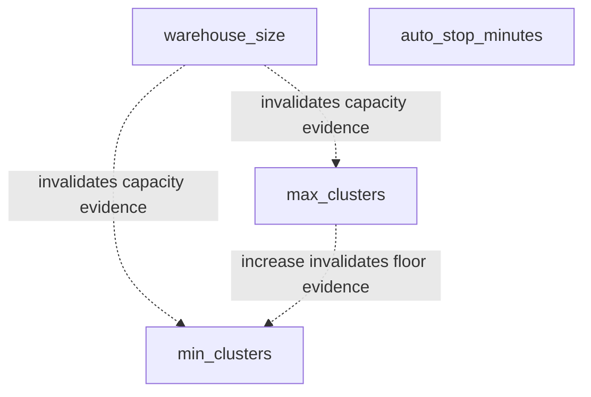

Auto-stop has no upstream invalidator. A max-cluster ceiling cut and a min-cluster change invalidate nothing downstream; a size change invalidates max and min clusters, which then wait in `PENDING_REEVALUATION`. Downstream candidates remain visible but transition to `PENDING_REEVALUATION` whenever an upstream applied change invalidates their evidence; they are not erased, and stay pending until fresh evidence is collected.

### 6.9 Stateful bundle estimator

**Responsibility:** Estimate scenario economics against evolving resource/configuration state.

This prevents the invalid pattern of directly summing independent candidate savings.

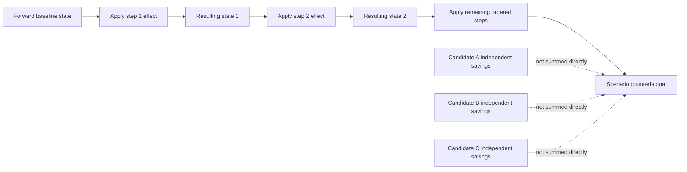

Only stateful scenario economics feed the package-level opportunity envelope.

### 6.10 Reviewer Gate 2 — scenario/package integrity

**Responsibility:** Validate assembled execution branches before any public package is built.

It verifies, at minimum:

- scenario references resolve,
- step config agrees with candidate config,
- step confidence equals candidate confidence,
- dependency/invalidation semantics are preserved,
- scenario range ordering is valid,
- the recommended scenario exists,
- migration/current-type branches do not incorrectly combine incompatible changes.

### 6.11 Public contract adapter

**Responsibility:** Convert reviewed internal domain state into the locked Reporter JSON Contract v2.0.0.

The public top-level hierarchy and field semantics: `docs/contracts/reporter-json-contract.md`.

One public package represents exactly one warehouse/current configuration epoch.

### 6.12 Contract validators

Before a package is written, it must pass:

1. dataclass/type validation,
2. semantic validation,
3. content-ID/hash recomputation,
4. evidence/candidate/scenario reference validation,
5. package-envelope validation,
6. JSON Schema Draft 2020-12 validation.

Any failure prevents package publication.

### 6.13 Workbook projection

**Responsibility:** Render human decision views from valid public packages only.

Sheets, grains and columns: `docs/contracts/workbook-contract.md`.

The workbook must not:

- recompute optimizer decisions,
- recompute confidence,
- recompute scenario/package savings,
- alter deterministic identifiers,
- interpret unavailable cost as zero.

A cost increase is a negative annual-impact number (shown in red parentheses) with Impact Type `COST_INCREASE`; the sign is never flipped.

---

## 7. Source architecture and authority

### 7.1 Source classification

| Source | Scope | Architectural use |
|---|---|---|
| `system.compute.warehouses` | Regional | authoritative warehouse configuration history / epochs |
| `system.compute.warehouse_events` | Regional | start/stop/scale/resource-state evidence |
| `system.query.history` | Regional | workload, latency, queue, spill, query-source/client evidence |
| `system.billing.usage` | Global/account | DBU usage/cost attribution, Photon observation, owner attribution |
| `system.billing.list_prices` | Global/account | temporal Databricks list-price evidence |
| Versioned AWS price registry | Local/versioned | explicit regional Pro/Classic EC2 reference price |
| Read-only Databricks REST | Workspace-scoped | execution-target validation and compatibility evidence only |

Databricks documents query history, warehouse events, and warehouse configuration system tables as regional, while billing usage and list pricing are account/global data surfaces. Source latency affects confidence/freshness policy rather than changing source authority; billing latency is handled by the per-workspace watermark and settle buffer, not by treating late days as zero (`docs/architecture/context.md` section 8.2). Field-level source mapping: `docs/reference/source-mapping.md`.

### 7.2 Authority rules

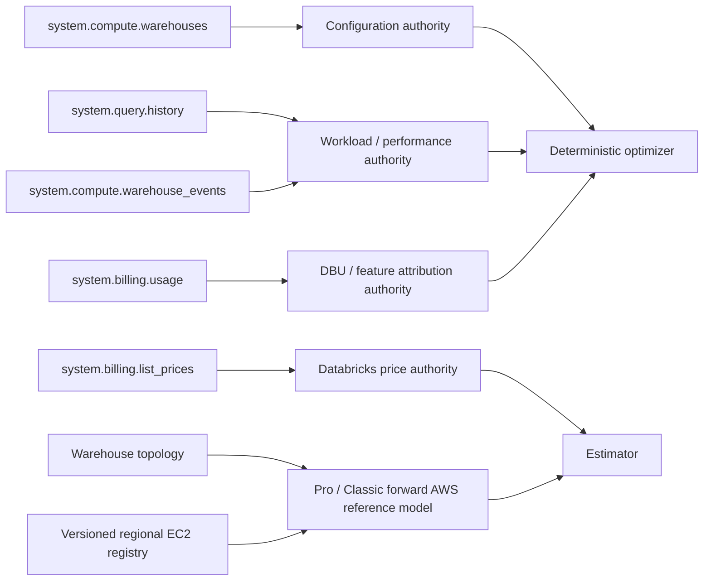

REST compatibility evidence may add blockers or validation context but cannot overwrite the authoritative warehouse configuration used by the optimizer.

### 7.3 Photon semantics

Photon is observation-only: it is derived from current-epoch billing evidence, never read from configuration and never recommended (state model and parameters: `docs/reference/source-mapping.md` and `docs/reference/thresholds.md`).

### 7.4 Owner and workload-source attribution

- owner is inferred from current-epoch billing attribution where available;
- query source is multi-label and can simultaneously include Databricks entity origin and client application;
- absence of attribution remains explicit rather than guessed.

Field mapping: `docs/reference/source-mapping.md`.

---

## 8. End-to-end runtime flows

### 8.1 Live mode

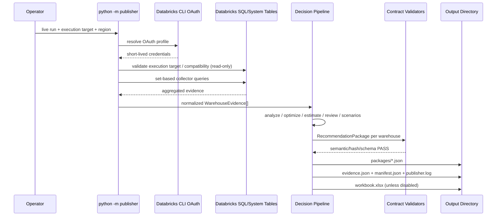

### 8.2 Evidence replay mode

Replay mode reads previously normalized evidence files and bypasses live collection/authentication.

Primary uses:

- deterministic regression,
- multi-region merge,
- offline review,
- policy/model comparison,
- reproducibility/debugging.

Conflicting evidence for the same warehouse/epoch must fail rather than silently merge incompatible values.

### 8.3 Synthetic mode

Synthetic mode creates deterministic normalized evidence and then enters the same downstream path as replay/live evidence.

The demo fleet has one simulated warehouse per golden scenario. Its evidence is simulated from workload descriptions (query windows, auto-stop, concurrency-driven clusters, billed DBU from published DBU/hour and SKU list prices) and normalized by the same extraction used for live evidence. It produces one package per simulated warehouse and one workbook; expected output counts: `README.md`.

Synthetic mode is a test/illustration facility, not an alternate recommendation engine.

---

## 9. Regional and account-scale topology

A single live collector invocation operates against one source region. Full account coverage requires one collection per relevant region because configuration/query/event system tables are regional.

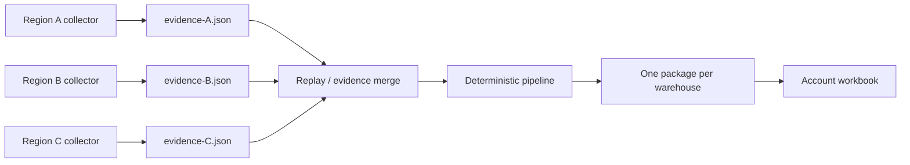

Merge key:

```text
(workspace_id, warehouse_id)
```

Epoch conflicts, modeled-evidence conflicts, currency conflicts, or incompatible duplicate records must fail closed.

### 9.1 Scale strategy

The architecture scales by reducing data before Python:

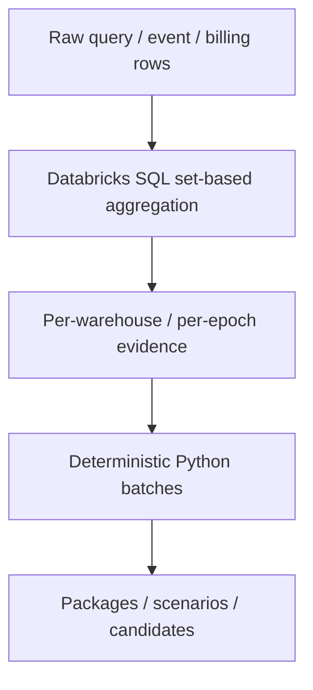

The production decision path intentionally does not require pandas. Python processes bounded domain objects/dataclasses in deterministic batches (batch size: `docs/architecture/lld.md` section 5.2, `--batch-size`).

---

## 10. Economic architecture

The system keeps the economic layers below separate. Definitions and semantics: `docs/architecture/context.md` sections 18 to 21 and `docs/contracts/reporter-json-contract.md`.

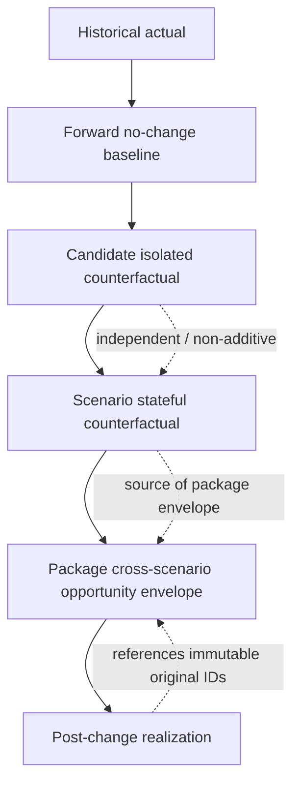

### 10.1 Historical actual

Observed historical Databricks DBU cost is retained separately from modeled forward cost. Usage with no matching list price is reported as unpriced DBU and makes the affected cost unavailable rather than understated (`docs/architecture/lld.md` section 11.4).

Historical customer AWS actual cost remains unavailable unless an authoritative customer billing/effective-rate source is integrated. The architecture forbids labeling an on-demand model as historical actual (`docs/reference/aws-cost-model.md`).

### 10.2 Forward baseline

The forward baseline is the expected next-365-day cost with no change, built from current-epoch-aware cost history and type-appropriate AWS treatment. It is published only when it is known: otherwise it is null (never $0 or a guessed run rate), the forecast metadata records why, and savings estimates and migration economics are withheld. Forecast algorithm: `docs/architecture/lld.md` section 11. Gating parameter: `min_economics_cost_history_days` (`docs/reference/thresholds.md`). Resulting codes: `docs/reference/blocker-codes.md` (section "DBU and AWS cost availability").

### 10.3 Candidate economics

The modeler/estimator prices each candidate in isolation; candidate economics are non-additive.

### 10.4 Scenario economics

The stateful bundle estimator owns scenario-level economics because it accounts for ordering and overlap.

### 10.5 Package economics

Package economics are derived from scenario economics only, as an opportunity envelope rather than a statistical confidence interval; DBU/AWS components stay attached to the scenario that generated each envelope point. Field semantics: `docs/contracts/reporter-json-contract.md` section 15.

### 10.6 Realization

Realization is modeled as a later measurement record that references the immutable original package/scenario/candidate. It does not rewrite the original recommendation identity.

---

## 11. Determinism and identity architecture

Determinism applies to recommendation semantics, not necessarily presentation timestamps.

For identical normalized evidence plus identical policy/model/catalog/contract versions, the system must produce identical:

- epoch IDs,
- evidence IDs/fingerprint,
- candidate IDs,
- scenario IDs,
- recommendation package ID,
- decisions,
- confidence values,
- scenario ordering,
- economic ranges.

The public identity hierarchy is:

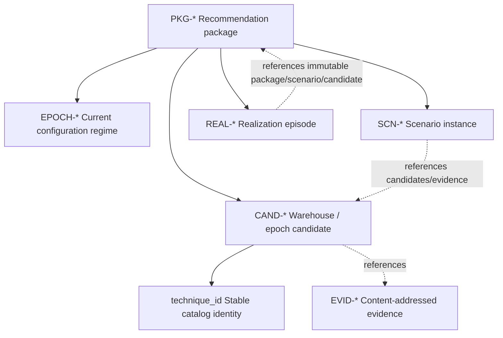

Public IDs (`EPOCH-*`, `EVID-*`, `CAND-*`, `SCN-*`, `REAL-*`, `PKG-*`) come only from the contract helpers in `src/publisher/contracts/reporter_contract.py`. The internal join keys that `src/publisher/common/ids.py` keeps while a run is in memory never reach a package (`docs/architecture/lld.md` section 22.4). Identity formats, hash inputs and the hierarchy: `docs/contracts/reporter-json-contract.md`.

Volatile data such as `generated_at`, filenames, log paths, or workbook formatting must not influence recommendation identities.

---

## 12. Contract architecture

### 12.1 Public recommendation contract

The only authoritative recommendation serialization is Reporter JSON Contract v2.0.0:

- Python dataclasses: `src/publisher/contracts/reporter_contract.py`
- JSON Schema: `schema/recommendation-package.schema.json`
- semantic specification: `docs/contracts/reporter-json-contract.md`

### 12.2 Workbook contract

Workbook Contract v1.4.0 is an independently versioned presentation contract:

- projection: `src/publisher/contracts/workbook_contract.py`
- renderer: `src/publisher/reporter/workbook_reporter.py`
- specification: `docs/contracts/workbook-contract.md`

The ordered workbook columns and column groups are declared only in the workbook contract module and consumed by the renderer, so renderer-only formatting changes cannot silently drop agreed fields. Sheets, grains and columns: `docs/contracts/workbook-contract.md`.

Signed values: a cost increase is a negative annual-impact number (shown in red parentheses) with Impact Type `COST_INCREASE`; the sign is never flipped.

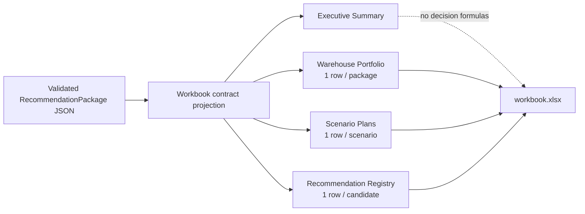

### 12.3 Internal domain contracts

The typed internal dataclasses for normalized evidence, findings, decisions, candidates, scenarios, and the minimal `WarehouseOptimization` orchestration result live in `src/publisher/contracts/` (`source.py`, `analysis.py`, `candidate.py`, `scenario.py`, `review.py`). The Packager (`src/publisher/packager/`) assembles the locked public `RecommendationPackage` directly, and reviewer gate 2 checks its scenarios; there is no separate internal report serialization model.

These internal objects are **not public APIs**. The public JSON contract remains the `RecommendationPackage` of the Reporter JSON Contract.

---

## 13. Security and privacy architecture

### 13.1 Authentication

Live execution uses Databricks CLI OAuth profile resolution. Long-lived static tokens are not a required runtime contract and credentials must never be logged.

### 13.2 Least-privilege/read-only posture

Required platform interactions are read-only:

- system-table SELECTs,
- execution-target validation,
- workspace identity resolution,
- compatibility evidence retrieval.

There is no SQL warehouse update/apply call in Phase 1.

### 13.3 Data minimization

The collector aggregates before export and does not require raw SQL statement text for optimization. Pattern counts may be derived in Databricks, but raw statement text is not emitted into recommendation artifacts.

Artifacts may contain operational metadata such as owner attribution, configuration, cost evidence, IDs, and workload-source classification and should therefore be stored according to the organization's internal access controls.

### 13.4 Logging

Logs may contain:

- lifecycle events,
- workspace/warehouse IDs,
- package counts,
- model/policy versions,
- validation status.

Logs must not contain:

- OAuth tokens,
- credentials,
- raw SQL statement text,
- unnecessary sensitive configuration values.

---

## 14. Reliability and failure behavior

The system follows a fail-closed publication posture.

### 14.1 Hard failures

Examples that stop affected publication/run processing include:

- multiple current epochs for one warehouse,
- conflicting replay evidence,
- mixed currencies where the contract cannot represent them safely,
- invalid config invariants,
- unresolved internal references,
- deterministic hash mismatch,
- JSON Schema failure,
- reviewer invariant failure.

### 14.2 Soft unavailability

Evidence that is legitimately unavailable should not crash the pipeline when the contract can represent it safely. Examples:

- no authoritative historical AWS actual cost,
- missing regional AWS forward price,
- insufficient Photon evidence,
- compatibility status unknown.

These become explicit null/unavailable values, blockers, reduced confidence, or non-assessable economics.

### 14.3 No fallback guessing

The architecture forbids silent fallbacks that convert unknown into:

- zero cost,
- enabled/disabled configuration,
- compatible migration,
- supported warehouse type,
- a default AWS region/rate.

---

## 15. Observability

Each run writes packages, the workbook, replay evidence, a run manifest and a log; the output tree is in `README.md`.

The manifest and log identify the run (publisher and contract versions, emitted packages and warehouses excluded by the supported-type gate) without duplicating metric evidence, which stays in the package and evidence artifacts. Manifest contents: `docs/architecture/lld.md` section 28.2. Policy, model and component versions are recorded in each package's provenance.

---

## 16. Deployment and execution topology

### 16.1 Current Phase-1 deployment

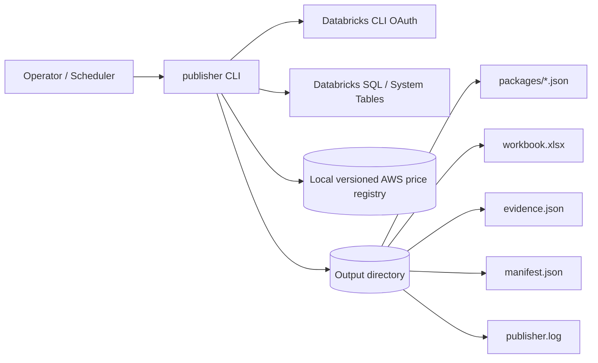

The current product is a single Python CLI/repository that runs where it has:

- Databricks CLI OAuth access,
- network access to the Databricks workspace,
- permission to query required system tables,
- access to the local AWS price registry,
- filesystem access to the selected output directory.

It can run from a developer workstation, controlled utility host, CI runner, or scheduled execution environment as long as those prerequisites are satisfied.

### 16.2 Execution target

Collector SQL can be executed through:

- a SQL warehouse,
- a Serverless SQL warehouse,
- a validated all-purpose cluster capable of SQL connector execution.

Jobs compute is rejected as an execution target.

The collector session time zone is pinned to UTC and verified before any query runs.

The execution target runs collector SQL only; it is not the set of warehouses being optimized. The collector analyzes all visible in-scope SQL warehouses available through the source tables for the selected regional context.

### 16.3 Persistence

There is no Phase-1 operational database. The filesystem output directory is the persistence boundary for:

- immutable packages,
- normalized replay evidence,
- workbook projection,
- run manifest/logs.

A future service deployment may persist packages in Delta/object storage or expose APIs, but the public package contract should remain the boundary.

---

## 17. Performance and capacity design

### 17.1 Source-side aggregation

High-cardinality data remains in Databricks. Source queries aggregate query history, warehouse events, and billing into bounded rows before transfer.

This avoids a design in which local runtime performance scales linearly with raw query/event records.

### 17.2 Downstream batching

Normalized warehouses are processed in deterministic batches. The batch size is an execution/memory control, not a decision semantic input (default: `docs/architecture/lld.md` section 5.2, `--batch-size`).

Changing batch size must not change package decisions or IDs.

### 17.3 Workbook scaling

The workbook is a human reporting surface, not the canonical persistence layer. At large account scale:

- package JSON remains authoritative,
- workbook row counts can grow with package/scenario/candidate count,
- future UI/dashboard surfaces may consume the same package contract without changing optimization semantics.

---

## 18. Scenario recommendation policy

The HLD preserves the approved conservative Phase-1 policy:

- Plan A/current-type optimization is the deterministic recommended scenario.
- Warehouse-type migration remains an alternative experimental branch.

This is a **policy choice**, not a model claim that Plan A is cheaper.

A future policy can promote a migration scenario only through a versioned change with explicit compatibility, economic, confidence, runtime, and validation requirements.

---

## 19. Technology choices

| Concern | Current choice | Architectural rationale |
|---|---|---|
| Runtime | Python | deterministic business logic, dataclasses, portable CLI |
| Source compute | Databricks SQL/system tables | push high-volume aggregation to the platform |
| Auth | Databricks CLI OAuth profile | short-lived user-authorized credentials; no token logging |
| Public contract | typed dataclasses + JSON Schema | stable machine-readable boundary + semantic validation |
| Public contract validation | `jsonschema` (Draft 2020-12) | package schema validation before any package is written; mandatory dependency (`requirements.txt`) |
| Workbook | `openpyxl` projection | presentation-only, no decision formulas |
| Local data processing | Python objects/dataclasses | bounded per-warehouse evidence; avoids pandas dependency in core |
| AWS forward price source | versioned JSON registry | explicit, reproducible, region-specific reference pricing |
| Logging | Python structured lifecycle logging | simple local observability without external dependency |

---

## 20. High-level test architecture

The repository test model is layered:

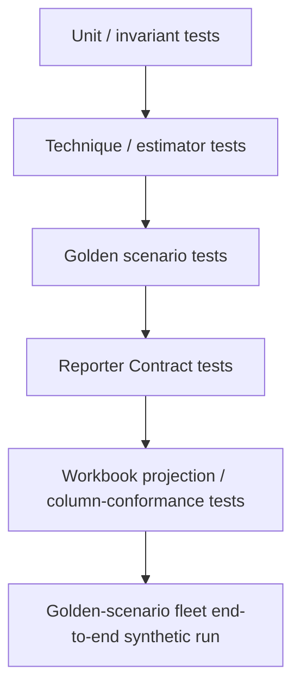

The architecture expects tests to prove both positive behavior and fail-closed behavior. Test design, golden scenarios and required contract assertions: `docs/architecture/lld.md` section 32. Reproduce results with the commands in `CLAUDE.md`.

---

## 21. Architecture decisions and tradeoffs

### 21.1 System-table-first vs configuration API

**Decision:** system tables are authoritative for optimizer configuration and telemetry.

**Tradeoff:** some fields such as spot policy or effective statement timeout remain out of scope rather than expanding write/config API dependency.

### 21.2 Dataclasses/objects vs pandas in the production path

**Decision:** use set-based SQL followed by typed Python domain objects.

**Tradeoff:** less vectorized local analysis, but lower dependency/memory complexity and clearer nested decision semantics.

### 21.3 One package per warehouse vs run-level recommendation document

**Decision:** one immutable package per warehouse/current epoch.

**Tradeoff:** multi-warehouse runs create many small files, but each package becomes independently addressable, auditable, hashable, replayable, and realizable.

### 21.4 Candidate estimates vs stateful scenarios

**Decision:** expose both, but only scenarios can represent bundled economics.

**Tradeoff:** additional modeling complexity prevents materially incorrect additive savings.

### 21.5 Advisory vs auto-apply

**Decision:** read-only advisory with HITL/canaries.

**Tradeoff:** lower automation rate in exchange for safer Phase-1 validation and evidence collection.

### 21.6 Workbook as projection

**Decision:** Excel is presentation-only.

**Tradeoff:** workbook is less “interactive” mathematically, but cannot drift from the deterministic package source of truth.

---

## 22. Implementation conformance

Open limitations and unimplemented scope: `docs/reference/known-limitations.md`.

---

## 23. Future architecture extensions

The following can extend the architecture without changing the Phase-1 decision authority model:

- scheduled multi-region orchestration,
- persisted package/realization store,
- API/UI over RecommendationPackage,
- approval workflow integration,
- controlled apply/rollback service,
- organization-effective AWS CUR rates,
- policy-based migration scenario promotion,
- Lakehouse Real-Time analyzer/optimizer/estimator,
- workload-group/topology optimization,
- ML forecasts as bounded inputs to deterministic optimizers,
- LLM explanation/diagnosis that cannot override deterministic decisions.

Any future decision-authority change requires a PRD/architecture revision rather than being introduced implicitly through an adapter or presentation layer.

---

## 24. HLD acceptance criteria

Product acceptance criteria: `docs/product/prd.md` section 23. The architecture additionally holds when:

1. system-table source authority and read-only API boundaries are as stated in sections 7 and 13;
2. live, replay, synthetic, and multi-region execution paths are represented (sections 8 and 9);
3. read-only/HITL/security behavior is explicit (section 13).

---

## 25. Reference sources

External platform references: `docs/product/prd.md` section 28.

Repository source-of-truth references: the topic homes in `docs/README.md`, plus `src/publisher/contracts/reporter_contract.py`, `src/publisher/contracts/workbook_contract.py`, `src/publisher/analyzer/`, `src/publisher/governor/`, `src/publisher/optimizer/`, `src/publisher/reviewer/`, `src/publisher/packager/`, `src/publisher/publisher.py`, `src/publisher/reporter/workbook_reporter.py` and `tests/`.
