# Low-Level Design — Databricks SQL Warehouse Optimizer

**Document:** `docs/architecture/lld.md`  
**Product:** Databricks SQL Warehouse Optimizer  
**Implementation baseline:** Publisher v2.10.0  
**Approved PRD:** `docs/product/prd.md` v1.0.0  
**Approved HLD:** `docs/architecture/hld.md` v1.0.0  
**Reporter JSON Contract:** v1.2.0 (locked)  
**Workbook Contract:** v1.3.0 (locked)  
**LLD version:** 1.0.0  
**Status:** Approved / locked  
**Last updated:** 2026-10-01  

---

## 1. Purpose

This document defines the implementation-level design of the Databricks SQL Warehouse Optimizer. It translates the approved PRD and HLD into concrete modules, classes, data contracts, SQL projections, algorithms, thresholds, deterministic identities, reviewer invariants, scenario state transitions, economics, publication behavior, CLI/runtime behavior, and test seams.

The LLD describes the **actual v2.10.0 implementation** unless a section is explicitly marked as an implementation-alignment requirement. It does not redesign the product while documenting it.

The implementation has one central invariant:

> **One supported warehouse + one authoritative current configuration epoch + one normalized evidence set + one version set must deterministically yield one immutable `RecommendationPackage` and one presentation-only workbook projection.**

---

## 2. Design baseline and implementation alignment

### 2.1 Locked external contracts

The following contracts are independent of publisher implementation version and are already locked:

| Contract | Version | Source of truth |
|---|---:|---|
| Reporter JSON Contract | 1.2.0 | `contracts/reporter_contract.py`, `schema/recommendation-package.schema.json`, `docs/contracts/reporter-json-contract.md` |
| Workbook Contract | 1.3.0 | `contracts/workbook_contract.py`, `docs/contracts/workbook-contract.md` |
| Publisher implementation | 2.10.0 | `publisher.py` plus reporter/contract modules |

### 2.2 Implementation conformance

Publisher v2.10.0 implements the sealed design directly:

1. the fail-closed Supported-Type Gate permits only `CLASSIC`, `PRO`, and standard `SERVERLESS`;
2. reviewer-gated candidates/scenarios flow through a minimal `WarehouseOptimization` orchestration result and then directly into `RecommendationPackage`; no transitional internal run-report serialization contract remains;
3. Workbook Contract v1.3.0 is a numeric-first presentation projection of the public packages.

Realization ingestion remains future scope; packages are initialized as `NOT_APPLIED` until a separately approved measured-outcome source contract exists.

---

## 3. Repository and module structure

```text
publisher.py
contracts/
├── reporter_contract.py
├── reporter_schema.py
└── workbook_contract.py
reporters/
└── workbook_reporter.py
schema/
└── recommendation-package.schema.json
pricing/
└── aws_ec2_on_demand.json
docs/
├── product/prd.md
├── architecture/{context,hld,lld}.md
├── contracts/{reporter-json-contract,workbook-contract}.md
├── reference/{thresholds,technique-catalog,source-mapping,aws-cost-model,known-limitations}.md
└── skills.md
tests/
├── test_publisher.py
├── test_locked_reporter_integration.py
├── test_reporter_contract.py
├── test_workbook_contract.py
└── golden/
```

### 3.1 Module responsibilities

| Module | Responsibility | May make optimization decisions? |
|---|---|---:|
| `publisher.py` | collection, normalization, model/analyze/optimize/estimate/review/scenario orchestration, public package adaptation, CLI | Yes, deterministic only |
| `contracts/reporter_contract.py` | immutable public dataclasses, enums, hash construction, semantic validation | No |
| `contracts/reporter_schema.py` | JSON Schema generation/support | No |
| `contracts/workbook_contract.py` | pure JSON-package-to-workbook row projection | No |
| `reporters/workbook_reporter.py` | Excel rendering, number formats, widths, filters, frozen panes, conditional formatting | No |
| `pricing/aws_ec2_on_demand.json` | versioned regional EC2 price reference | No |

### 3.2 Layer dependency rule


The workbook layer cannot call optimizer/estimator logic. It may only project already-validated public packages.

---

## 4. Runtime constants and version boundaries

Publisher v2.10.0 declares independent version identifiers for deterministic replay:

| Constant | Current value | Purpose |
|---|---|---|
| `PUBLISHER_VERSION` | `2.10.0` | implementation release |
| `POLICY_VERSION` | `sql-warehouse-policy-v2.9.0` | threshold/policy semantics |
| `ANALYZER_VERSION` | `sql-warehouse-analyzer-v2.10.0` | analyzer semantics |
| `OPTIMIZER_VERSION` | `sql-warehouse-optimizer-v2.10.0` | decision semantics |
| `MODEL_VERSION` | `epoch-runrate-v2.10.0` | forward forecast |
| `ESTIMATOR_VERSION` | `counterfactual-v2.10.0` | candidate economics |
| `BUNDLE_MODEL_VERSION` | `stateful-resource-bundle-v2.10.0` | scenario economics |
| `REVIEWER_VERSION` | `recommendation-reviewer-v2.9.0` | invariant policy |
| `DECISION_VERSION` | `warehouse-decision-graph-v2.9.0` | dependency/order semantics |
| `TECHNIQUE_CATALOG_VERSION` | `technique-catalog-v1` | stable technique mapping |

Changing a decision-affecting implementation without changing the corresponding version is prohibited.

---

## 5. Execution modes and CLI

### 5.1 Modes

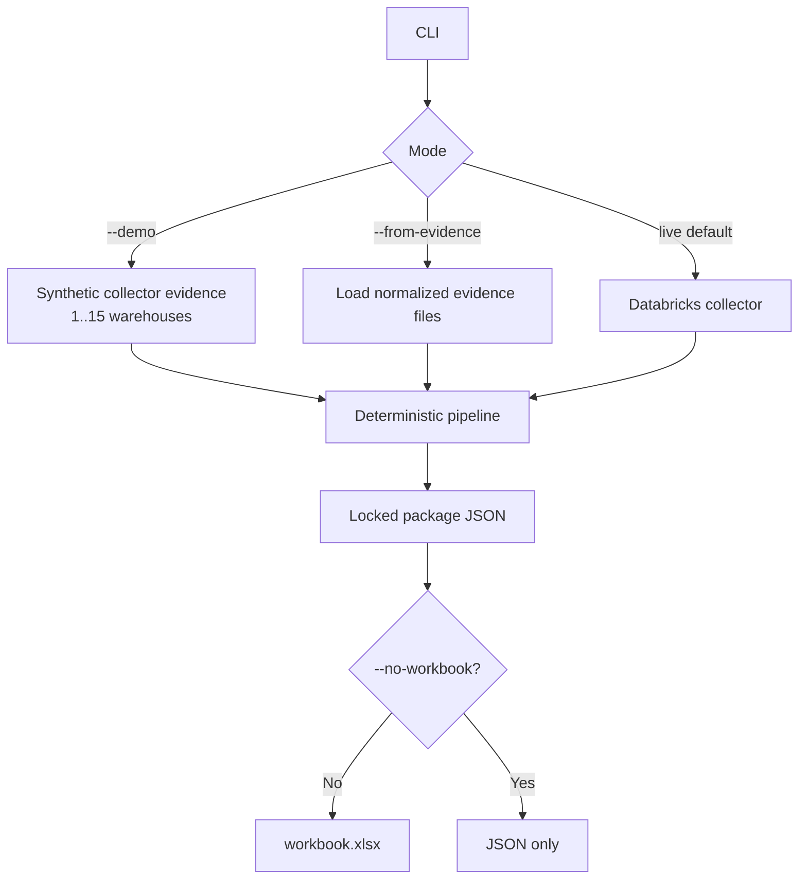

### 5.2 Key CLI arguments

| Argument | Semantics |
|---|---|
| `--output-dir` | output root; default `./warehouse_optimizer_out` |
| `--demo` | synthetic collector mode |
| `--demo-count` | number of synthetic warehouses, `1..15` |
| `--from-evidence` | replay one or more normalized evidence files |
| `--profile` | Databricks CLI profile |
| `--serverless-warehouse-id` | SQL execution target convenience flag |
| `--sql-warehouse-id` | SQL execution target convenience flag |
| `--all-purpose-cluster-id` | all-purpose SQL Connector target |
| `--execution-kind` / `--execution-id` | generic execution target pair |
| `--workspace-id` | required for cluster HTTP path when not discoverable |
| `--source-region` | regional context for source collection and AWS model |
| `--aws-price-registry` | versioned EC2 registry path |
| `--batch-size` | downstream Python batch size; collector remains set-based |
| `--billing-ingested-through` | `YYYY-MM-DD`; pins every billing query to records ingested on or before that date, so a re-collection reproduces an earlier run despite later billing corrections |
| `--compatibility-api-mode` | `auto` or `off` |
| `--no-workbook` | suppress workbook while preserving canonical JSON |
| `--print-json` | print exactly one package to stdout |

### 5.3 Execution target resolution

A live run must resolve exactly one SQL execution target. SQL warehouses use `/sql/1.0/warehouses/<id>`. All-purpose compute uses the SQL Connector cluster path after read-only validation that the supplied cluster is not jobs compute.

The execution target is only where collector SQL runs; it is not the warehouse being optimized.

---

## 6. Detailed end-to-end sequence

```mermaid
sequenceDiagram
    autonumber
    participant CLI as CLI
    participant AUTH as OAuth/Auth
    participant SQL as Databricks SQL
    participant COL as Collector
    participant MOD as Modeler
    participant ANA as Analyzer
    participant OPT as Optimizer
    participant EST as Estimator
    participant R1 as Reviewer Gate 1
    participant PLN as Scenario Planner
    participant BND as Bundle Estimator
    participant R2 as Reviewer Gate 2
    participant ADP as Public Contract Adapter
    participant VAL as Contract Validator
    participant WB as Workbook Projection
    participant OUT as Output Directory

    CLI->>AUTH: resolve execution target + U2M token
    AUTH->>SQL: SQL Connector session (UTC-pinned, verified)
    SQL->>COL: set-based system table aggregates
    COL->>MOD: daily DBU cost + current epoch
    MOD-->>COL: forward baseline forecast
    COL->>ANA: WarehouseEvidence
    ANA-->>OPT: AnalysisResult[6]
    OPT-->>EST: OptimizationDecision[6]
    EST-->>R1: CandidateRecommendation[6]
    R1-->>PLN: reviewed candidates
    PLN->>BND: ordered Plan A / Plan B steps
    BND-->>PLN: stateful scenario economics
    PLN-->>R2: scenarios
    R2-->>ADP: reviewed internal report
    ADP->>VAL: RecommendationPackage
    VAL->>VAL: semantic/hash/schema checks
    VAL-->>OUT: packages/*.json
    VAL->>WB: validated packages
    WB-->>OUT: workbook.xlsx
    COL-->>OUT: evidence.json
    VAL-->>OUT: manifest.json
    CLI-->>OUT: publisher.log
```

---

## 7. Source contracts and collector SQL

### 7.1 Authoritative source matrix

| Source | Grain used by publisher | Decision role |
|---|---|---|
| `system.compute.warehouses` | warehouse configuration snapshots | authoritative configuration + epoch boundaries |
| `system.compute.warehouse_events` | warehouse event stream aggregated to epoch | resource minutes, scale-state, starts |
| `system.query.history` | query history aggregated to epoch/30d | queue, spill, latency, source, cache, tags, gaps |
| `system.billing.usage` | daily/epoch usage | DBU cost, Photon observation, owner, serverless evidence |
| `system.billing.list_prices` | active SQL DBU price rows | list-cost and migration pricing |
| versioned AWS registry | region + instance family | Pro/Classic customer EC2 model |
| read-only workspace SQL config API | current connected workspace only | compatibility evidence only |

Configuration values from read-only APIs **must never override** `system.compute.warehouses`.

### 7.2 Collector projections

#### `CONFIG_EPOCHS_SQL`

Produces one row per configuration epoch for active warehouses, with:

- account/workspace/warehouse identity,
- warehouse name,
- type/channel/size/min/max/auto-stop (name and tags from the epoch's latest snapshot),
- `epoch_start` = `change_time` of the first snapshot of the epoch,
- `epoch_end` = the next epoch's `epoch_start`,
- `is_current = epoch_end IS NULL`.

The query retains epochs overlapping the last 365 days plus the current epoch.

Epochs are islands of the decision fields. A shared CTE (`CONFIG_EPOCHS_CTE`) compares each snapshot with the previous one; a new epoch starts when `warehouse_type`, `warehouse_channel`, `warehouse_size`, `min_clusters`, `max_clusters` or `auto_stop_minutes` differ. Snapshots that change only the name or tags are folded into the surrounding epoch. The same CTE groups the query-metric, warehouse-event, idle-gap, daily-cost and billing-attribution queries by epoch, so all of them share one set of epoch boundaries.

All collector SQL runs in a session pinned to UTC (`TIMEZONE=UTC`), so `DATE()`, `CURRENT_DATE()` and `CURRENT_TIMESTAMP()` align with UTC billing `usage_date`. The collector reads `current_timezone()` immediately after connecting and exits with an error if the session is not UTC.

#### `EPOCH_QUERY_METRICS_SQL`

Aggregates query history into each warehouse epoch. Important 30-day/current-epoch metrics include:

- query count and active days,
- p95 total/wait/compute/capacity/execution durations,
- p99 and max execution duration,
- queued-query percentage,
- spill frequency, p95 spill bytes, total spill GiB,
- read bytes and IO-cache percentage,
- failed/cancelled percentage,
- result-cache percentage,
- query-tag coverage,
- Databricks source counts for dashboard/job/notebook/Genie/alert/SQL query,
- external/client application counts for Power BI/Tableau/Looker/Databricks SQL Editor,
- statement-text visibility and legacy Hive metastore reference count,
- epoch-level p95 execution, queue and spill percentages,
- epoch-level total task duration (`epoch_task_duration_ms`, the sum of `total_task_duration_ms`), the numerator of the task-time utilization evidence.

Raw query rows are not loaded into the optimizer.

#### `EPOCH_EVENT_METRICS_SQL`

Reconstructs event segments (the `LEAD` window orders by `event_time`, `event_type`, `cluster_count`, so events with equal timestamps segment deterministically) and aggregates:

- uptime minutes,
- cluster-minutes,
- minutes/time at configured minimum,
- minutes/time at configured maximum,
- maximum observed clusters,
- 30-day starts,
- scale-up count,
- scale-down count.

#### `RESOURCE_DAILY_SQL`

Reads a daily resource series for the current epoch over the last 120 UTC days: uptime minutes, cluster-minutes, minutes at the configured minimum and maximum, recycle minutes, the peak cluster count excluding recycling transients above `max_clusters`, and starts. Event segments are split at UTC midnight so every minute lands on its own UTC day; zero-length segments are dropped. The Python side trims the series to the billing basis (11.1) and to the collected range (`events.resource_daily_from`): days before it are unknown, so the window shrinks instead of counting them as idle. When the last 30 days have no running time, the capacity facts are undefined and min/max changes are held with `NO_RECENT_RUNNING_TIME`.

#### Idle-gap SQL

`build_epoch_gap_metrics_sql()` derives inter-query idle gaps within each epoch and materializes projected removable idle minutes for all configured deterministic auto-stop targets. The running maximum of prior query end times orders by `start_time`, `end_time`, `statement_id`, so queries with equal start times produce deterministic gaps.

#### `EPOCH_DAILY_COST_SQL`

Left-joins billing usage to the list price effective at each usage record's end time to produce daily SQL warehouse DBU list cost by warehouse/epoch/currency. Each usage record (`record_id`) takes one price row, the latest `price_start_time` when price rows overlap, so it is counted once. Usage with no matching price row (for example a promotional or not-yet-listed SKU) is kept and reported as `unpriced_dbu_quantity` instead of being dropped; its cost is unknown, not zero. Signed usage quantities are preserved so billing corrections flow into the run-rate model. Each daily row also carries `retracted_dbu_quantity` (the magnitude of RETRACTION records, positive) and `restated_dbu_quantity` (RESTATEMENT records); `record_type` only labels these two quantities and never filters rows, so every record type stays in the signed cost sums.

#### `BILLING_WATERMARK_SQL`

Returns, per workspace, `MAX(usage_end_time)` (the billing watermark) and `MAX(ingestion_date)` (billing ingested-through) over recent SQL-product usage. Billing completeness is judged per workspace, so one workspace's lagging ingestion is not hidden by another's. A workspace whose warehouses stopped running also stops producing usage, so its watermark stalls although billing is complete: when the warehouse's daily resource series shows no running time after the workspace watermark (on its own day, only running that provably follows the watermark time counts) through the last day that should already be billed (settled, passed by the account watermark, and before any ingestion cut-off), the account-wide watermark applies (`billing_watermark_source = ACCOUNT_IDLE_WAREHOUSE`); when it did run, the gap is ingestion lag and the workspace watermark stands (`WORKSPACE_LAGGING`). With `--billing-ingested-through`, every billing query (watermark, daily cost, features, attribution) only reads records ingested on or before that date. The settle buffer is then measured from that date's 00:00 UTC (or the analysis time, if earlier), so a later re-collection reproduces the original run's basis end.

#### `EPOCH_BILLING_ATTRIBUTION_SQL`

Produces current/historical epoch attribution evidence:

- signed Photon-true DBUs,
- signed Photon-false DBUs,
- signed Photon-null DBUs,
- latest usage timestamp,
- latest owner,
- observed owners.

#### `SQL_SKU_PRICE_SQL`

Loads currently effective SQL DBU list-price rows and classifies them for Pro/Classic/Serverless target pricing.

### 7.3 Collector cardinality

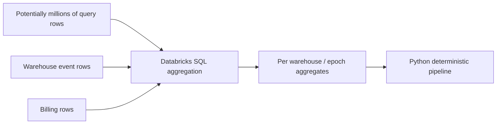

The local process scales with warehouses/epochs rather than raw query-history cardinality.

---

## 8. Authentication and optional REST compatibility evidence

### 8.1 Authentication

The publisher resolves a Databricks CLI OAuth profile and obtains a short-lived user-to-machine access token. Tokens are held in memory and are not serialized into package/evidence/workbook outputs.

### 8.2 REST usage boundary

Read-only REST is permitted for:

- all-purpose execution-target validation,
- workspace ID discovery needed for a cluster SQL Connector path,
- optional workspace SQL compatibility evidence.

The current compatibility path is `GET /api/2.0/sql/config/warehouses`. Only safe metadata is retained. Data-access configuration **values** are not retained; only matching key names used to detect external legacy Hive metastore configuration are preserved.

### 8.3 Compatibility mode

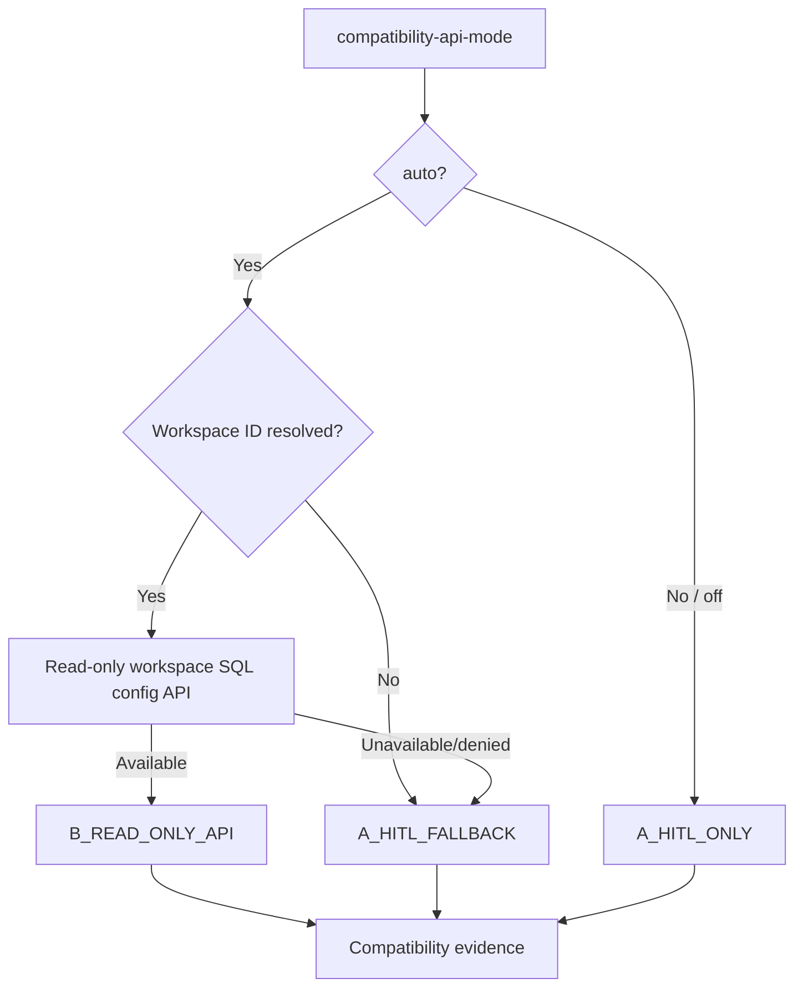

Unknown compatibility evidence is represented as `UNKNOWN` / HITL-required, not guessed.

---

## 9. Normalized internal domain contracts

Internal dataclasses are implementation contracts, not public API contracts.

| Contract | Role | Key invariants |
|---|---|---|
| `Thresholds` | centralized deterministic policy | immutable defaults; no hidden per-function constants |
| `WarehouseConfig` | authoritative config snapshot | type/channel/size/min/max/auto-stop |
| `PhotonObservation` | billing-derived observed Photon state | not authoritative config; ENABLED/DISABLED/MIXED/UNKNOWN |
| `QuerySourceProfile` | current-epoch workload source mix | multi-label |
| `WarehouseAttribution` | owner + source attribution | owner may be unavailable |
| `EpochEvidence` | one config regime | immutable epoch identity; current/historical flag |
| `WarehouseEvidence` | one warehouse normalized evidence set | exactly one current epoch |
| `Finding` | atomic explainability fact | metric + source + field + epoch + threshold |
| `AnalysisResult` | analyzer output per knob | facts/findings only |
| `OptimizationDecision` | optimizer output before pricing | current/recommended config, status, dependencies, blockers |
| `Range3` | low/base/high range | ordered where reviewed |
| `CandidateRecommendation` | independent reviewed counterfactual | one per active knob |
| `PlanStep` | scenario execution step | exact candidate propagation |
| `PortfolioEstimate` | scenario stateful economics | DBU/AWS/total ranges |
| `Scenario` | Plan A or Plan B branch | independent mutually exclusive path |
| `WarehouseOptimization` | minimal reviewer-gated orchestration result | candidate/scenario state only; not serialized |

### 9.1 Contract flow

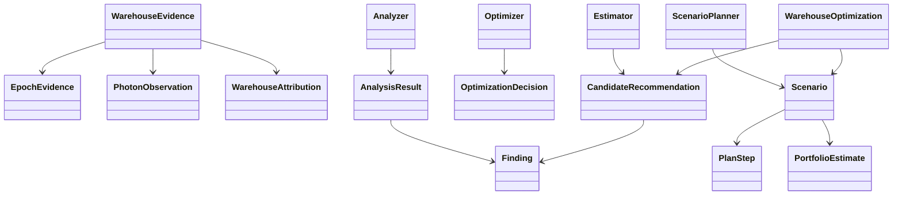

---

## 10. Configuration epochs

### 10.1 Epoch construction

An epoch is a run of consecutive `system.compute.warehouses` snapshots with identical decision fields (type, channel, size, min/max clusters, auto-stop). It starts at the `change_time` of the first such snapshot and ends where the next epoch starts; snapshots that change only the name or tags are folded into it. A rename or tag edit therefore does not start a new epoch or reset epoch maturity, cost history or the forecast basis. The table has no unique snapshot key, so snapshots sharing a `change_time` are first collapsed to one row chosen deterministically (a deleted snapshot wins; otherwise the lowest decision fields, then name); every later window orders by `change_time` alone, which is then unique.

Public epoch identity includes:

- contract version,
- workspace ID,
- warehouse ID,
- epoch start,
- warehouse type,
- warehouse size,
- min clusters,
- max clusters,
- auto-stop minutes,
- warehouse channel.

Photon is deliberately excluded from epoch identity because it is observed from billing feature attribution rather than treated as an authoritative `system.compute.warehouses` field.

### 10.2 Current-epoch rule

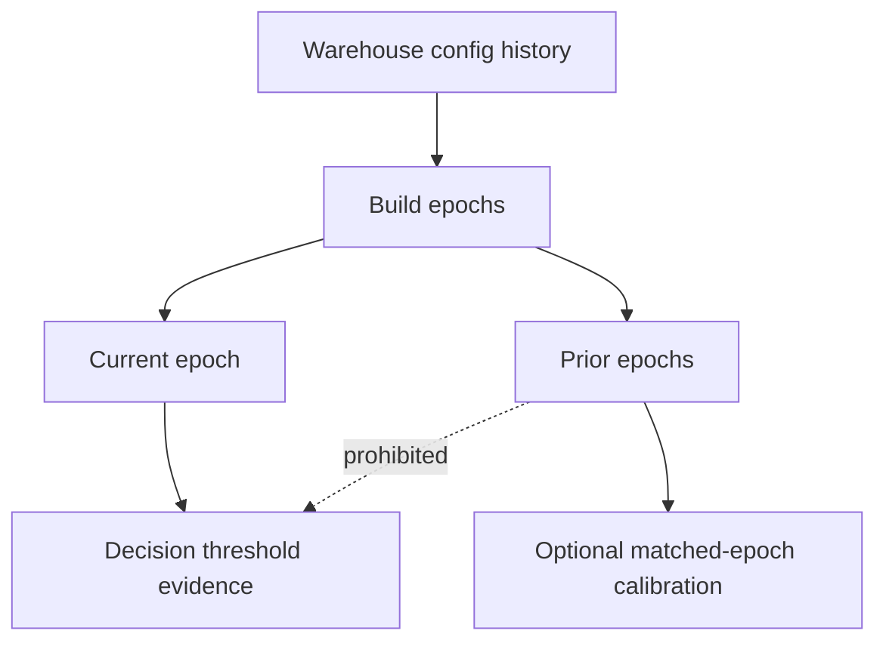

Only current-epoch findings may satisfy active optimizer decisions. Reviewer gate 1 rejects decision findings from historical epochs except explicitly non-decision historical coverage evidence.

### 10.3 Supported-Type Gate

Immediately after normalization and before analyzer invocation:

```python
SUPPORTED_WAREHOUSE_TYPES = {"CLASSIC", "PRO", "SERVERLESS"}
if current_epoch.config.warehouse_type not in SUPPORTED_WAREHOUSE_TYPES:
    # fail closed / publish unsupported assessment; do not route into Pro/Classic logic
```

Publisher v2.10.0 enforces this gate before analyzer invocation; unsupported/future types fail closed. The exclusion is per warehouse: the rest of the fleet is still evaluated, and each excluded warehouse is recorded in `manifest.json` `excluded_warehouses`.

---

## 11. Forward baseline model

`Modeler.forecast_from_daily_cost()` builds the no-change DBU forward baseline from **zero-filled calendar-day current-epoch daily cost**, while `current_cost_365` remains the observed trailing-365-day actual DBU list cost.

### 11.1 Basis

- analysis day itself is excluded,
- a UTC day is complete, and so enters the basis, only `billing_settle_hours` (24) after it ends and once the billing watermark of its own workspace has passed it; the basis ends at the last complete day,
- basis begins at the later of current epoch start or 365 days before analysis,
- missing calendar days are filled with zero (a day with no billing is a $0 day, but the forecast is published only when the epoch has enough billed days; see 11.2),
- mixed currencies are rejected (unpriced rows carry no currency and are not counted as a currency),
- forecast metadata records `billing_settle_hours`, `billing_watermark`, `billing_complete_through`, `billing_ingested_through` (`MAX(ingestion_date)` per workspace) and `billing_ingestion_cutoff` (the `--billing-ingested-through` pin, if any),
- over the same settled trailing window as the trailing-365-day actual cost (window start to `billing_complete_through`), forecast metadata also records `billing_retracted_dbu_quantity_365`, `billing_restated_dbu_quantity_365` and `billing_correction_dbu_share_365` (retracted DBU / originally billed DBU, where originally billed = net DBU + retracted - restated, rounded to 6 places). All three are null when any day in the window lacks the collected quantities (for example evidence collected before they existed); the share is also null when nothing was originally billed. Retractions of earlier restatements also count, so the share can exceed 1 when a day is corrected more than once. This is a cost-basis quality signal only: no decision, confidence or economics reads it.

### 11.2 Daily run rate

Let:

- `m28` = mean daily cost over the most recent 28 basis days,
- `m84` = mean daily cost over the most recent 84 basis days,
- `mall` = mean over the available current-epoch basis.

All rates (and the trend and CV) use the most recent whole weeks of the basis (`rate_basis_days`, a multiple of 7; the oldest 0–6 days are dropped), so an epoch that is not a whole number of weeks does not over- or under-weight weekends. The 7-billed-day floor counts billed days inside those rate weeks (`rate_billed_days`), so a weekday-only warehouse gets its first forecast after two weeks rather than one from a single week's partial billing. The daily resource blend for AWS and migration bounds uses the same trim.

Then:

```text
if history >= 84d:
  daily = 0.65*m28 + 0.35*m84
elif history >= 28d:
  daily = 0.75*m28 + 0.25*mall
else:
  daily = mall
```

Trend uses the ratio of last-28 to previous-28 mean, clamped to `[0.75, 1.25]`:

```text
trend_adjustment = 1 + 0.25 * (clamped_ratio - 1)
forecast_365 = daily * trend_adjustment * 365
```

The forward DBU cost (`forecast_cost_365`) is published only when it is known. Otherwise it is null, never $0 and never a run rate guessed from a few days. It is known when every basis day is priced, the current epoch has at least `min_economics_cost_history_days` (7) billed (non-zero cost) days, and the run rate is positive. Forecast metadata records `dbu_forecast_status`:

- `COMPLETE`: published;
- `INSUFFICIENT_ACTIVE_COST_DAYS`: fewer than 7 billed days, including an empty basis;
- `UNPRICED_USAGE`: unpriced DBU inside the basis (11.4);
- `NON_POSITIVE_RUN_RATE`: net billing corrections leave a run rate at or below zero.

`cost_cv_84` is the population coefficient of variation for the last-84 window when enough observations exist.

### 11.3 Forecast semantics

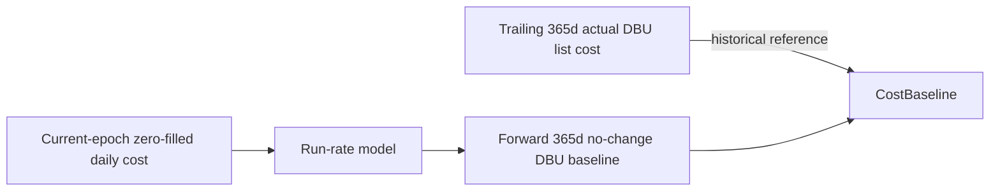

Actual and forward baseline are deliberately different concepts.

### 11.4 Unpriced usage

Unpriced DBU is unknown cost, never zero:

- unpriced DBU in the trailing 365-day window makes `current_cost_365` (the actual DBU cost) null;
- unpriced DBU inside the current-epoch forecast basis makes the forward DBU baseline (`forecast_cost_365`) null; because unpriced days would read as $0 days, `trend_ratio`, `run_rate_28`, `run_rate_84` and `cost_cv_84` are also null and `trend_adjustment_factor` is 1.0 (no trend adjustment of the AWS model);
- price rows without a list price count as unpriced; when price rows overlap, the latest `price_start_time` wins, with currency and end time as tie-breakers;
- an epoch whose usage includes unpriced DBU has a null list cost and is skipped by historical-epoch calibration;
- forecast metadata records `unpriced_dbu_quantity_365`, `unpriced_dbu_quantity_in_basis` and `dbu_pricing_status` (`COMPLETE` | `UNPRICED_USAGE`); null costs survive evidence save/load.

With a null forward DBU baseline, the candidate estimator withholds every savings estimate and the warehouse-type migration candidate is `INSUFFICIENT_EVIDENCE`, both with blocker `COST_HISTORY_INSUFFICIENT` when the epoch is younger than 7 calendar days (the re-evaluation window says when it clears), `BILLED_COST_DAYS_INSUFFICIENT` when a mature epoch has fewer than 7 billed days (not time-boxed), and `DBU_COST_UNAVAILABLE` otherwise (unpriced usage or a non-positive run rate) (`estimate_blocker` carries the same code), and scenario and package economics are withheld. The forward cost breakdown is `PARTIAL` for Pro/Classic (AWS cost is still modeled) and `UNAVAILABLE` when no component is known.

---

## 12. AWS baseline model

### 12.1 Serverless

For standard Serverless SQL warehouses:

- separate customer AWS EC2 cost is modeled as `0`,
- Databricks-managed infrastructure cost is considered embedded in the Serverless DBU price line.

### 12.2 Pro/Classic

For Pro/Classic:

```text
annual_cluster_minutes
  = blended_daily_cluster_minutes      # 28/84-day blend, as the DBU forecast
    * 365
    * forecast_trend_adjustment

annual_aws_cost
  = annual_cluster_minutes / 60
    * modeled_cluster_hourly_price
```

`blended_daily_cluster_minutes` is computed from the current epoch's daily resource series on the DBU forecast's window and calendar (the last 84 complete days ending at the billing basis end, clipped to the epoch start, missing days zero-filled) with the same 28/84-day blend, so DBU and AWS describe the same period.

`modeled_cluster_hourly_price` comes from documented warehouse topology encoded against the versioned regional EC2 price registry.

If region pricing or the daily resource series is unavailable, AWS baseline is `null`/unavailable rather than zero (`RECENT_RESOURCE_WINDOW_UNAVAILABLE`).

---

## 13. Photon observation algorithm

Photon is inferred from signed current-epoch DBU billing evidence.

### 13.1 Inputs

- `photon_true_dbu`
- `photon_false_dbu`
- `photon_null_dbu`
- latest usage timestamp

### 13.2 Thresholds

| Threshold | Value |
|---|---:|
| minimum known feature coverage | 90% |
| inferred enabled | ≥95% of known DBU usage true |
| inferred disabled | ≤5% true |
| minimum epoch DBU | 1 DBU |
| max evidence age | 14 days |

### 13.3 State flow

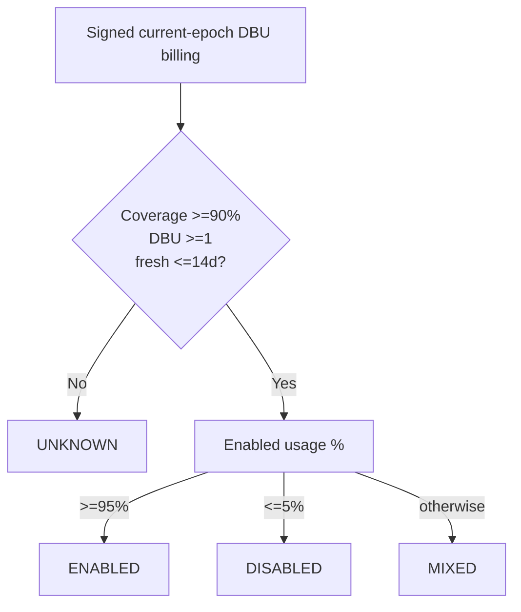

`MIXED` and `UNKNOWN` never become asserted boolean configuration states.

---

## 14. Analyzer design

The analyzer emits **facts and findings**, never a recommendation. Each finding records metric, value, unit, threshold, comparator, source table/field, current epoch ID, observation window, and interpretation.

### 14.1 Analyzer output matrix

| Candidate | Principal analyzer evidence |
|---|---|
| `warehouse_channel` | current channel |
| ~~`enable_photon`~~ | retired in v2.7.1; the observation (state, enabled %, coverage, freshness) is still collected for `current_config.photon` |
| `warehouse_size` | size, spill %, spilled-query count, p95 spill bytes among spilled queries, queue %, p95/p99 execution, IO cache, task-time utilization |
| `max_clusters` | max config, observed max clusters, queue %, queued-query count, p95 capacity wait among queued queries, time at max |
| `min_clusters` | min config, time/minutes at min, time at max, queue %, p95 capacity wait among queued queries, task-time utilization |
| `auto_stop_minutes` | current auto-stop, queries/day, gap sample, projected saved idle minutes, cluster-minutes, cold-start metrics |
| `warehouse_type` | current type, observed workspace Serverless/Pro-Classic capability, source/compatibility evidence |

Common facts include query count, active days, queries per active day, epoch age, epoch query count, cost-history days, and cost variability.

The task-time utilization finding (`task_minutes_per_cluster_minute`) is `epoch_task_duration_ms / 60000 / cluster_minutes` over the whole current epoch (both terms cover the same period), rounded to 6 places; it is null when either term is missing or zero. It is emitted on the `warehouse_size` and `min_clusters` candidates as evidence only: no optimizer decision reads it, and it is not yet calibrated on real data.

---

## 15. Optimizer decision algorithms

`Optimizer.optimize()` must return exactly one `OptimizationDecision` per active knob.

Reliability guard shared by every capacity cut (one size down, lower max clusters, lower min clusters, lower auto-stop): a failed/cancelled query share above 5% (`failure_cancel_pct_downsize_safe`) holds the cut with `FAILURE_CANCEL_RATE_HIGH`, and an unreported share holds it with `FAILURE_CANCEL_EVIDENCE_UNAVAILABLE`. Increases are not held by it.

### 15.1 Channel

| Current state | Decision |
|---|---|
| `PREVIEW` | `REVIEW`: propose `CURRENT`, blocker `PREVIEW_FEATURE_DEPENDENCY_UNKNOWN`; invalidate size/max/min/auto-stop |
| otherwise | `NO_CHANGE` |

### 15.2 Photon

No Photon decision is made (v2.7.1). Photon is **left at its default** (v2.7.1): the product observes Photon state from billing but makes no Photon recommendation, because Databricks publishes no on/off price or rate for Photon on SQL warehouses and no savings can be modeled without guessing. The reserved `enable_photon` knob/technique `WH-PHOTON-ENABLE-001` is no longer emitted. The observed state (`ENABLED`/`DISABLED`/`MIXED`/`UNKNOWN`) is reported in `current_config.photon` and never creates a candidate, plan step or invalidation.

### 15.3 Warehouse size

#### Upsize

Upsize one nominal size when both hold:

```text
spill_query_pct >= 2%
AND p95_spill_bytes >= 1 GiB
```

Status is `ACTIONABLE`; if already at the largest known size, status becomes `BLOCKED`.

#### Downsize

Downsize exactly one size only when all hold:

```text
epoch_age >= 7d
queries_30 >= 500
spill_query_pct <= 0.1%
queued_query_pct <= 0.5%
p95_execution <= 5s
p99_execution <= 30s
previous size exists
```

Spill frequency, queue frequency and p95/p99 execution latency must be known. When the collector did not report one, the value stays null (never read as 0 / no pressure) and the downsize is held as `NO_CHANGE` with `SPILL_EVIDENCE_UNAVAILABLE`, `QUEUE_EVIDENCE_UNAVAILABLE` or `LATENCY_EVIDENCE_UNAVAILABLE`.

Status is `TEST_REQUIRED`; an A/B performance canary is mandatory. The change invalidates max/min/auto-stop.

Otherwise the result is `NO_CHANGE` with reasons preserved as blockers/context.

### 15.4 Max clusters

#### Increase

Increase by one when all hold:

```text
queued_query_pct >= 5%
p95_wait_at_capacity >= 30s
max_observed_clusters >= current max_clusters
current max_clusters < 40
```

`time_at_max` and `max_observed_clusters` (here and in the rules below) come from the last `pressure_window_days` (30) of the daily resource window, not the whole epoch. When the series was not collected (older evidence) they are unknown and the max/min-cluster changes are held with `RECENT_RESOURCE_WINDOW_UNAVAILABLE`.

Unknown queue frequency or capacity wait is never read as 0; an increase needs both known. Like every other change it also needs a mature configuration epoch (at least 7 days), the minimum 30-day query sample and enough queued queries for the wait percentile; otherwise the decision is `INSUFFICIENT_EVIDENCE` with `CURRENT_CONFIG_EPOCH_TOO_NEW`, `INSUFFICIENT_QUERY_SAMPLE` or `INSUFFICIENT_AFFECTED_QUERY_SAMPLE`.

Status: `ACTIONABLE`.

#### Reduce ceiling

A lower max-cluster guardrail is considered when:

```text
max_clusters > min_clusters
epoch_age >= 7d
queries_30 >= 100
queued_query_pct <= 0.5%
time_at_max <= 1%
0 < max_observed_clusters < configured max
```

Queue frequency must be known, and when queries queued their capacity wait must be known too. Otherwise the ceiling is held as `NO_CHANGE` with `QUEUE_EVIDENCE_UNAVAILABLE` (queue frequency not reported) or `QUEUE_WAIT_EVIDENCE_UNAVAILABLE` (queries queued but capacity wait not reported).

Target:

```text
max(current_min, min(current_max - 1, max_observed + 1))
```

This is `ACTIONABLE` as a `COST_GUARDRAIL`, but **no direct savings are assigned**.

### 15.5 Min clusters

If current minimum ≤1, return `NO_CHANGE`.

Otherwise reduce by exactly one only when:

```text
epoch_age >= 7d
queries_30 >= 100
queued_query_pct <= 0.5%
p95_wait_at_capacity <= 5s
time_at_max < 20%
time_at_min >= 25%
```

`time_at_min` and `time_at_max` are measured over the last 30 days of the daily resource window. Queue frequency and capacity wait must be known; an unreported value is held as a blocker (`QUEUE_EVIDENCE_UNAVAILABLE`, `QUEUE_WAIT_EVIDENCE_UNAVAILABLE`), never read as 0. Without the resource series the reduction is held with `RECENT_RESOURCE_WINDOW_UNAVAILABLE`.

Status: `TEST_REQUIRED` (a canary with blockers `A_B_PERFORMANCE_VALIDATION_REQUIRED` and `SPARE_FLOOR_CAPACITY_UNPROVEN`: time at the floor does not prove a floor cluster was spare). It invalidates auto-stop because baseline capacity changed.

### 15.6 Auto-stop

Target is deterministic by workload activity:

```text
SERVERLESS                      -> 10 min
<50 queries / active day       -> 15 min
50..499 queries / active day   -> 30 min
>=500 queries / active day     -> 45 min
```

No change when current nonzero auto-stop is already at/below target.

Otherwise a recommendation is blocked when any hold:

```text
epoch age < 7d
queries_30 < 100
idle-gap count < 30
cluster_minutes < 1
p95 compute wait among queries that waited >= 60s AND starts/active-day >= 0.5
```

The final blocker is `COLD_START_SENSITIVE`.

### 15.7 Warehouse type

Warehouse type is always a **separate experimental branch**:

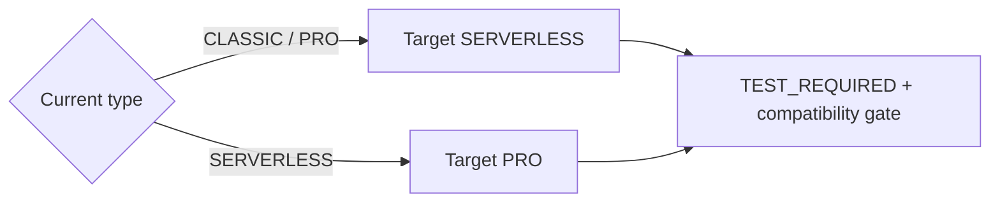

Both directions carry `A_B_COST_PERFORMANCE_VALIDATION_REQUIRED`. Missing observed workspace capability is retained as a blocker/HITL condition rather than removing the branch.

### 15.8 Dependency graph

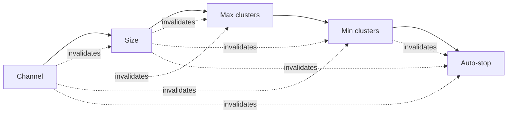

---

## 16. Candidate confidence model

Candidate confidence is deterministic evidence quality, **not probability that savings will materialize**.

Components:

```text
coverage = clamp(cost_history_days / 90, 0, 1)
sample = clamp(queries_30 / 500, 0, 1)
stability = clamp(1 - cost_cv_84 / 2, 0, 1)
epoch_maturity = clamp(epoch_age_days / 30, 0, 1)
signal = 1.0 for change, 0.7 for no-change/default
```

Weighted score:

```text
0.10
+ 0.25*coverage
+ 0.25*sample
+ 0.15*stability
+ 0.15*epoch_maturity
+ 0.10*signal
```

Then clamp to a status cap:

| Candidate state | Score cap |
|---|---:|
| `TEST_REQUIRED` | 0.78 |
| `ACTIONABLE` | 0.93 |
| other | 0.80 |

Levels:

```text
HIGH   >= 0.80
MEDIUM >= 0.60
LOW    < 0.60
```


---

## 17. Independent candidate estimator

Candidate economics are standalone counterfactuals and are explicitly non-additive.

### 17.1 General range convention

`Range3(low, base, high)` represents ordered annual cost or savings outcomes. Candidate status may have no available estimate.

### 17.2 No-change/guardrail candidates

- `NO_CHANGE` / `BLOCKED` use factor `1.0` where an economics object is needed.
- channel stability and max-cluster ceiling reduction receive **no direct savings**.

### 17.3 Auto-stop estimator

```text
theoretical_removed_cluster_minutes
  = saved_idle_minutes * current_min_clusters

raw_savings_fraction
  = min(theoretical_removed / current_cluster_minutes, 0.60)
```

Realization tracks use conservative/base/optimistic multipliers `0.50 / 0.75 / 1.00`.

### 17.4 Min-cluster estimator

```text
theoretical_removed_cluster_minutes
  = minutes_at_current_min * (current_min - target_min)

raw_fraction
  = min(theoretical_removed / current_cluster_minutes, 0.50)
```

Both terms use whole-epoch event totals, so the ratio covers one period. The same applies to the auto-stop estimator (17.3) with whole-epoch idle minutes.

The same `0.50 / 0.75 / 1.00` realization tracks are applied.

### 17.5 Size estimator

Size candidate cost factor is:

```text
capacity_ratio * runtime_elasticity
```

Capacity ratio source:

1. **Serverless:** published Serverless SQL DBU/hour size ratio.
2. **Pro/Classic:** same-workspace observed Pro/Classic DBU-per-cluster-hour ratio when both sizes exist.
3. **Fallback:** nominal deterministic size-capacity ratio.

Runtime multiplier ranges:

| Direction | optimistic | base | conservative |
|---|---:|---:|---:|
| downsize | 1.10 | 1.30 | 1.55 |
| upsize | 0.50 | 0.70 | 1.00 |

If a prior historical epoch exactly matches the target knob while all other active config fields match current config, the factor is blended 50/50 with normalized historical cost-per-1,000-query evidence, subject to configured factor clamps.

### 17.6 Max-cluster increase estimator

When increasing max clusters, cost uplift is bounded by the additional capacity that could have been used during observed time at the existing maximum. Direct savings are not expected; the range can represent a cost increase for performance.

### 17.7 Migration estimator

Migration uses a structural annualized resource-time range:

```text
low  = annualized uptime minutes
base = annualized cluster-minutes
high = annualized uptime * max_observed_clusters
```

Uptime and cluster-minutes are annualized from the daily resource series on the DBU forecast's window and 28/84-day blend (`max_observed_clusters` is the window peak excluding recycling transients). All tracks include the baseline forecast trend adjustment. Without the series the bounds are unavailable (`RECENT_RESOURCE_WINDOW_UNAVAILABLE`).

For target Serverless:

```text
DBU cost = annualized resource minutes / 60
           * published Serverless DBU/hour for size
           * target SQL DBU list price
AWS cost = 0
```

For target Pro/Classic:

```text
DBU cost = annualized resource minutes / 60
           * observed same-workspace Pro/Classic DBU/cluster-hour
           * target SQL DBU list price
AWS cost = annualized resource minutes / 60
           * regional modeled EC2 cluster hourly cost
```

Missing resource bounds, target DBU rate, list price, or AWS registry evidence makes migration economics unavailable rather than guessed.

---

## 18. Reviewer Gate 1 — candidate invariants

`Reviewer.review()` fails the run for a warehouse when any invariant is violated.

It validates:

- exactly one candidate for each of six active knobs,
- candidate workspace/warehouse identity,
- unique internal recommendation IDs,
- nonnegative actual/forward baseline cost,
- confidence score in `[0,1]`,
- change statuses must actually change config,
- blocked candidates must contain blockers,
- `NO_CHANGE` cannot claim savings,
- ordered cost and savings ranges,
- findings used for decisions belong to the current epoch,
- warehouse-size target belongs to known size order,
- min/max cluster target bounds,
- `min <= max` consistency against current config,
- nonnegative auto-stop,
- package currency consistency.


---

## 19. Scenario planner and execution states

### 19.1 Plan A

Plan A is the Phase-1 recommended scenario and processes candidates in this order:

```text
warehouse_channel
→ warehouse_size
→ max_clusters
→ min_clusters
→ auto_stop_minutes
```

Only statuses `ACTIONABLE`, `TEST_REQUIRED`, and `REVIEW` become plan steps.

### 19.2 Invalidation behavior

If an upstream step invalidates a downstream knob, the downstream step remains visible but receives:

```text
execution_state = PENDING_REEVALUATION
gate = RE_ANALYZE_AFTER_UPSTREAM_CANARY
```

**Pricing of pending steps (Contract 1.1.0).** The stateful bundle estimator prices a plan as two chains over the same
evolving cost/resource state:

- the **authoritative** chain applies only steps that are not `PENDING_REEVALUATION`. Their evidence has not been
  invalidated by an upstream change. A pending step's effect is *skipped*, so a later ready step is priced on the state
  without it. This chain defines scenario `savings_365d`/`estimated_cost_365d`, the package economics and the envelope;
- the **contingent** chain applies every step using pre-change evidence. It is published as `contingent_*` scenario
  economics and as per-step `projected_economics` with `pricing_basis = CONTINGENT_PENDING_REEVALUATION`, a big-picture
  upside that must be regenerated after the upstream step is applied and remeasured. It never feeds package economics.

If a chain cannot be priced (for example a migration with no target SQL price) its economics are null,
never zero. A pending step that cannot be priced does not affect the authoritative chain. Phase 1 has no apply API:
"re-validation on application" means the next publisher run after an upstream step is applied produces fresh
authoritative economics for the next knob.

### 19.3 Step state machine

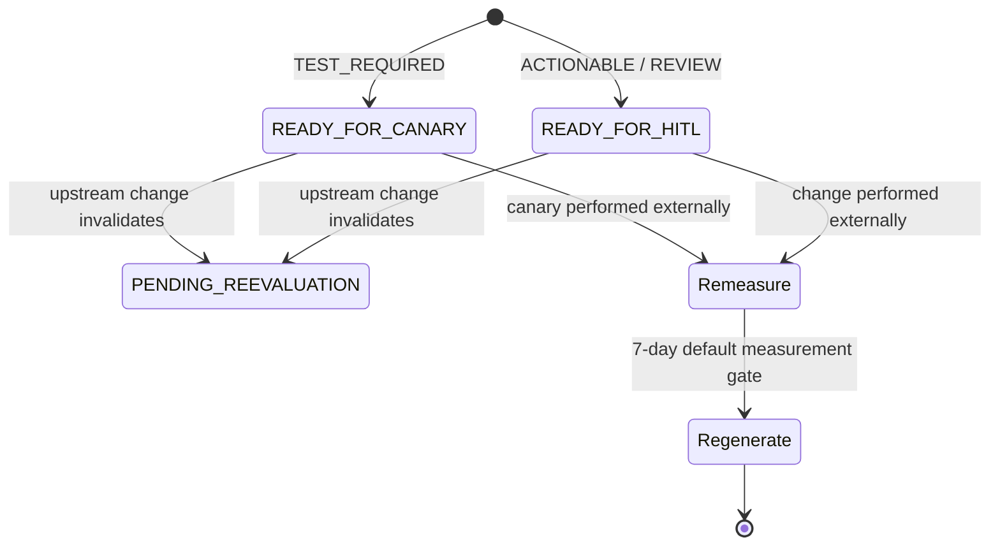

### 19.4 Plan B

Plan B contains at most one warehouse-type migration candidate. It is an alternative branch and cannot absorb current-type tuning candidates.

Compatibility checks may include:

- region/Serverless availability context,
- observed Serverless or Pro/Classic workspace capability,
- workspace enablement from optional read-only API,
- external legacy Hive metastore workspace configuration,
- S3 access-policy unknown/HITL status,
- legacy Hive metastore references observed in SQL history,
- regional AWS price registry for Pro/Classic target.

Phase 1 always keeps Plan B as `ALTERNATIVE`.

---

## 20. Stateful bundle estimator

The bundle estimator is the only component allowed to combine candidate effects into a scenario-level portfolio range.

### 20.1 Tracks

Three deterministic tracks are maintained:

```text
low-cost / optimistic
base
high-cost / conservative
```

Each track carries:

- DBU cost,
- AWS cost when available,
- remaining resource cluster-minutes.

### 20.2 Effect types

| Bundle effect | Behavior |
|---|---|
| `no_cost_change` | state unchanged |
| `multiplicative_cost_factor` | multiply evolving DBU/AWS cost; optionally resource runtime |
| `min_cluster_reduction` | remove realized cluster-minutes from remaining state |
| `idle_cluster_minute_reduction` | remove realized idle cluster-minutes from remaining state |
| `migration_cost_override` | replace evolving state with migration counterfactual |
| `requires_canary` | withhold portfolio economics and return `REQUIRES_CANARY` |

### 20.3 Double-count prevention


Min-cluster and auto-stop do not both claim the same original capacity minute.

### 20.4 Scenario estimate statuses

- `NO_CHANGE`
- `MODELED_RANGE`
- `PROVISIONAL_MODELED_RANGE`
- `PRE_CANARY_MODELED_RANGE`
- `REQUIRES_CANARY`
- `REQUIRES_COST_MODEL`

---

## 21. Reviewer Gate 2 — scenario invariants

`Reviewer.review_scenarios()` validates:

- recommended scenario ID exists,
- exactly one internal scenario is marked recommended,
- scenario and step confidence are within `[0,1]`,
- every plan step references a real candidate,
- no duplicate candidate in a scenario,
- step knob/current/recommended config exactly equal candidate contract,
- step confidence exactly equals candidate confidence,
- invalidated downstream steps are `PENDING_REEVALUATION`,
- a step's pricing basis matches its execution state (`PENDING_REEVALUATION` ⇔ contingent),
- authoritative scenario savings equal the last authoritative step's running savings, and contingent savings equal the last pending step's,
- every scenario range is ordered,
- Plan A contains no warehouse-type migration,
- Plan B contains no more than one step.

Only after reviewer gate 2 may the public contract adapter run.

---

## 22. Public Reporter JSON Contract v1.2.0

The public JSON package is the canonical output. One file equals one warehouse/current-epoch assessment.

### 22.1 Top-level hierarchy

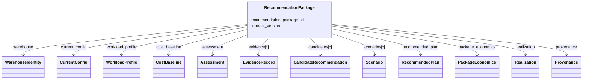

### 22.2 Stable top-level sections

```text
recommendation_package_id
contract_version
warehouse
current_config
workload_profile
cost_baseline
assessment
evidence
candidates
scenarios
recommended_plan
package_economics
realization
provenance
```

Stable keys are not omitted to represent missing information.

### 22.3 Null semantics

```text
null = unavailable / unknown / not measured
0    = known numeric zero
[]   = known empty collection
```

These meanings must survive JSON→workbook projection.

### 22.4 Public candidate identity

Internal `recommendation_id` is transitional. The public `candidate_id` is content-addressed from:

- contract version,
- workspace/warehouse,
- epoch ID,
- technique ID,
- knob,
- current value,
- recommended value,
- sorted evidence references,
- policy version,
- analyzer version,
- optimizer version,
- estimator version,
- reviewer version,
- decision-graph version.

### 22.5 Technique IDs

Current stable mappings include:

```text
WH-SIZE-DOWNSIZE-001
WH-SIZE-UPSIZE-001
WH-SIZE-RIGHTSIZE-001
WH-MAX-CLUSTER-REDUCE-001
WH-MAX-CLUSTER-INCREASE-001
WH-MAX-CLUSTER-ASSESS-001
WH-MIN-CLUSTER-REDUCE-001
WH-MIN-CLUSTER-INCREASE-001
WH-MIN-CLUSTER-ASSESS-001
WH-AUTOSTOP-REDUCE-001
WH-AUTOSTOP-ASSESS-001
WH-SERVERLESS-MIGRATE-001
WH-PRO-MIGRATE-001
WH-WAREHOUSE-TYPE-ASSESS-001
WH-CHANNEL-CURRENT-001
WH-CHANNEL-STABILITY-001
```

### 22.6 Deterministic content IDs

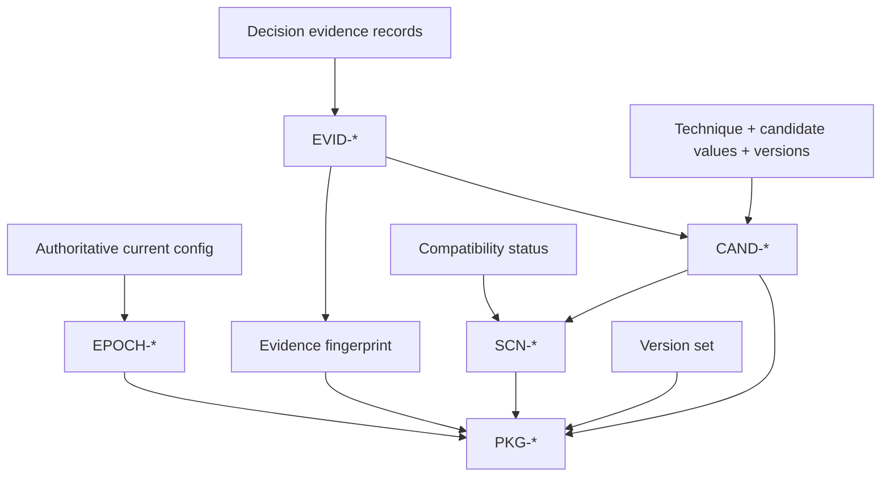

IDs use canonical JSON + SHA-256 and a fixed prefix with the configured leading digest length.

### 22.7 Package hash payload

`recommendation_package_id` includes:

- contract version,
- workspace ID,
- warehouse ID,
- current epoch ID,
- canonical current config,
- evidence fingerprint,
- policy/analyzer/optimizer/modeler/estimator/bundle/reviewer/decision-graph/technique-catalog versions,
- ordered candidate IDs,
- ordered scenario IDs.

It excludes volatile presentation metadata such as generation timestamp, output path, workbook formatting, or log filename.

---

## 23. Evidence registry

Evidence is declared once and referenced by candidates/scenarios.

An `EvidenceRecord` includes:

- deterministic `evidence_id`,
- metric,
- value,
- unit,
- source,
- source field,
- epoch scope,
- observation window,
- threshold,
- comparator,
- interpretation.

Interpretation prose is excluded from the evidence fingerprint; decision-relevant values and source semantics are included.

Shared cost evidence (`actual_dbu_cost_365d`, `forward_dbu_cost_365d`, `forward_aws_cost_365d`, `cost_history_days`) is declared once per package and referenced by every candidate. The package also carries `billing_correction_dbu_share_365d` (unit `ratio`, source `system.billing.usage`, source field `record_type`, window `trailing_365d`): retracted DBU per originally billed DBU. It is package evidence only: no candidate references it, so it does not enter candidate IDs, and no decision, confidence or economics reads it.

The package validator recomputes the evidence fingerprint before accepting the package.

---

## 24. Package economics

### 24.1 Economic layers

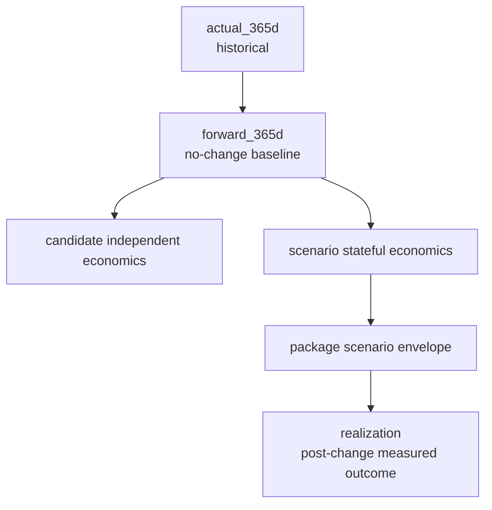

### 24.2 Package scenario envelope

Only economically assessable scenarios are included. Blocked/unavailable scenarios are explicitly excluded with reason codes.

Package savings semantics:

```text
low  = minimum LOW savings bound across included scenarios
base = BASE savings of the recommended scenario
high = maximum HIGH savings bound across included scenarios
```

Package future cost range is derived from the common forward total baseline:

```text
cost.low  = baseline - savings.high
cost.base = baseline - savings.base
cost.high = baseline - savings.low
```

Each envelope point stores its source `scenario_id` so DBU/AWS component details are never fabricated by mixing unrelated scenarios.

Negative savings are valid and mean **cost increase**. The JSON preserves the signed value. Workbook presentation converts the sign into explicit `SAVINGS` vs `COST_INCREASE` semantics.

---

## 25. Public semantic validation

Before a package is emitted it must pass:

1. dataclass field validation,
2. epoch ID recomputation,
3. evidence ID recomputation,
4. evidence fingerprint recomputation,
5. candidate ID recomputation,
6. scenario ID recomputation,
7. candidate/evidence/scenario reference integrity,
8. recommended-scenario uniqueness,
9. package-envelope derivation checks,
10. package currency consistency,
11. assessment count reconciliation,
12. realization reference validation,
13. package ID recomputation,
14. optional full package hash validation,
15. JSON Schema Draft 2020-12 validation.

Failure is fatal for publication of that run/package.

---

## 26. Realization contract

Phase 1 emits an initialized realization section even though the publisher does not yet ingest applied-change measurements.

Initial state:

```text
status = NOT_APPLIED
realization_records = []
measured_candidates = 0
successful_candidates = 0
rolled_back_candidates = 0
realized_savings_to_date = 0
annualized_realized_savings = 0
```

Future `REAL-*` records reference the immutable package/scenario/candidate identity and capture applied config, validation window, observed cost, realized savings, rollback, and learning codes.

Realization never changes the original `PKG-*` identity.

---

## 27. Workbook Contract v1.3.0

The workbook is generated from already-validated `RecommendationPackage` objects.

### 27.1 Sheet grains

| Sheet | Grain | Current synthetic example |
|---|---|---:|
| Executive Summary | portfolio aggregation | 1 summary surface |
| Warehouse Portfolio | one `recommendation_package_id` | 15 rows |
| Scenario Plans | one `scenario_id` | 30 rows |
| Recommendation Registry | one `candidate_id` | 90 rows |

### 27.2 Projection architecture

```mermaid
flowchart LR
    P[RecommendationPackage[]] --> PROJ[contracts/workbook_contract.py]
    PROJ --> E[Executive rows]
    PROJ --> W[Warehouse rows]
    PROJ --> S[Scenario rows]
    PROJ --> C[Candidate rows]
    E --> R[workbook_reporter.py]
    W --> R
    S --> R
    C --> R
    R --> X[workbook.xlsx]
```

### 27.3 Contract-owned columns

Exact ordered columns and column groups live in `contracts/workbook_contract.py`; the renderer must not maintain a separate column list.

Current detailed-sheet column counts:

- Warehouse Portfolio: **58**
- Scenario Plans: **42**
- Recommendation Registry: **53**

### 27.4 Presentation rules

- row 1: title,
- row 2: context/subtitle,
- row 3: grouped section bands,
- row 4: filterable field headers,
- frozen identity columns,
- explicit currency/percentage/confidence formats,
- no optimizer/business formulas in Excel,
- no hidden worksheets,
- no macros,
- long JSON/audit columns at the right edge,
- blanks normalized to explicit `—`, `UNKNOWN`, or `UNAVAILABLE`,
- signed negative savings displayed as positive magnitude with `COST_INCREASE` semantics,
- IDs rendered as text to prevent numeric truncation.

The workbook must not alter the underlying JSON economics.

---

## 28. Packaging and output directory

`package_locked_contract()` writes:

```text
<output-dir>/
├── packages/
│   ├── <workspace>__<warehouse>.json
│   └── ...
├── workbook.xlsx
├── evidence.json
├── manifest.json
└── publisher.log
```

`workbook.xlsx` is omitted only with `--no-workbook`.

### 28.1 Package filenames

Filenames are operational locators only. They are not content identities and are excluded from hashes.

### 28.2 Manifest

The manifest records publisher/contract versions, package count, package paths/IDs/hashes, and workbook path when generated. It also lists warehouses excluded by the supported-type gate (`excluded_warehouse_count`, `excluded_warehouses` with reason code `UNSUPPORTED_WAREHOUSE_TYPE`). It is not itself a Reporter JSON Contract package.

### 28.3 Replay evidence

`evidence.json` serializes normalized evidence for deterministic replay as a versioned envelope (`evidence_format_version` 1.0.0) validated against `schema/evidence.schema.json` on write and on load; any other version, or a bare list, is rejected (`docs/contracts/evidence-format.md`). Multi-file replay rejects conflicting modeled evidence, epochs, daily cost records, or billing features for the same workspace/warehouse identity.

---

## 29. Logging and sensitive-data handling

### 29.1 Log destination

`publisher.log` is always created under the chosen output directory.

### 29.2 Logged categories

- publisher/version start,
- auth/execution target metadata,
- compatibility mode/status,
- collector query labels and aggregate counts,
- pipeline batches/warehouse identities,
- package validation and IDs,
- final package/candidate/scenario counts.

### 29.3 Must not be logged/published

- OAuth access tokens,
- secrets,
- raw data-access configuration values,
- raw SQL statement text,
- unbounded query/event rows.

Statement text is used only through collector aggregates such as visibility percentage or legacy metastore-reference counts.

---

## 30. Failure behavior

The product follows fail-closed semantics for decisions and publication.

| Failure | Behavior |
|---|---|
| mixed billing currencies | reject aggregation |
| missing current epoch | reject warehouse evidence |
| conflicting replay evidence | terminate replay |
| invalid candidate invariant | no scenario/public package |
| invalid scenario invariant | no public package |
| missing AWS price region | DBU may remain assessable; AWS/total become unavailable as appropriate |
| missing migration cost source | migration economics unavailable; no fabricated value |
| optional compatibility API unavailable | explicit HITL fallback |
| unsupported future warehouse type | fail closed per warehouse before optimization; recorded in manifest exclusions |
| workbook generation failure | JSON packages remain canonical; run surfaces reporting error |

---

## 31. Scale and memory behavior

### 31.1 Source-side reduction

All expensive query/event/billing aggregation executes in Databricks SQL. Python receives per-warehouse/per-epoch aggregates.

### 31.2 Downstream batching

`build_report()` processes warehouses in configurable batches, default `100`. Batching controls local decision/report work; it does not change source query semantics.

### 31.3 Multi-region merge

Replay/multi-region normalized evidence merges on:

```text
(workspace_id, warehouse_id)
```

The merge requires equivalent modeled values for duplicate identities and unions compatible epochs/daily cost/features. Conflicting evidence fails closed.

---

## 32. Test design and seams

### 32.1 Test layers

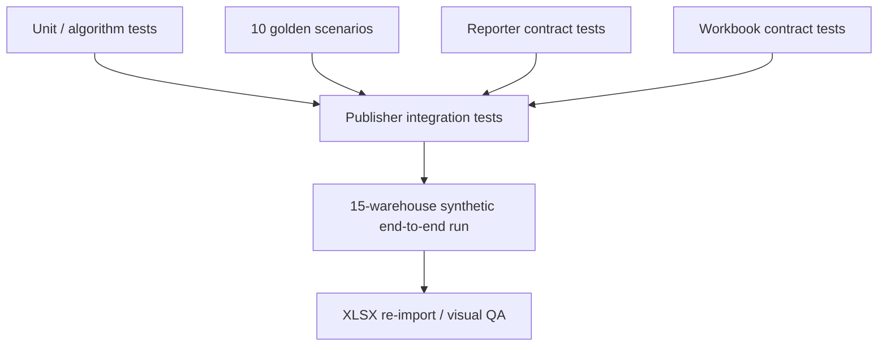

### 32.2 Current regression baseline

Publisher v2.10.0 is validated by the full regression suite; reproduce the results with the commands in `CLAUDE.md`.

### 32.3 Golden scenarios

The golden suite includes:

- idle-expensive warehouse,
- spill-constrained,
- concurrency-constrained,
- cold-start-sensitive,
- Serverless,
- Photon-disabled,
- newly changed config,
- sparse evidence,
- Serverless→Pro costed migration,
- missing AWS-region price evidence.

### 32.4 Required contract assertions

Tests verify:

- one candidate per active knob,
- deterministic IDs and hashes,
- public JSON schema/semantic validation,
- scenario confidence propagation,
- scenario dependency/invalidation behavior,
- package economics envelope,
- exact workbook column set/order,
- sheet grains,
- no blank semantic workbook cells,
- no negative numeric presentation values,
- no Excel business formulas,
- output generation from 15 synthetic warehouses.

---

## 33. Maintainability rules

1. **All decision thresholds live in `Thresholds`.** Do not introduce hidden constants inside optimizer methods.
2. **Analyzer observes; optimizer decides; estimator prices.** Do not collapse those responsibilities.
3. **Candidate estimates remain independent.** Do not sum them outside `StatefulBundleEstimator`.
4. **Public contract dataclasses are frozen and versioned.** Breaking field semantics require a new contract version.
5. **Workbook columns are contract-owned.** Renderer code cannot invent/drop columns.
6. **New warehouse types fail closed.** A new type requires explicit analyzer/optimizer/estimator/golden support.
7. **New techniques require stable `technique_id`.** IDs must be cataloged before publication.
8. **Decision-affecting code changes require version changes and golden-test updates.**
9. **Read-only APIs remain compatibility evidence only.** Authoritative config continues to come from system tables.
10. **No probabilistic/LLM output may override deterministic decisions.** Explanation may vary separately from the locked package.

---

## 34. Remaining implementation boundary

### 34.1 Realization ingestion is not implemented

The public contract supports realization, but Phase 1 initializes `realization.status = NOT_APPLIED`. A future release must define authoritative post-change measurement sources, attribution windows, rollback semantics, and validation rules before measured realization becomes writable.

### 34.2 Compatibility API remains optional evidence

The read-only workspace compatibility API is intentionally non-authoritative and has a deterministic fallback. Any future dependency on it for a hard optimization decision requires a separately approved source contract.

### 34.3 Threshold calibration

Current thresholds are conservative policy defaults. Live testing should calibrate them only through versioned policy changes backed by golden/regression evidence.

---

## 35. Technical acceptance criteria

The LLD is satisfied by an implementation when all of the following hold:

1. Only supported warehouse types can enter active optimization logic.
2. Exactly six candidate decisions are produced for every supported warehouse package.
3. All active recommendation evidence is current-epoch scoped.
4. Analyzer, optimizer, candidate estimator, bundle estimator, and reviewer responsibilities remain separated.
5. Candidate savings cannot be added to form scenario or package savings.
6. Plan A dependency/invalidation order is deterministic.
7. Plan B remains an isolated migration experiment under Phase-1 policy.
8. Candidate, scenario, evidence, epoch, realization, and package IDs are reproducible from documented hash inputs.
9. Every emitted JSON package passes dataclass semantic validation and JSON Schema v1.2.0.
10. Package economics are traceable to included scenario bounds.
11. Unknown costs are null/unavailable, never silently converted to zero.
12. Workbook generation is a pure projection of validated packages.
13. Workbook sheet/column contracts are controlled from `workbook_contract.py` and regression-tested.
14. Live, replay, and synthetic execution paths converge on the same deterministic decision pipeline.
15. Logs and output artifacts do not contain access tokens or raw SQL text.
16. Golden scenarios and full regression suite remain green after any decision-affecting change.

---

## 36. Document relationships

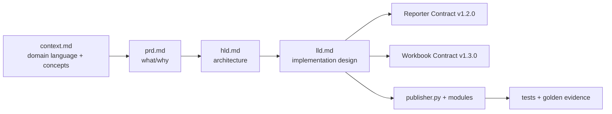

The locked Reporter and Workbook contract documents remain normative for their field-level semantics. This LLD defines how publisher v2.10.0 produces and consumes those contracts.
