# Low-Level Design — Databricks SQL Warehouse Optimizer

**Document:** `docs/architecture/lld.md`  
**Product:** Databricks SQL Warehouse Optimizer  
**Reporter JSON Contract:** v1.3.0  
**Workbook Contract:** v1.4.0  

Role: implementation design of the current publisher.

---

## 1. Purpose

This document defines the implementation-level design of the Databricks SQL Warehouse Optimizer. It translates the PRD and HLD into concrete modules, classes, data contracts, SQL projections, algorithms, thresholds, deterministic identities, reviewer invariants, scenario state transitions, economics, publication behavior, CLI/runtime behavior, and test seams.

The LLD describes the **actual implementation** unless a section is explicitly marked as an implementation-alignment requirement. It does not redesign the product while documenting it.

The implementation has one central invariant:

> **One supported warehouse + one authoritative current configuration epoch + one normalized evidence set + one version set must deterministically yield one immutable `RecommendationPackage` and one presentation-only workbook projection.**

---

## 2. Design baseline and implementation alignment

### 2.1 Locked external contracts

The following contracts are versioned independently of the publisher:

| Contract | Version | Source of truth |
|---|---:|---|
| Reporter JSON Contract | 1.3.0 | `contracts/reporter_contract.py`, `schema/recommendation-package.schema.json`, `docs/contracts/reporter-json-contract.md` |
| Workbook Contract | 1.4.0 | `contracts/workbook_contract.py`, `docs/contracts/workbook-contract.md` |

### 2.2 Implementation conformance

The publisher implements the design directly:

1. the fail-closed Supported-Type Gate permits only `CLASSIC`, `PRO`, and standard `SERVERLESS`;
2. reviewer-gated candidates/scenarios flow through a minimal `WarehouseOptimization` orchestration result and then directly into `RecommendationPackage`; no transitional internal run-report serialization contract remains;
3. Workbook Contract v1.4.0 is a numeric-first presentation projection of the public packages.

Realization ingestion remains future scope; packages are initialized as `NOT_APPLIED` until a separately approved measured-outcome source contract exists.

---

## 3. Repository and module structure

The repository is organized in layers: `publisher.py` (the domain engine and CLI), `contracts/` (the public Reporter and Workbook contracts and their schema/example tooling), `reporters/` (workbook rendering), `schema/` (the committed JSON Schemas), `pricing/` (the versioned AWS price registry), `tools/` (validators and fixture helpers), `examples/` (contract example builder), `tests/` (unit, golden and contract tests) and `docs/`. The repository itself is the file inventory; the document map is [`docs/README.md`](../README.md).

### 3.1 Module responsibilities

| Module | Responsibility | May make optimization decisions? |
|---|---|---:|
| `publisher.py` | collection, normalization, model/analyze/optimize/estimate/review/scenario orchestration, public package adaptation, CLI | Yes, deterministic only |
| `contracts/reporter_contract.py` | immutable public dataclasses, enums, hash construction, semantic validation | No |
| `contracts/reporter_schema.py` | JSON Schema generation/support | No |
| `contracts/workbook_contract.py` | pure JSON-package-to-workbook row projection | No |
| `reporters/workbook_reporter.py` | Excel rendering, number formats, widths, filters, frozen panes, conditional formatting | No |
| `pricing/aws_ec2_on_demand.json` | versioned regional EC2 price reference | No |
| `schema/*.schema.json` | committed Draft 2020-12 schemas for the package and for replay evidence | No |
| `tools/validate_workbook.py` | independent workbook validator (sheets, columns, grains, numeric economics) | No |

### 3.2 Layer dependency rule

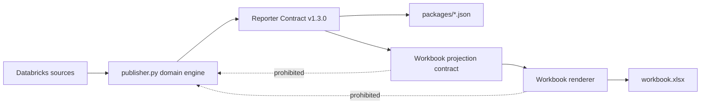

The workbook layer cannot call optimizer/estimator logic. It may only project already-validated public packages.

---

## 4. Runtime constants and version boundaries

The publisher declares independent version identifiers for deterministic replay. Values: `publisher.py` (`PUBLISHER_VERSION` and the other `*_VERSION` constants).

| Constant | Purpose |
|---|---|
| `PUBLISHER_VERSION` | implementation release |
| `CONTRACT_VERSION` | public Reporter contract version (from `contracts/reporter_contract.py`) |
| `POLICY_VERSION` | threshold/policy semantics |
| `ANALYZER_VERSION` | analyzer semantics |
| `OPTIMIZER_VERSION` | decision semantics |
| `MODEL_VERSION` | forward forecast |
| `ESTIMATOR_VERSION` | candidate economics |
| `BUNDLE_MODEL_VERSION` | scenario economics |
| `REVIEWER_VERSION` | invariant policy |
| `DECISION_VERSION` | dependency/order semantics |
| `TECHNIQUE_CATALOG_VERSION` | stable technique mapping |
| `EVIDENCE_FORMAT_VERSION` | replay evidence file format (`docs/contracts/evidence-format.md`) |

Changing a decision-affecting implementation without changing the corresponding version is prohibited.

---

## 5. Execution modes and CLI

### 5.1 Modes

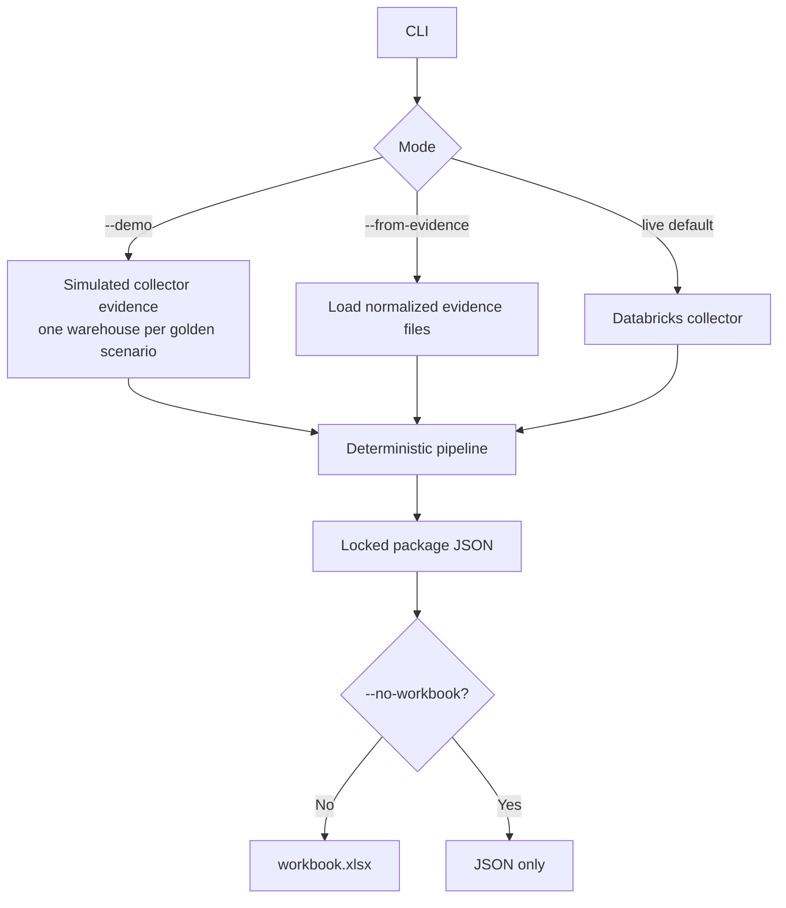

### 5.2 Key CLI arguments

This table is the CLI reference. Defaults read from the environment are noted; every option has a default or is optional unless stated.

| Argument | Semantics |
|---|---|
| `--output-dir` | output root; default `./warehouse_optimizer_out` |
| `--demo` | synthetic collector mode; takes precedence over `--from-evidence` and live collection |
| `--demo-count` | number of simulated warehouses for `--demo`: from 1 to the size of the simulated fleet (one warehouse per golden scenario); the first N are run; default is the whole fleet; a value outside the range exits with an error |
| `--from-evidence` | repeatable; replay one or more `evidence.json` files, merged on `(workspace_id, warehouse_id)` (28.3, 31.3) |
| `--profile` | Databricks CLI profile; default `DATABRICKS_CONFIG_PROFILE`, else `DEFAULT`. OAuth profiles only: a profile that holds a static PAT is rejected |
| `--config-file` | path of the Databricks CLI config file that holds the profile; default `DATABRICKS_CONFIG_FILE`, else `~/.databrickscfg`. It is read to resolve the profile host and to reject a PAT profile, and is passed to `databricks auth token` as `DATABRICKS_CONFIG_FILE` |
| `--serverless-warehouse-id` | SQL execution target convenience flag (default `DATABRICKS_SERVERLESS_WAREHOUSE_ID`) |
| `--sql-warehouse-id` | SQL execution target convenience flag (default `DATABRICKS_SQL_WAREHOUSE_ID`) |
| `--all-purpose-cluster-id` | all-purpose SQL Connector target (default `DATABRICKS_ALL_PURPOSE_CLUSTER_ID`) |
| `--execution-kind` / `--execution-id` | generic execution target pair; `--execution-kind` is `warehouse` or `cluster` and is required with `--execution-id` |
| `--workspace-id` | required for the cluster HTTP path when it cannot be discovered; default `DATABRICKS_WORKSPACE_ID` |
| `--source-region` | AWS region of the workspace, used for source collection and the AWS model; default `DATABRICKS_REGION`, else `unknown` |
| `--allow-missing-aws-price` | live mode only; by default, when any supported Pro/Classic warehouse exists and `--source-region` is not a region in the AWS price registry, the run stops after collection, before any package, evidence or workbook is written (the log is already open). With this flag it publishes and Pro/Classic AWS cost is unavailable (null), with a logged warning. Serverless-only fleets and `--from-evidence` replays are not affected |
| `--aws-price-registry` | versioned EC2 registry path; default `AWS_PRICE_REGISTRY`, else the shipped `pricing/aws_ec2_on_demand.json` |
| `--batch-size` | downstream Python batch size (31.2); collector remains set-based; default `WAREHOUSE_BATCH_SIZE`, else 100 |
| `--billing-ingested-through` | `YYYY-MM-DD`; pins every billing query to records ingested on or before that date, so a re-collection reproduces an earlier run despite later billing corrections |
| `--compatibility-api-mode` | `auto` or `off`; default `COMPATIBILITY_API_MODE`, else `auto` (8.3) |
| `--log-level` | `DEBUG`, `INFO`, `WARNING` or `ERROR`; default `PUBLISHER_LOG_LEVEL`, else `INFO`. Sets the verbosity of the logger that writes to stderr and `publisher.log` (29); it never changes what is excluded from the log |
| `--no-workbook` | suppress workbook while preserving canonical JSON |
| `--print-json` | print exactly one package to stdout; a run that produces more or fewer than one package exits with an error |

### 5.3 Execution target resolution

A live run must resolve exactly one SQL execution target: one of the three convenience flags, or `--execution-kind` with `--execution-id`. Combining the pair with a convenience flag, supplying more than one convenience flag, or supplying none exits with an error. SQL warehouses use `/sql/1.0/warehouses/<id>`. All-purpose compute uses the SQL Connector cluster path after read-only validation that the supplied cluster is not jobs compute.

The execution target is only where collector SQL runs; it is not the warehouse being optimized.

---

## 6. Detailed end-to-end sequence

```mermaid
sequenceDiagram
    autonumber
    participant CLI as CLI
    participant AUTH as OAuth/Auth
    participant SQL as Databricks SQL
    participant COL as Collector
    participant MOD as Modeler
    participant ANA as Analyzer
    participant OPT as Optimizer
    participant EST as Estimator
    participant R1 as Reviewer Gate 1
    participant PLN as Scenario Planner
    participant BND as Bundle Estimator
    participant R2 as Reviewer Gate 2
    participant ADP as Public Contract Adapter
    participant VAL as Contract Validator
    participant WB as Workbook Projection
    participant OUT as Output Directory

    CLI->>AUTH: resolve execution target + U2M token
    AUTH->>SQL: SQL Connector session (UTC-pinned, verified)
    SQL->>COL: set-based system table aggregates
    COL->>MOD: daily DBU cost + current epoch
    MOD-->>COL: forward baseline forecast
    COL->>ANA: WarehouseEvidence
    ANA-->>OPT: AnalysisResult[6]
    OPT-->>EST: OptimizationDecision[6]
    EST-->>R1: CandidateRecommendation[6]
    R1-->>PLN: reviewed candidates
    PLN->>BND: ordered Plan A / Plan B steps
    BND-->>PLN: stateful scenario economics
    PLN-->>R2: scenarios
    R2-->>ADP: reviewed internal report
    ADP->>VAL: RecommendationPackage
    VAL->>VAL: semantic/hash/schema checks
    VAL-->>OUT: packages/*.json
    VAL->>WB: validated packages
    WB-->>OUT: workbook.xlsx
    COL-->>OUT: evidence.json
    VAL-->>OUT: manifest.json
    CLI-->>OUT: publisher.log
```

Reviewer Gate 2 hands the reviewed candidates and scenarios (`WarehouseOptimization`) to the public contract adapter; no internal run report exists. The adapter is `build_recommendation_packages()`, which evaluates the supported warehouses and assembles each frozen package.

---

## 7. Source contracts and collector SQL

### 7.1 Authoritative source matrix

| Source | Grain used by publisher | Decision role |
|---|---|---|
| `system.compute.warehouses` | warehouse configuration snapshots | authoritative configuration + epoch boundaries |
| `system.compute.warehouse_events` | warehouse event stream aggregated to epoch | resource minutes, scale-state, starts |
| `system.query.history` | query history aggregated to epoch/30d | queue, spill, latency, source, cache, tags, running idle gaps, concurrency, spill sources |
| `system.billing.usage` | daily/epoch usage | DBU cost, Photon observation, owner, serverless evidence |
| `system.billing.list_prices` | active SQL DBU price rows | list-cost and migration pricing |
| versioned AWS registry | region + instance family | Pro/Classic customer EC2 model |
| read-only workspace SQL config API | current connected workspace only | compatibility evidence only |

Configuration values from read-only APIs **must never override** `system.compute.warehouses`. Field-level source mapping: [`docs/reference/source-mapping.md`](../reference/source-mapping.md).

### 7.2 Collector projections

#### `CONFIG_EPOCHS_SQL`

Produces one row per configuration epoch for active warehouses, with:

- account/workspace/warehouse identity,
- warehouse name,
- type/channel/size/min/max/auto-stop (name and tags from the epoch's latest snapshot),
- `epoch_start` = `change_time` of the first snapshot of the epoch,
- `epoch_end` = the next epoch's `epoch_start`,
- `is_current = epoch_end IS NULL`.

The query retains epochs overlapping the last 365 days plus the current epoch.

Epochs are islands of the decision fields (10.1). A shared CTE (`CONFIG_EPOCHS_CTE`) compares each snapshot with the previous one. The same CTE groups the query-metric, warehouse-event, idle-gap, daily-cost and billing-attribution queries by epoch, so all of them share one set of epoch boundaries.

All collector SQL runs in a session pinned to UTC (`TIMEZONE=UTC`), so `DATE()`, `CURRENT_DATE()` and `CURRENT_TIMESTAMP()` align with UTC billing `usage_date`. The collector reads `current_timezone()` immediately after connecting and exits with an error if the session is not UTC.

#### `EPOCH_QUERY_METRICS_SQL`

Aggregates query history into each warehouse epoch. Important 30-day/current-epoch metrics include:

- query count and active days,
- p95 total/wait/compute/capacity/execution durations,
- p99 and max execution duration,
- queued-query percentage,
- spill frequency, spilled-query count, p95 spill bytes, total spill GiB,
- read bytes and the IO-cache percentage (the share of bytes read, weighted by read bytes; evidence only),
- failed/cancelled percentage,
- result-cache percentage,
- query-tag coverage,
- Databricks source counts for dashboard/job/notebook/Genie/alert/SQL query,
- external/client application counts for Power BI/Tableau/Looker/Databricks SQL Editor,
- statement-text visibility (a statement counts as visible only when its text is non-null, not blank and not `<REDACTED>`) and the legacy Hive metastore reference count (null, not 0, when no statement text is visible; the compatibility check that reads it is then `UNKNOWN`),
- epoch-level p95 execution, queue and spill percentages,
- epoch-level total task duration (`epoch_task_duration_ms`), the numerator of the task-time utilization evidence (`docs/reference/source-mapping.md`),
- queries per complete UTC week (`queries_week_1` to `queries_week_8`; week 1 is the seven days before the analysis day), null for a week not wholly inside the current epoch, which feed the growth guard (15.3),
- the decision population count (`decision_queries_30`) and p95 compilation and result-fetch time (evidence only).

Latency (p95/p99/max execution) and spill (share, count, p95 bytes) are measured on the decision population: queries not served from the result cache, because cache hits take about 0 ms and would loosen the latency gates; failed and cancelled queries stay in, since a statement timeout is latency. `decision_queries_30` counts that population and is the sample size the size gates use; when it is missing the size change is held with `DECISION_QUERY_EVIDENCE_UNAVAILABLE`. Queue and failure shares, and the other metrics, still use all queries.

Raw query rows are not loaded into the optimizer.

#### `EPOCH_EVENT_METRICS_SQL`

Reconstructs event segments (the `LEAD` window orders by `event_time`, `event_type`, `cluster_count`, so events with equal timestamps segment deterministically) and aggregates:

- uptime minutes,
- cluster-minutes,
- minutes/time at configured minimum,
- minutes/time at configured maximum,
- maximum observed clusters,
- the first retained event (`event_coverage_start`),
- 30-day starts,
- scale-up count,
- scale-down count.

`system.compute.warehouse_events` keeps 365 days, so running time is known only after a warehouse's first retained event. A warehouse running since before that event (for example an always-on warehouse that was never restarted) has no row until its next event; its event totals and capacity facts are unavailable rather than idle (`docs/reference/known-limitations.md`).

#### `RESOURCE_DAILY_SQL`

Reads a daily resource series for the current epoch over the last `RESOURCE_DAILY_COLLECT_DAYS` UTC days (a hard-coded constant that covers the long forecast window plus billing lag): uptime minutes, cluster-minutes, minutes at the configured minimum and maximum, recycle minutes, the peak cluster count excluding recycling transients above `max_clusters`, and starts. Event segments are split at UTC midnight so every minute lands on its own UTC day; zero-length segments are dropped. The Python side trims the series to the billing basis (11.1) and to the collected range (`events.resource_daily_from`): days before it are unknown, so the window shrinks instead of counting them as idle. When the warehouse was billed on days before its first retained event (the series begins after both the collected range and the epoch start), the collector sets `events.resource_coverage_from` and the window starts on that first fully covered day; unbilled lead-in days (not yet created, dormant) stay known zeros. Evidence collected before the marker existed has no `resource_coverage_from` and its window is unavailable. A warehouse billed in the collected range with no series row at all gets no series: `resource_daily` is null and `events.resource_daily_status` is `UNAVAILABLE_BILLED_WITHOUT_RETAINED_EVENTS`, so the recent-window facts and resource-time costs are unavailable. When the last `pressure_window_days` have no running time, the capacity facts are undefined and min/max changes are held with `NO_RECENT_RUNNING_TIME`.

#### Idle-gap SQL

`build_epoch_gap_metrics_sql()` returns, per epoch, the busy minutes (wall-clock minutes with at least one query running: the length of the union of the query intervals) and the inter-query gap count with its median and 90th percentile. The running maximum of prior query end times orders by `start_time`, `end_time`, `statement_id`, so queries with equal start times produce deterministic gaps. A `retained` CTE (the warehouse's first `warehouse_events` event in the last 365 days) restricts the sample to queries after that event, so it covers the same period as the event totals it is divided by. The gap columns are null (`gap_count` 0) when an epoch has no gaps. The busy minutes feed the size estimate; the auto-stop decision does not read the gap count.

#### Running-idle SQL

Auto-stop is priced on idle time the warehouse actually ran. `build_running_idle_sql()` and `build_running_idle_targets_sql()` build, for the current epoch only, the idle gaps (the latest busy end before a query to that query's start, plus the trailing gap after the last query up to now, or from the window start when there is no query) and intersect them with the `RUNNING` segments of `system.compute.warehouse_events`. The period is the same as the event totals (from the later of the epoch start and the warehouse's first event retained in 365 days, to now), at millisecond precision. Two queries share one set of CTEs:

- one row per warehouse: the window, the query count, the running segment count, the observed running cluster-minutes, and the kept-alive minutes and gap count (running time past the current auto-stop with no query running: open sessions, result fetching or keep-alive);
- one row per auto-stop value (every `auto_stop_step_minutes` step from the lower floor to `auto_stop_max_minutes`) that has a non-zero field: the removable running wall and cluster minutes, the additional starts a lower value causes, the starts a higher value avoids, and the idle wall minutes a higher value adds.

The normalizer stores them as `gaps.running_idle_*` keys and the sparse `gaps.running_idle_by_target` map keyed by minutes; a value without a row is a known zero, while missing keys mean the evidence was not collected (auto-stop then fails closed, 15.6). `running_idle_metrics()` is the Python reference of the same arithmetic and is what the tests pin. A value covers a gap only when it is `auto_stop_bridge_margin_pct` longer than the gap, and a gap counts as running throughout when the warehouse ran at least `running_idle_full_window_fraction` of it.

#### Concurrency SQL

`build_concurrency_sql()` measures per UTC minute the time-weighted number of running plus queued queries (a query occupies `[start_time, end_time)`, millisecond precision); the level of a minute is that number rounded up. It writes histograms (level to number of minutes) per epoch for the last 365 days under `query.concurrency_histogram`: `EPOCH` (busy minutes) for every epoch, and for the current epoch also `RECENT` (the last 30 days) and `BUSY_START` (for each busy period that starts after at least the scale-up lag of idle minutes, its highest level in its first lag minutes, so the weight is the number of periods). The lag is `scale_up_lag_minutes_pro_classic` or `scale_up_lag_minutes_serverless`. A missing histogram means it was not collected and every rule that needs it fails closed. `concurrency_histograms()` is the Python reference.

#### Spill-source SQL

`build_spill_source_sql()` sums, for the current epoch over the last 30 days, the spilled bytes of non-result-cache queries per statement source (saved query ID, dashboard ID, legacy dashboard ID, job ID, notebook ID, otherwise a hash of the statement text; a redacted or null text counts by its statement ID and is never merged) and returns `query.spill_sources_30` (the number of sources that spilled) and `query.top_spill_source_share_pct_30` (the share of spilled bytes carried by the top `spill_concentration_top_sources`). The statement text is hashed in the query and never exported.

#### `EPOCH_DAILY_COST_SQL`

Left-joins billing usage to the list price effective at each usage record's end time to produce daily SQL warehouse DBU list cost by warehouse/epoch/currency. Each usage record (`record_id`) takes one price row, the latest `price_start_time` when price rows overlap, so it is counted once. Usage with no matching price row (for example a promotional or not-yet-listed SKU) is kept and reported as `unpriced_dbu_quantity` instead of being dropped; its cost is unknown, not zero. Each daily row also carries the retracted and restated DBU quantities (`retracted_dbu_quantity`, `restated_dbu_quantity`; `docs/reference/source-mapping.md`); every record type stays in the signed cost sums.

#### `BILLING_WATERMARK_SQL`

Returns, per workspace, `MAX(usage_end_time)` (the billing watermark) and `MAX(ingestion_date)` (billing ingested-through) over recent SQL-product usage. Billing completeness is judged per workspace, so one workspace's lagging ingestion is not hidden by another's. A workspace whose warehouses stopped running also stops producing usage, so its watermark stalls although billing is complete: when the warehouse's daily resource series shows no running time after the workspace watermark (on its own day, only running that provably follows the watermark time counts) through the last day that should already be billed (settled, passed by the account watermark, and before any ingestion cut-off), the account-wide watermark applies (`billing_watermark_source = ACCOUNT_IDLE_WAREHOUSE`); when it did run, the gap is ingestion lag and the workspace watermark stands (`WORKSPACE_LAGGING`). With `--billing-ingested-through`, every billing query (watermark, daily cost, features, attribution) only reads records ingested on or before that date. The settle buffer is then measured from that date's 00:00 UTC (or the analysis time, if earlier), so a later re-collection reproduces the original run's basis end.

#### `EPOCH_BILLING_ATTRIBUTION_SQL`

Produces current/historical epoch attribution evidence:

- signed Photon-true DBUs,
- signed Photon-false DBUs,
- signed Photon-null DBUs,
- latest usage timestamp,
- latest owner,
- observed owners (a blank or redacted owner is dropped in the SQL before the latest owner is picked and again in the normalizer, so it is unknown rather than an owner),
- observed billed node types (`usage_metadata.node_type`, non-Serverless warehouses) and SQL tiers (`product_features.sql_tier`).

#### `SQL_SKU_PRICE_SQL`

Loads currently effective SQL DBU list-price rows and classifies them for Pro/Classic/Serverless target pricing.

### 7.3 Collector cardinality

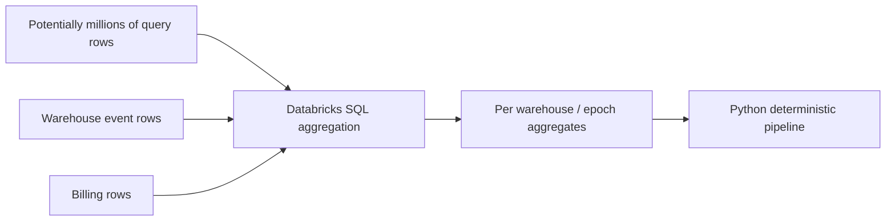

The local process scales with warehouses/epochs rather than raw query-history cardinality.

---

## 8. Authentication and optional REST compatibility evidence

### 8.1 Authentication

The publisher resolves a Databricks CLI OAuth profile and obtains a short-lived user-to-machine access token. Tokens are held in memory and are not serialized into package/evidence/workbook outputs.

### 8.2 REST usage boundary

Read-only REST is permitted for:

- all-purpose execution-target validation,
- workspace ID discovery needed for a cluster SQL Connector path,
- optional workspace SQL compatibility evidence.

The current compatibility path is `GET /api/2.0/sql/config/warehouses`. Only safe metadata is retained. Data-access configuration **values** are not retained; only matching key names used to detect external legacy Hive metastore configuration are preserved.

### 8.3 Compatibility mode

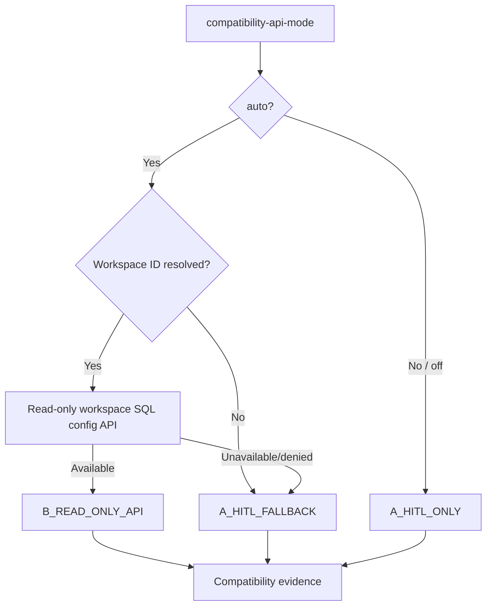

Unknown compatibility evidence is represented as `UNKNOWN` / HITL-required, not guessed.

---

## 9. Normalized internal domain contracts

Internal dataclasses are implementation contracts, not public API contracts.

| Contract | Role | Key invariants |
|---|---|---|
| `Thresholds` | centralized deterministic policy | immutable defaults; no hidden per-function constants |
| `WarehouseConfig` | authoritative config snapshot | type/channel/size/min/max/auto-stop |
| `PhotonObservation` | billing-derived observed Photon state | not authoritative config; ENABLED/DISABLED/MIXED/UNKNOWN |
| `QuerySourceProfile` | current-epoch workload source mix | multi-label |
| `WarehouseAttribution` | owner + source attribution | owner may be unavailable |
| `EpochEvidence` | one config regime | immutable epoch identity; current/historical flag |
| `WarehouseEvidence` | one warehouse normalized evidence set | exactly one current epoch |
| `Finding` | atomic explainability fact | metric + source + field + epoch + threshold |
| `AnalysisResult` | analyzer output per knob | facts/findings only |
| `OptimizationDecision` | optimizer output before pricing | current/recommended config, status, dependencies, blockers |
| `Range3` | low/base/high range | ordered where reviewed |
| `CandidateRecommendation` | independent reviewed counterfactual | one per active knob |
| `PlanStep` | scenario execution step | exact candidate propagation |
| `PortfolioEstimate` | scenario stateful economics | DBU/AWS/total ranges |
| `Scenario` | Plan A or Plan B branch | independent mutually exclusive path |
| `WarehouseOptimization` | minimal reviewer-gated orchestration result | candidate/scenario state only; not serialized |

### 9.1 Contract flow

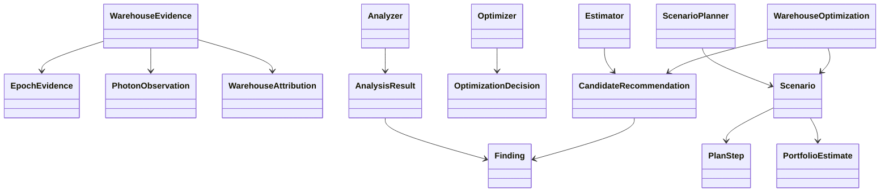

---

## 10. Configuration epochs

### 10.1 Epoch construction

An epoch is a run of consecutive `system.compute.warehouses` snapshots with identical decision fields (type, channel, size, min/max clusters, auto-stop). It starts at the `change_time` of the first such snapshot and ends where the next epoch starts; snapshots that change only the name or tags are folded into it. A rename or tag edit therefore does not start a new epoch or reset epoch maturity, cost history or the forecast basis. The table has no unique snapshot key, so snapshots sharing a `change_time` are first collapsed to one row chosen deterministically (a deleted snapshot wins; otherwise the lowest decision fields, then name); every later window orders by `change_time` alone, which is then unique.

Public epoch identity includes:

- contract version,
- workspace ID,
- warehouse ID,
- epoch start,
- warehouse type,
- warehouse size,
- min clusters,
- max clusters,
- auto-stop minutes,
- warehouse channel.

Photon is deliberately excluded from epoch identity because it is observed from billing feature attribution rather than treated as an authoritative `system.compute.warehouses` field.

### 10.2 Current-epoch rule

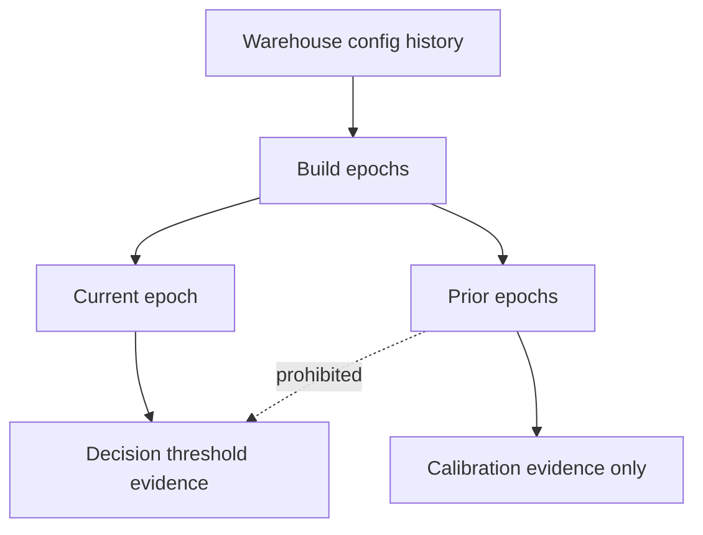

Only current-epoch findings may satisfy active optimizer decisions. Reviewer gate 1 rejects decision findings from historical epochs except explicitly non-decision historical coverage evidence.

Older epochs have one decision use: they can hold a capacity cut. A size reduction, a lower max clusters or a lower min clusters is held (`OLDER_EPOCH_PEAK_DEMAND_HIGHER`) when any older epoch of the same warehouse within the last 365 days peaked at more clusters of demand than the current recent window (15). Both peaks are read at the same rate: the older epoch's is the per-minute concurrency level reached in at least `peak_demand_min_minutes` busy minutes of its `query.concurrency_histogram.EPOCH`; the recent window's is the level reached in `peak_demand_min_minutes` × (recent days) / (older epoch days) of its `RECENT` busy minutes (at least one; recent days = 30, or the current epoch's age when younger), so the same spike rate compares equal over windows of different length. An older epoch with fewer busy minutes than the threshold has no peak and holds nothing; a recent window too quiet to reach its threshold counts at its highest level (0 with no busy minute), so a quiet present never hides a busier past. Older concurrency depends on that epoch's configuration (a smaller size shows more concurrency), so it is used only to hold, never to choose a change, its target or its economics. After a heavy team leaves, the hold lasts until the older epoch ages past 365 days; the blocker stays visible for a human override.

### 10.3 Supported-Type Gate

Immediately after normalization and before analyzer invocation:

```python
SUPPORTED_WAREHOUSE_TYPES = {"CLASSIC", "PRO", "SERVERLESS"}
if current_epoch.config.warehouse_type not in SUPPORTED_WAREHOUSE_TYPES:
    # fail closed / publish unsupported assessment; do not route into Pro/Classic logic
```

The publisher enforces this gate before analyzer invocation; unsupported/future types fail closed. The exclusion is per warehouse: the rest of the fleet is still evaluated, and each excluded warehouse is recorded in `manifest.json` `excluded_warehouses`.

---

## 11. Forward baseline model

`Modeler.forecast_from_daily_cost()` builds the no-change DBU forward baseline from **zero-filled calendar-day current-epoch daily cost**, while `current_cost_365` remains the observed trailing-365-day actual DBU list cost.

### 11.1 Basis

- analysis day itself is excluded,
- a UTC day is complete, and so enters the basis, only `billing_settle_hours` after it ends and once the billing watermark of its own workspace has passed it; the basis ends at the last complete day,
- basis begins at the later of current epoch start or 365 days before analysis,
- missing calendar days are filled with zero (a day with no billing is a $0 day, but the forecast is published only when the epoch has enough billed days; see 11.2),
- mixed currencies are rejected (unpriced rows carry no currency and are not counted as a currency),
- forecast metadata records `billing_settle_hours`, `billing_watermark`, `billing_complete_through`, `billing_ingested_through` (`MAX(ingestion_date)` per workspace) and `billing_ingestion_cutoff` (the `--billing-ingested-through` pin, if any),
- over the same settled trailing window as the trailing-365-day actual cost (window start to `billing_complete_through`), forecast metadata also records `billing_retracted_dbu_quantity_365`, `billing_restated_dbu_quantity_365` and `billing_correction_dbu_share_365` (retracted DBU / originally billed DBU, where originally billed = net DBU + retracted - restated, rounded to 6 places). All three are null when any day in the window lacks the collected quantities (for example evidence collected before they existed); the share is also null when nothing was originally billed. Retractions of earlier restatements also count, so the share can exceed 1 when a day is corrected more than once. This is a cost-basis quality signal only: no decision, confidence or economics reads it.

### 11.2 Daily run rate

Let:

- `m28` = mean daily cost over the most recent `forecast_recent_days` rate days,
- `m84` = mean daily cost over the most recent `forecast_long_days` rate days,
- `mall` = mean over the available current-epoch rate days.

All rates (and the trend and CV) use the most recent whole weeks of the basis (`rate_basis_days`, a multiple of 7; the oldest 0-6 days are dropped), so an epoch that is not a whole number of weeks does not over- or under-weight weekends. The billed-day floor (`min_economics_cost_history_days`) counts billed days inside those rate weeks (`rate_billed_days`), so a weekday-only warehouse gets its first forecast after two weeks rather than one from a single week's partial billing. The daily resource blend for AWS and migration bounds uses the same trim.

Then, with `rate_days` the number of rate days:

```text
if rate_days >= forecast_long_days:
  daily = forecast_weight_28_long*m28 + (1 - forecast_weight_28_long)*m84
elif rate_days >= forecast_recent_days:
  daily = forecast_weight_28_mid*m28 + (1 - forecast_weight_28_mid)*mall
else:
  daily = mall
```

Trend is the ratio of the last-`forecast_recent_days` mean to the previous `forecast_recent_days` mean (1.0 when fewer than twice that many rate days exist or the previous mean is not positive), clamped to `[trend_ratio_floor, trend_ratio_ceiling]`:

```text
trend_adjustment = 1 + trend_adjustment_weight * (clamped_ratio - 1)
forecast_365 = daily * trend_adjustment * 365
```

The forward DBU cost (`forecast_cost_365`) is published only when it is known. Otherwise it is null, never $0 and never a run rate guessed from a few days. It is known when every basis day is priced, the rate window holds at least `min_economics_cost_history_days` billed (non-zero cost) days, and the run rate is positive. Forecast metadata records `dbu_forecast_status`:

- `COMPLETE`: published;
- `INSUFFICIENT_ACTIVE_COST_DAYS`: fewer than `min_economics_cost_history_days` billed days, including an empty basis;
- `UNPRICED_USAGE`: unpriced DBU inside the basis (11.4);
- `NON_POSITIVE_RUN_RATE`: net billing corrections leave a run rate at or below zero.

`cost_cv_84` is the population coefficient of variation for the last-`forecast_long_days` window when it holds at least `forecast_cv_min_days` observations. Defaults: [`docs/reference/thresholds.md`](../reference/thresholds.md) (Cost forecast and billing windows).

### 11.3 Forecast semantics

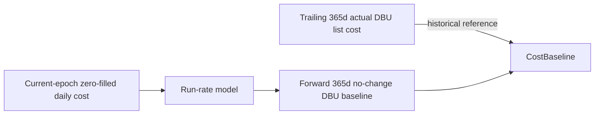

Actual and forward baseline are deliberately different concepts.

### 11.4 Unpriced usage

Unpriced DBU is unknown cost, never zero:

- unpriced DBU in the trailing 365-day window makes `current_cost_365` (the actual DBU cost) null;
- unpriced DBU inside the current-epoch forecast basis makes the forward DBU baseline (`forecast_cost_365`) null; because unpriced days would read as $0 days, `trend_ratio`, `run_rate_28`, `run_rate_84` and `cost_cv_84` are also null and `trend_adjustment_factor` is 1.0 (no trend adjustment of the AWS model);
- price rows without a list price count as unpriced; when price rows overlap, the latest `price_start_time` wins, with currency and end time as tie-breakers;
- an epoch whose usage includes unpriced DBU has a null list cost;
- forecast metadata records `unpriced_dbu_quantity_365`, `unpriced_dbu_quantity_in_basis` and `dbu_pricing_status` (`COMPLETE` | `UNPRICED_USAGE`); null costs survive evidence save/load.

With a null forward DBU baseline, the candidate estimator withholds every savings estimate and the warehouse-type migration candidate is `INSUFFICIENT_EVIDENCE`, both with the blocker chosen by `dbu_baseline_blocker`: `COST_HISTORY_INSUFFICIENT` when `cost_history_days` (the settled basis days of the current epoch) is below `min_economics_cost_history_days` (the re-evaluation window says when it clears), `BILLED_COST_DAYS_INSUFFICIENT` when that history is sufficient but the forecast status is `INSUFFICIENT_ACTIVE_COST_DAYS` (not time-boxed), and `DBU_COST_UNAVAILABLE` otherwise (unpriced usage or a non-positive run rate) (`estimate_blocker` carries the same code; meanings and resulting statuses: [`docs/reference/blocker-codes.md`](../reference/blocker-codes.md)), and scenario and package economics are withheld. The forward cost breakdown is `PARTIAL` for Pro/Classic (AWS cost is still modeled) and `UNAVAILABLE` when no component is known.

---

## 12. AWS baseline model

### 12.1 Serverless

Standard Serverless SQL warehouses model no separate customer AWS EC2 cost; Databricks-managed infrastructure is embedded in the Serverless DBU price line. Formula and rationale: [`docs/reference/aws-cost-model.md`](../reference/aws-cost-model.md).

### 12.2 Pro/Classic

For Pro/Classic, annual AWS cost is the annualized recent cluster-minutes (daily resource series on the DBU forecast's window, calendar and recent/long-window blend (`forecast_recent_days`, `forecast_long_days`), times the forecast trend adjustment and 365) divided by 60 and priced at the modeled cluster hourly price from the versioned regional registry. Formula, topology and registry rules: [`docs/reference/aws-cost-model.md`](../reference/aws-cost-model.md).

The resource window is the last `forecast_long_days` complete days ending at the billing basis end, clipped to the epoch start, with missing days zero-filled (days before the collected range are unknown, so the window shrinks), so DBU and AWS describe the same period.

The AWS baseline is `null`/unavailable, never zero, when its inputs are missing: a region with no entry in the registry gives `AWS_PRICE_REGION_NOT_IN_REGISTRY` (there is no default-region fallback), and a missing daily resource series gives `RECENT_RESOURCE_WINDOW_UNAVAILABLE`, and billed node types outside the modeled topology (the size's driver instance and the `i3.2xlarge` worker; billing does not distinguish driver from worker) give `AWS_NODE_TYPE_MISMATCH`. `aws_cost_model.node_type_check` records `VERIFIED` or `UNVERIFIED` (no billed node type) (meanings: [`docs/reference/blocker-codes.md`](../reference/blocker-codes.md)).

---

## 13. Photon observation algorithm

Photon is inferred from signed current-epoch DBU billing evidence.

### 13.1 Inputs

- `photon_true_dbu`
- `photon_false_dbu`
- `photon_null_dbu`
- latest usage timestamp

### 13.2 Thresholds

Parameters (defaults: [`docs/reference/thresholds.md`](../reference/thresholds.md), Photon observation):

- `photon_min_feature_coverage_pct`: minimum share of current-epoch DBU whose billing row carries a non-null Photon flag;
- `photon_enabled_usage_pct`: share of known-flag DBU that must be Photon-enabled for `ENABLED`;
- `photon_disabled_usage_pct`: share at or below which the state is `DISABLED`;
- `photon_min_epoch_dbu`: minimum total current-epoch DBU;
- `photon_freshness_days`: maximum age of the latest supporting usage.

Derivation: `known = photon_true_dbu + photon_false_dbu`, `total = known + photon_null_dbu`, `coverage = known / total` and `enabled share = photon_true_dbu / known`. The observation is sufficient only when `total`, `coverage` and the age of the latest usage all satisfy their parameters and `known > 0`; otherwise the state is `UNKNOWN`. A sufficient observation is `ENABLED` at or above `photon_enabled_usage_pct`, `DISABLED` at or below `photon_disabled_usage_pct`, and `MIXED` in between. The observation also carries a deterministic confidence score; it is never a recommendation input.

### 13.3 State flow

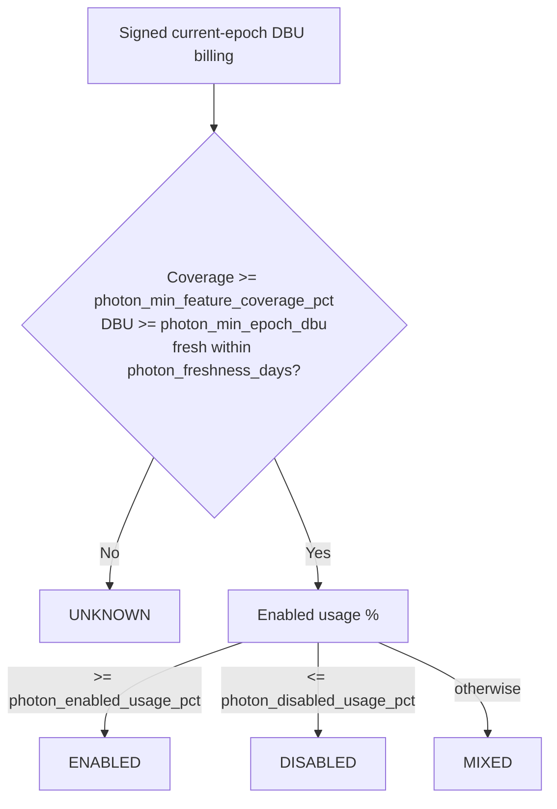

`MIXED` and `UNKNOWN` never become asserted boolean configuration states.

---

## 14. Analyzer design

The analyzer emits **facts and findings**, never a recommendation. Each finding records metric, value, unit, threshold, comparator, source table/field, current epoch ID, observation window, and interpretation.

### 14.1 Analyzer output matrix

| Candidate | Principal analyzer evidence |
|---|---|
| ~~`enable_photon`~~ | retired; the observation (state, enabled %, coverage, freshness) is still collected for `current_config.photon` |
| `warehouse_size` | size, decision-population query count, spill %, spilled-query count, p95 spill bytes among spilled queries, share of spilled bytes from the top statement sources, queue %, p95/p99 execution, job-query share (batch profile), active days, p95 compilation and result-fetch time (evidence only), IO cache, task-time utilization, query-volume growth ratio, older-epoch peak concurrency |
| `max_clusters` | max config, observed max clusters, whole-epoch peak, queue %, queued-query count, p95 capacity wait among queued queries, time at max, peak query concurrency (recent window and whole epoch), busy minutes, query-volume growth ratio, older-epoch peak concurrency |
| `min_clusters` | min config, time/minutes at min, time at max, queue %, p95 capacity wait among queued queries, task-time utilization, busy-period start concurrency and busy periods, query-volume growth ratio, older-epoch peak concurrency |
| `auto_stop_minutes` | current auto-stop, the type's auto-stop values with their net saving, added restarts and added cold-start share (from running idle time), observed running cluster-minutes, kept-alive minutes, running share of the clock, busy share of running time, restart cost, nonprod profile |
| `warehouse_type` | current type, observed workspace Serverless/Pro-Classic capability, billed SQL tiers (evidence only), the target type's own best auto-stop and running fraction, source/compatibility evidence |

Common facts include query count, active days, queries per active day, epoch age, epoch query count, cost-history days, and cost variability.

The task-time utilization finding (`task_minutes_per_cluster_minute`) is `epoch_task_duration_ms / 60000 / cluster_minutes` over the whole current epoch (both terms cover the same period), rounded to 6 places; it is null when either term is missing or zero. It is emitted on the `warehouse_size` and `min_clusters` candidates as evidence only: no optimizer decision reads it, and it is not yet calibrated on real data.

---

## 15. Optimizer decision algorithms

`Optimizer.optimize()` must return exactly one `OptimizationDecision` per active knob. Each rule below states its conditions in words and names the `Thresholds` parameter that gates it; defaults: [`docs/reference/thresholds.md`](../reference/thresholds.md). Meaning, gating parameter and resulting status of every blocker code: [`docs/reference/blocker-codes.md`](../reference/blocker-codes.md).

Rules shared by several knobs:

- **Epoch maturity.** A change needs a current epoch at least `current_config_stability_days` old; otherwise the decision carries `CURRENT_CONFIG_EPOCH_TOO_NEW` (max-cluster reduction applies the same test without a code).
- **Reliability guard** for every capacity cut (one size down, lower max clusters, lower min clusters, lower auto-stop): a failed/cancelled query share above `failure_cancel_pct_downsize_safe` holds the cut with `FAILURE_CANCEL_RATE_HIGH`, and an unreported share holds it with `FAILURE_CANCEL_EVIDENCE_UNAVAILABLE`. Increases are not held by it.
- **Growth guard** for the size downsize, the max-cluster reduction and the min-cluster reduction: the query-volume growth ratio is the smallest of the last four complete weekly query counts divided by the median of the four weeks before. At or above `growth_hold_weekly_ratio` the cut is `NO_CHANGE` with `QUERY_VOLUME_GROWING`. Using every recent week keeps one month-, quarter- or year-end burst week from looking like growth. The ratio is unknown, and holds nothing, when the epoch has fewer than eight complete weeks or the earlier median is zero. Auto-stop and increases are not held by it.
- **Older-epoch hold** for the size downsize, the max-cluster reduction and the min-cluster reduction: the cut is `NO_CHANGE` with `OLDER_EPOCH_PEAK_DEMAND_HIGHER` when an earlier configuration of the warehouse within the last 365 days peaked at more clusters of demand than the recent window (10.2). Older epochs never choose a change, its target or its economics.
- **Missing evidence is never read as zero.** An unreported spill, queue, latency or severity value holds the change with an `*_EVIDENCE_UNAVAILABLE` code.
- **Recent capacity facts** (time at max, time at min, observed peak) come from the last `pressure_window_days` of the daily resource window, not the whole epoch. When the series was not collected the max/min-cluster change is held with `RECENT_RESOURCE_WINDOW_UNAVAILABLE`; when it was collected but the warehouse did not run in the window, it is held with `NO_RECENT_RUNNING_TIME`.

### 15.1 Channel

No channel decision is made. The channel is reported in `current_config.warehouse_channel` and stays an epoch field; it never creates a candidate, plan step or invalidation. When it is `PREVIEW` the package carries a `warehouse_channel` evidence record with an informational note (section 23). The `warehouse_channel` knob value and the `WH-CHANNEL-*` techniques are reserved and not emitted.

### 15.2 Photon

No Photon decision is made. Photon is **left at its default**: the product observes Photon state from billing but makes no Photon recommendation, because Databricks publishes no on/off price or rate for Photon on SQL warehouses and no savings can be modeled without guessing. The reserved `enable_photon` knob/technique `WH-PHOTON-ENABLE-001` is no longer emitted. The observed state (`ENABLED`/`DISABLED`/`MIXED`/`UNKNOWN`) is reported in `current_config.photon` and never creates a candidate, plan step or invalidation.

### 15.3 Warehouse size

A size outside the known size ordering is `BLOCKED` with `UNKNOWN_WAREHOUSE_SIZE`.

#### Upsize

Upsize one nominal size when spill is both frequent and severe: the share of spilled queries reaches `spill_query_pct_upsize` and the p95 spilled bytes among spilled queries reach `spill_p95_bytes_upsize`. Outcomes:

- the spill share reaches `spill_query_pct_upsize` but the p95 spill severity was not reported: `INSUFFICIENT_EVIDENCE` with `SPILL_SEVERITY_EVIDENCE_UNAVAILABLE`, and no resize;
- both signals reached, a larger size exists, and an evidence gate holds: `INSUFFICIENT_EVIDENCE` with the matching codes and no resize. The gates are an epoch younger than `current_config_stability_days` (`CURRENT_CONFIG_EPOCH_TOO_NEW`), fewer than `min_query_sample_size` decision-population queries in the 30-day window, or a missing count (`INSUFFICIENT_QUERY_SAMPLE`), and fewer than `severity_min_affected_queries` spilled queries (`INSUFFICIENT_AFFECTED_QUERY_SAMPLE`);
- both signals reached, a larger size exists, no gate holds and the share of spilled bytes carried by the top `spill_concentration_top_sources` statement sources reaches `spill_concentration_hold_pct`: `NO_CHANGE` with `SPILL_CONCENTRATED_IN_FEW_STATEMENTS`, because a few statements are better rewritten than every query moved to a larger size; a missing share (older evidence) is `INSUFFICIENT_EVIDENCE` with `SPILL_CONCENTRATION_EVIDENCE_UNAVAILABLE`;
- both signals reached, a larger size exists, no gate holds and the spill is spread across statements: `TEST_REQUIRED` with `A_B_PERFORMANCE_VALIDATION_REQUIRED`, one size up; the speed-up and its cost are modeled, not observed, so an A/B canary is mandatory. The change invalidates max and min clusters;
- both signals reached and the warehouse is already at the largest known size: `BLOCKED` with `ALREADY_AT_MAX_KNOWN_SIZE`.

#### Downsize

Every case that is not an upsize is evaluated for a downsize of exactly one size. It is proposed only when a smaller size exists and none of these blockers applies:

- epoch younger than `current_config_stability_days` (`CURRENT_CONFIG_EPOCH_TOO_NEW`);
- fewer than `strong_query_sample_size` decision-population queries in the 30-day window, or a missing count (`INSUFFICIENT_STRONG_QUERY_SAMPLE`); a batch warehouse uses run days instead (below);
- spilled-query share above `spill_query_pct_downsize_safe` (`SPILL_PRESENT`), or not reported (`SPILL_EVIDENCE_UNAVAILABLE`);
- queued-query share above `queue_query_pct_safe` (`QUEUE_PRESSURE_PRESENT`), or not reported (`QUEUE_EVIDENCE_UNAVAILABLE`);
- the reliability guard (`FAILURE_CANCEL_RATE_HIGH`, `FAILURE_CANCEL_EVIDENCE_UNAVAILABLE`);
- the growth guard (`QUERY_VOLUME_GROWING`);
- the whole current epoch's peak cluster count above the recent window's ceiling (recent peak plus headroom), so the 30-day canary evidence cannot see a seasonal peak the epoch reached (`PEAK_OUTSIDE_RECENT_WINDOW`; skipped when either peak is unknown);
- the older-epoch hold (`OLDER_EPOCH_PEAK_DEMAND_HIGHER`);
- p95 execution above `p95_execution_ms_downsize_safe` (`P95_LATENCY_TOO_HIGH`), p99 above `p99_execution_ms_downsize_safe` (`P99_LATENCY_TOO_HIGH`), or either not reported (`LATENCY_EVIDENCE_UNAVAILABLE`).

The decision population is the non-result-cache queries (7.2), so latency and spill are not loosened by cache hits; failed and cancelled queries (timeouts included) stay in the tail. Spill frequency, queue frequency and p95/p99 execution latency must be known: a value the collector did not report stays null (never read as 0 / no pressure) and holds the downsize.

With no blocker the status is `TEST_REQUIRED` with `A_B_PERFORMANCE_VALIDATION_REQUIRED`: an A/B performance canary is mandatory. The change invalidates max and min clusters.

Otherwise the result is `NO_CHANGE` with the blockers preserved. At the smallest size there is no smaller size to propose, so the blockers include `ALREADY_AT_SMALLEST_SIZE`; when that is the only code, the rationale says the warehouse is already at the smallest size.

**Batch profile.** A warehouse is a batch warehouse when job queries are at least `batch_job_query_share_pct` of its last-30-day queries. Its downsize is still a canary only, but a ten-minute ETL query is normal for it, so the p95/p99 latency gates (and `LATENCY_EVIDENCE_UNAVAILABLE`) do not apply and the sample is at least `batch_min_active_days` active days in 30 (`INSUFFICIENT_BATCH_RUN_DAYS`) instead of `strong_query_sample_size` non-cache queries. The spill, queue, failure, growth, seasonal and older-epoch holds, the epoch-maturity gate and the canary are unchanged, and the rationale says the canary measures job run times.

### 15.4 Max clusters

Pro/Classic ceilings follow query concurrency. The collector measures the running plus queued queries of every busy UTC minute (7.2, Concurrency SQL); one Pro/Classic cluster serves `queries_per_cluster_pro_classic` concurrent queries, so peak demand in queries becomes clusters. Two peaks are used:

- the recent peak: the `max_cluster_target_percentile` percentile of the busy minutes of the last 30 days (needs at least `concurrency_min_busy_minutes` busy minutes);
- the epoch peak: the level reached in at least `peak_demand_min_minutes` busy minutes of the whole current epoch. A long window uses this instead of a percentile because a two-hour quarter-end peak is a tiny share of months of busy minutes. It only matters when it needs more clusters than the recent window's peak read at the same rate (the level reached in `peak_demand_min_minutes` × recent days / epoch days of its busy minutes, at least one; recent days = 30 or the epoch's age when younger): then the peak lies outside the recent window, a cut targets the epoch peak, and a cut held by it carries `PEAK_OUTSIDE_RECENT_WINDOW`. A histogram with fewer busy minutes than that has no sustained peak.

```text
target(peak_clusters) = min(max_clusters_supported_limit,
                            max(min_clusters, peak_clusters + max_cluster_target_headroom_clusters))
```

Serverless scales differently and keeps its own rules (queue-based one-step increase, shown at low confidence via `confidence_cap_serverless_ceiling_increase`; peak-plus-headroom reduction, below).

#### Increase

An increase is considered when all of these hold:

- the queued-query share is known and reaches `queue_query_pct_increase_max`;
- the p95 capacity wait among queued queries reaches `queue_wait_p95_ms_increase_max`;
- the warehouse is saturated: time at the configured maximum (pressure window) reaches `time_at_max_pct_saturated`.

Unknown queue frequency or capacity wait is never read as 0. Outcomes:

- queue share and saturation reached but the capacity wait was not reported: `INSUFFICIENT_EVIDENCE` with `QUEUE_WAIT_EVIDENCE_UNAVAILABLE`;
- all signals reached and `max_clusters` is already at `max_clusters_supported_limit`: `BLOCKED` with `MAX_CLUSTER_LIMIT_REACHED`;
- all signals reached and an evidence gate holds: `INSUFFICIENT_EVIDENCE` with `CURRENT_CONFIG_EPOCH_TOO_NEW` (epoch younger than `current_config_stability_days`), `INSUFFICIENT_QUERY_SAMPLE` (fewer than `min_query_sample_size` queries) or `INSUFFICIENT_AFFECTED_QUERY_SAMPLE` (fewer than `severity_min_affected_queries` queued queries);
- Pro/Classic with no concurrency evidence: `INSUFFICIENT_EVIDENCE` with `CONCURRENCY_EVIDENCE_UNAVAILABLE`; with fewer than `concurrency_min_busy_minutes` busy minutes: `INSUFFICIENT_EVIDENCE` with `INSUFFICIENT_BUSY_MINUTE_SAMPLE`;
- Pro/Classic where the target from the recent peak is not above the current maximum: `NO_CHANGE` with `QUEUEING_WITH_DEMAND_WITHIN_CEILING`, because peak demand fits the current ceiling and the queueing is not caused by the ceiling;
- Pro/Classic otherwise: `ACTIONABLE`, one move to the target (not a fixed step); the change invalidates min clusters. When the demand-derived target exceeds `max_clusters_supported_limit`, the increase stays `ACTIONABLE` at the limit with the informational code `PEAK_DEMAND_ABOVE_CLUSTER_LIMIT`, and the rationale gives the clusters the peak needs: queueing remains at the peak, and a larger size or a split workload is a human decision;
- Serverless: `ACTIONABLE`, one cluster more, at low confidence; the change invalidates min clusters.

When the recent resource window is unavailable, saturation cannot be judged and the decision is `NO_CHANGE` with `RECENT_RESOURCE_WINDOW_UNAVAILABLE` (series not collected) or `NO_RECENT_RUNNING_TIME` (collected but the warehouse did not run in the window).

#### Reduce ceiling

A lower max-cluster guardrail is considered only when all of these hold:

- the recent resource window is known and the observed peak is above zero;
- `max_clusters` is above `min_clusters`;
- the epoch is at least `current_config_stability_days` old and at least `min_query_sample_size` queries were seen in the 30-day window;
- time at the configured maximum is at most `time_at_max_pct_safe_reduce`;
- the target below is lower than the current maximum.

Pro/Classic target: `target()` of the larger of the recent peak and the epoch peak, in clusters. Concurrency evidence missing is `CONCURRENCY_EVIDENCE_UNAVAILABLE` and too few busy minutes `INSUFFICIENT_BUSY_MINUTE_SAMPLE`, each holding the cut as `NO_CHANGE`.

Serverless target:

```text
peak     = max(recent_window_peak, epoch_max_observed_clusters)
headroom = max(max_cluster_headroom_clusters,
               ceil(max_cluster_headroom_pct / 100 * peak))
target   = max(min_clusters, peak + headroom)
```

`recent_window_peak` is the highest scale level over the last `pressure_window_days`. `epoch_max_observed_clusters` is the highest scale level over the whole current epoch (`warehouse_events`, retained 365 days), excluding cluster-recycling transients above the configured maximum. In both cases a seasonal peak outside the recent window is not cut away: when the recent window alone would allow a lower ceiling but the epoch peak does not, the ceiling is held as `NO_CHANGE` with `PEAK_OUTSIDE_RECENT_WINDOW`.

The queued-query share must be known and at most `queue_query_pct_safe`, and when some queries queued their capacity wait must be known too; the reliability guard, the growth guard and the older-epoch hold apply. Otherwise the ceiling is held as `NO_CHANGE` with `QUEUE_EVIDENCE_UNAVAILABLE` (queue frequency not reported), `QUEUE_WAIT_EVIDENCE_UNAVAILABLE` (queries queued but capacity wait not reported), the `FAILURE_CANCEL_*` codes, `QUERY_VOLUME_GROWING` or `OLDER_EPOCH_PEAK_DEMAND_HIGHER`. An ineligible ceiling is `NO_CHANGE` without a code.

An eligible reduction is `ACTIONABLE` as a `COST_GUARDRAIL`, but **no direct savings are assigned**. It invalidates nothing: the new ceiling stays above the observed peak, so no other knob's evidence changes.

#### Queueing below the ceiling

When neither an increase nor a cut applies, the queued-query share reaches `queue_query_pct_increase_max`, the p95 capacity wait is unknown or reaches `queue_wait_p95_ms_increase_max`, and the time at the configured maximum is below `time_at_max_pct_saturated`, the result is `NO_CHANGE` with `QUEUEING_BELOW_CEILING`: the ceiling is not what limits the warehouse. The rationale gives the queued share and the time at the ceiling and, for Pro/Classic with concurrency evidence, the peak and busy-start demand in clusters against the current floor. It explains that clusters are added minutes after a burst starts, so short bursts queue before the ceiling is reached, and that a higher floor is a human decision: the publisher never raises the floor (15.5).

### 15.5 Min clusters

If the current minimum is 1 or lower, return `NO_CHANGE`.

The floor carries the demand a busy period starts with until the autoscaler adds clusters (the scale-up lag, 7.2). The target is the smallest floor that covers that demand:

```text
floor_target = max(1, ceil(P(min_cluster_busy_start_percentile) of busy-period start demand
                           / queries_per_cluster_pro_classic))
```

A floor is lowered, in one canary, only when the target is below the current minimum; a floor raise is never recommended. A target at or above the current minimum is `NO_CHANGE` (the current floor is needed). It applies to every supported type, so a Serverless floor is judged on the same demand with its shorter lag.

A reduction is held when any of these blockers applies:

- epoch younger than `current_config_stability_days` (`CURRENT_CONFIG_EPOCH_TOO_NEW`), or fewer than `min_query_sample_size` queries (`INSUFFICIENT_QUERY_SAMPLE`);
- queued-query share not reported (`QUEUE_EVIDENCE_UNAVAILABLE`), above `queue_query_pct_safe`, or a known p95 capacity wait above `queue_wait_p95_ms_safe` (`QUEUE_PRESSURE_PRESENT`);
- capacity wait not reported (`QUEUE_WAIT_EVIDENCE_UNAVAILABLE`);
- recent resource window unavailable (`RECENT_RESOURCE_WINDOW_UNAVAILABLE`) or idle (`NO_RECENT_RUNNING_TIME`);
- time at the configured maximum at or above `time_at_max_pct_block_min_reduce` (`SUSTAINED_SCALE_PRESSURE`); a pinned warehouse (minimum equal to maximum) always runs at its maximum, so this blocker does not apply and pressure is judged on queueing;
- time at the configured minimum below `time_at_min_pct_reduce` (`WAREHOUSE_RARELY_AT_MINIMUM`);
- the reliability guard, the growth guard (`QUERY_VOLUME_GROWING`) and the older-epoch hold (`OLDER_EPOCH_PEAK_DEMAND_HIGHER`);
- busy-start concurrency not collected (`CONCURRENCY_EVIDENCE_UNAVAILABLE`), or fewer than `min_cluster_min_busy_periods` busy periods in the recent window (`INSUFFICIENT_BUSY_PERIOD_SAMPLE`).

`time_at_min` and `time_at_max` are measured over the last `pressure_window_days` of the daily resource window. An unreported value is held as a blocker, never read as 0.

With no blocker and a target below the current minimum the status is `TEST_REQUIRED` (a canary with blockers `A_B_PERFORMANCE_VALIDATION_REQUIRED` and `SPARE_FLOOR_CAPACITY_UNPROVEN`: time at the floor does not prove a floor cluster was spare). It invalidates nothing: auto-stop is evaluated independently of the floor, and the bundle estimator keeps the two from claiming the same cluster-minute (20.3). Otherwise the result is `NO_CHANGE` with the blockers preserved.

### 15.6 Auto-stop

Auto-stop is not a fixed target by workload class: it jumps to the value that costs least on the warehouse's own measured running idle time (7.2, Running-idle SQL). Idle time is only a cost while the warehouse runs, and a lower value saves idle minutes but adds restarts for the gaps it no longer bridges.

**Values evaluated.** Every `auto_stop_step_minutes` step from the type's floor (`auto_stop_floor_pro_classic` for Pro and Classic, `auto_stop_floor_serverless` for standard Serverless) up to `auto_stop_max_minutes`. A Serverless value below its floor, set through the API, is left alone (`NO_CHANGE`). Pro and Classic never go below their floor (the reviewer rejects it). A value covers a gap, so the warehouse stays up and no restart happens, only when it is `auto_stop_bridge_margin_pct` longer than the gap.

**Objective per value**, in cluster-minutes (the floor cluster count is the current minimum, at least 1):

```text
lowering:  net = removable running cluster-minutes
                 - additional restarts * restart_cost
raising:   net = restarts avoided * restart_cost
                 - added idle wall minutes * floor clusters
restart_cost = restart_cost_cluster_minutes_{pro_classic|serverless} * floor clusters
```

The restart cost is the documented start time (about 4 minutes on Pro and Classic, 2 to 6 seconds on Serverless, priced at the upper end). Databricks does not document whether starting minutes are billed, so on Pro and Classic the restart cost is a priced assumption: a raise, whose saving is entirely avoided restarts, is therefore always a canary. Running time past the current auto-stop (kept-alive time: open sessions, result fetching) is reported and never removable by a lower value. A gap run past the current auto-stop by more than a late stop event explains (more than `kept_alive_gap_tolerance_minutes` when it ran through to the next query or the window end, more than `kept_alive_stopped_gap_minutes` when it stopped before the next query) was kept alive by something other than queries and would not stop at a lower value either, so it contributes no removable time and no added restart; added restarts are otherwise counted only in gaps within the current setting. A migration alternative is priced on its own cost basis: today's running time, minus the idle time its auto-stop removes (or plus the idle it adds), plus every restart it still has at its own restart cost, against today's running time plus today's restarts at today's cost (measured running time excludes starting time). A query with no end time counts as still running only if it started within the last day; an older one ends at its start.

**Cold-start budget** (Pro and Classic only; Serverless starts in seconds and has none): the restarts a lower value adds, as a share of the queries over the same window, must stay within `cold_start_added_share_max_pct`, or `cold_start_added_share_max_pct_nonprod` for a warehouse tagged nonprod. Nonprod means a tag whose key is one of `nonprod_tag_keys` (case-insensitive) with a value in `nonprod_tag_values`; staging and UAT stay production, and the only effect of nonprod is the larger budget.

**Choice.** Among the values within budget that save money, the best net wins; among values whose net is within `auto_stop_near_best_pct` of the best, the smallest change from the current value wins (an always-on value of 0 counts as infinitely long, so the largest such value is the smallest change). The candidate is priced at its net divided by the observed running cluster-minutes, scaled by the realization tracks (17.3).

**Outcomes**, in the order the optimizer checks them:

- Serverless value below its floor: `NO_CHANGE`, left alone;
- running-idle evidence not collected (older evidence, or no retained warehouse event): `INSUFFICIENT_EVIDENCE` with `RUNNING_INTERVAL_EVIDENCE_UNAVAILABLE`;
- fewer than `min_cluster_minutes_for_cost_model` running cluster-minutes: `INSUFFICIENT_EVIDENCE` with `INSUFFICIENT_EVENT_RESOURCE_EVIDENCE`;
- a lower value removes more running cluster-minutes than the events recorded: `INSUFFICIENT_EVIDENCE` with `IDLE_EVIDENCE_EXCEEDS_RUNTIME`, no change and no price;
- epoch younger than `current_config_stability_days`: `INSUFFICIENT_EVIDENCE` with `CURRENT_CONFIG_EPOCH_TOO_NEW`;
- no queries while running: `REVIEW` at the floor value when it removes running time (`NO_QUERIES_WHILE_RUNNING`), otherwise `NO_CHANGE` with the same code;
- no value saves money: `NO_CHANGE` (the current value is cost-optimal), with `SHORT_QUERIES_KEEP_WAREHOUSE_RUNNING` when the warehouse runs at least `always_on_running_pct` of the window while queries are busy at most `always_on_busy_pct_max` of its running time (frequent tiny queries such as BI polling or dashboard refresh keep it up; the rationale names the client applications);
- every value that saves money is over the cold-start budget: `NO_CHANGE` with `COLD_START_BUDGET_EXCEEDED`;
- the chosen value lowers auto-stop: `ACTIONABLE`, unless the reliability guard holds the cut, which makes it `BLOCKED`;
- the chosen value raises auto-stop: `TEST_REQUIRED` with `RESTART_BILLING_UNVERIFIED`, a canary that measures billed cost after the change.

**Non-work activity.** With any outcome, when kept-alive minutes are at least `kept_alive_flag_pct` of running time the decision also carries the advisory `ACTIVITY_WITHOUT_QUERIES_KEEPS_WAREHOUSE_RUNNING` and its rationale states the share; that time is never priced as removable. The analyzer emits `running_share_of_clock_pct` and `busy_share_of_running_pct` findings for the flags above.

Auto-stop is evaluated independently of size and min clusters: no other change invalidates it. The size canary does not sequence it either: a size change alters idle gaps only by the change in query durations, and auto-stop is priced on measured gaps.

### 15.7 Warehouse type

Warehouse type is always a **separate experimental branch**:

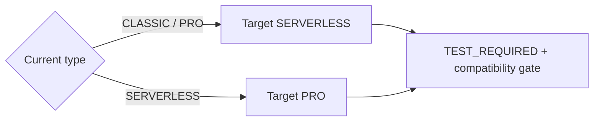

Both directions carry `A_B_COST_PERFORMANCE_VALIDATION_REQUIRED`. Missing observed workspace capability is retained as a blocker/HITL condition (`PRO_CLASSIC_WORKSPACE_CAPABILITY_NOT_CONFIRMED_FROM_SYSTEM_TABLES`, `SERVERLESS_WORKSPACE_CAPABILITY_NOT_CONFIRMED_FROM_SYSTEM_TABLES`) rather than removing the branch. When the forward DBU baseline is unknown, or `cost_history_days` is below `min_economics_cost_history_days`, the migration candidate is `INSUFFICIENT_EVIDENCE` with the DBU baseline code instead (11.4).

The target type is priced at its own cost-minimizing auto-stop on the same running-idle evidence as 15.6, with the target's floor, restart cost and cold-start budget (Serverless: its floor, a very small restart cost and no budget; Pro: its floor, the long restart cost and the budget). If no value saves money and the current value is valid for the target, the target keeps the current value; if the current value is below the target's floor (a Serverless value under the Pro floor), it takes the best allowed value even when that adds running time. The result is the target's running fraction (17.7). Without running-idle evidence the migration estimate is withheld (`RUNNING_INTERVAL_EVIDENCE_UNAVAILABLE`).

Value gate: a migration whose savings range high bound (total cost, DBU plus AWS; not gated when the total is unknown) is at or below 0 is held as `NO_CHANGE` with `MIGRATION_NOT_COST_EFFECTIVE`, the modeled economics stay in `metadata.value_gate`, and no Plan B scenario is built for it (17.1).

### 15.8 Dependency graph

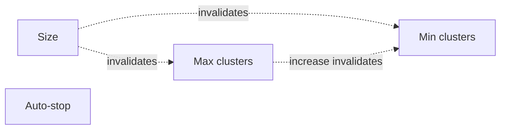

A max-cluster ceiling cut, a min-cluster change and an auto-stop change invalidate nothing. Plan order is by value within these edges (19.1).

---

## 16. Candidate confidence model

Candidate confidence is deterministic evidence quality, **not probability that savings will materialize**.

Components (parameters: [`docs/reference/thresholds.md`](../reference/thresholds.md), Confidence):

```text
coverage       = clamp(cost_history_days / confidence_coverage_days, 0, 1)
sample         = clamp(decision_sample / strong_sample, 0, 1)   # the sample the knob's decision is made on;
                                                                  # an unknown sample earns no credit
stability      = clamp(1 - cost_cv_84 / 2, 0, 1)          # unknown cv earns no credit
epoch_maturity = clamp(epoch_age_days / confidence_epoch_maturity_days, 0, 1)
signal         = confidence_signal_change for ACTIONABLE / TEST_REQUIRED,
                 confidence_signal_no_change otherwise
```

Weighted score:

```text
score = confidence_base_weight
      + confidence_coverage_weight  * coverage
      + confidence_sample_weight    * sample
      + confidence_stability_weight * stability
      + confidence_epoch_weight     * epoch_maturity
      + confidence_signal_weight    * signal
```

Decision sample by knob:

| Knob | `decision_sample` | `strong_sample` |
|---|---|---|
| Size | queries not served from the result cache, last 30 days | `strong_query_sample_size` |
| Max clusters | busy minutes in the recent window | `confidence_strong_busy_minutes` |
| Min clusters | busy periods in the recent window | `confidence_strong_busy_periods` |
| Auto-stop | queries over the running-idle window | `strong_query_sample_size` |
| Migration | queries, last 30 days | `strong_query_sample_size` |

The score is clamped to a cap by candidate status: `confidence_cap_actionable` for `ACTIONABLE`, `confidence_cap_test_required` for `TEST_REQUIRED`, `confidence_cap_insufficient_evidence` for `INSUFFICIENT_EVIDENCE` (below the MEDIUM cut-off) and `confidence_cap_default` for every other status (below the HIGH cut-off): a candidate that changes nothing is never `HIGH`, and one without enough evidence is `LOW`. The score is mapped to a level with `confidence_high_threshold` and `confidence_medium_threshold` (`HIGH`, `MEDIUM`, otherwise `LOW`). A scenario's confidence is the minimum of its step confidences; a scenario with no steps has no score (`UNKNOWN`).

---

## 17. Independent candidate estimator

Candidate economics are standalone counterfactuals and are explicitly non-additive.

### 17.1 General range convention

`Range3(low, base, high)` represents ordered annual cost or savings outcomes. Candidate status may have no available estimate.

Value gate: a change whose objective is cost (a size reduction, a lower minimum or a lower auto-stop) that is `ACTIONABLE` or `TEST_REQUIRED` and priced is held as `NO_CHANGE` when its own base savings are not positive (`COST_CHANGE_NOT_COST_EFFECTIVE`) or below `cost_change_min_annual_savings` (`COST_SAVINGS_BELOW_MATERIALITY`). The candidate carries the code as a blocker and `metadata.value_gate` records the modeled savings and range, the floor, the held change and the original status. The gate does not apply to performance, guardrail or compatibility objectives, or to a change whose estimate is withheld. A warehouse-type migration has its own gate: when even the best case of its total savings range is not above 0 it is held (no gate when the total is unknown) as `NO_CHANGE` with `MIGRATION_NOT_COST_EFFECTIVE`, and the modeled economics are recorded the same way.

### 17.2 No-change/guardrail candidates

- `NO_CHANGE` candidates use factor `1.0` (a known no-change), as does a max-cluster ceiling reduction, which receives **no direct savings**.
- `BLOCKED` and `INSUFFICIENT_EVIDENCE` candidates are not priced: no counterfactual is attempted and their economics are null, never zero.
- With a null forward DBU baseline (11.4) every other candidate that needs a priced counterfactual is withheld the same way, and `estimate_blocker` names the reason.

### 17.3 Auto-stop estimator

The estimator prices the recommended value from the option the optimizer chose (15.6), not from a generic cap:

```text
raw_savings_fraction = clamp(net_cluster_minutes / observed_running_cluster_minutes, 0, 1)
```

`net_cluster_minutes` is idle running time removed minus restarts added (or restarts saved minus idle added when raising), and the denominator is the running cluster-minutes the events recorded over the same period, so the ratio covers one period. Realization tracks scale the fraction by `realization_optimistic`, `realization_base` and `realization_conservative` (high, base and low savings). There is no separate savings cap: only idle time the warehouse actually ran can be removed. The candidate metadata records the chosen option and the restart-cost assumption (Pro and Classic starting minutes are assumed billed; Databricks does not document it). Idle time above the recorded running time is rejected upstream (15.6), not clamped.

### 17.4 Min-cluster estimator

```text
theoretical_removed_cluster_minutes
  = minutes_at_current_min * (current_min - target_min)

raw_fraction
  = clamp(theoretical_removed / current_cluster_minutes, 0, min_cluster_savings_fraction_cap)
```

Both terms use whole-epoch event totals, so the ratio covers one period.

The realization tracks are `min_cluster_realization_optimistic`, `min_cluster_realization_base` and `min_cluster_realization_conservative` (high, base and low savings), not the auto-stop `realization_*` tracks: time at the floor does not prove a floor cluster was spare, so the high track is an upper bound and the low track assumes no savings.

### 17.5 Size estimator

Size candidate cost factor is:

```text
capacity_ratio * runtime_elasticity
```

Capacity ratio source:

1. **Serverless:** published Serverless SQL DBU/hour size ratio. A size with no published rate is not priced (`SERVERLESS_DBU_RATE_NOT_PUBLISHED`): the candidate keeps its decision status with null economics and a plan containing it is withheld as `REQUIRES_CANARY`.
2. **Pro/Classic:** the target/current ratio of the workspace's billed DBU per cluster-hour by size (billed DBU over running cluster-hours, on the same days: the current epoch on its event-covered resource window, earlier epochs from their event coverage start), used only when the observed rates rise with size and the pair ratio is within `size_rate_published_band` of the published per-size ratio. Otherwise the estimate is withheld (`PRO_CLASSIC_SIZE_RATE_UNVERIFIED`; `size_rate_check` is `RATES_NOT_RISING_WITH_SIZE`, `SIZE_RATE_NOT_OBSERVED`, `OUTSIDE_PUBLISHED_RATIO_BAND` or `NO_PUBLISHED_SIZE_RATE`): the candidate keeps its decision status with null economics and the plan step needs a canary. There is no nominal capacity-ratio fallback.

Runtime elasticity is a low/base/high multiplier range chosen by the decided direction in size order, not by the price ratio: a downsize uses `downsize_runtime_multiplier_optimistic`, `_base` and `_conservative`; an upsize uses `upsize_runtime_multiplier_optimistic`, `_base` and `_conservative`. The multiplier changes query execution time only; idle running time is unchanged. It is therefore applied to the busy share of running cluster time:

```text
busy_cluster_time_share = clamp(1 - (uptime - busy) * min_clusters / cluster_minutes, 0, 1)
effective_multiplier    = busy_cluster_time_share * runtime_multiplier + (1 - busy_cluster_time_share)
cost_factor             = capacity_ratio * effective_multiplier
```

`busy_cluster_time_share` is the analyzer's size finding over the whole current epoch (`uptime` and `cluster_minutes` from the event totals, `busy` from the idle-gap query); it is null when any input is unknown, and an unknown share treats all running time as busy. Candidate metadata records `busy_share`, `busy_runtime_multiplier_range` (the policy multipliers) and `runtime_multiplier_range` (the effective range). Example: Serverless LARGE to X_LARGE (DBU ratio 2.0) with half of the cluster time busy has a base factor of 2.0 x (0.5 x 0.70 + 0.5) = 1.70, not 1.40.

The final factors are clamped to `cost_factor_floor`..`cost_factor_ceiling`. No historical epoch enters the size factor. Defaults: [`docs/reference/thresholds.md`](../reference/thresholds.md) (Estimators and realization, Size price factor and value gate).

### 17.6 Max-cluster increase estimator

When increasing max clusters, the worst-case cost uplift is the additional capacity that could have been used during observed time at the existing maximum (pressure window). It is not capped: a single-cluster warehouse at its ceiling all the time doubles its cost with a second cluster.

```text
raw_uplift = max(0, minutes_at_max * (target_max - current_max) / cluster_minutes)
cost factor: low = 1.0, base = 1 + raw_uplift * max_cluster_base_uplift_weight, high = 1 + raw_uplift
```

The best case is no added cost (factor 1.0). Direct savings are not expected; the range represents a cost increase for performance.

For Pro/Classic with concurrency evidence the base case is what peak demand actually needs under the new ceiling. Each busy minute of the recent window runs `min(ceil(level / queries_per_cluster_pro_classic), target)` clusters instead of `min(ceil(level / queries_per_cluster_pro_classic), current)`; the added cluster-minutes as a share of the recent cluster-minutes are the base uplift, never above the worst case. Otherwise (Serverless, or no histogram) the base is `max_cluster_base_uplift_weight` of the worst case.

### 17.7 Migration estimator

Migration uses a structural annualized resource-time range of the current warehouse:

```text
today_low  = annualized uptime minutes
today_base = annualized cluster-minutes
today_high = max(today_base, annualized uptime * max_observed_clusters)
```

Uptime and cluster-minutes are annualized from the daily resource series on the DBU forecast's window and recent/long-window blend (`max_observed_clusters` is the window peak excluding recycling transients). All tracks include the baseline forecast trend adjustment. Without the series the bounds are unavailable (`RECENT_RESOURCE_WINDOW_UNAVAILABLE`).

The target runs at its own cost-minimizing auto-stop (15.7). Its running fraction is `f = 1 - net(T*) / observed running cluster-minutes`, clamped to [0, `cost_factor_ceiling`], where `net(T*)` is that value's net cluster-minutes saving (zero when the current value is kept). The target's resource range is:

```text
base         = today_base * f
optimistic   = busy cluster-time share * today_base, never above base
conservative = today_high, never below base
```

Without running-idle evidence the migration estimate is withheld (`RUNNING_INTERVAL_EVIDENCE_UNAVAILABLE`).

For target Serverless:

```text
DBU cost = target resource minutes / 60
           * published Serverless DBU/hour for size
           * target SQL DBU list price
AWS cost = 0
```

For target Pro/Classic:

```text
DBU cost = target resource minutes / 60
           * observed same-workspace Pro/Classic DBU/cluster-hour
           * target SQL DBU list price
AWS cost = target resource minutes / 60
           * regional modeled EC2 cluster hourly cost
```

Migration is priced relative to billing. The same formula applied to the current warehouse (running cluster-hours at today's base bound, times its current DBU per cluster-hour, times its current SKU price; Serverless uses the published table, Pro/Classic the workspace's measured rate) gives a modeled current DBU cost. The reconciliation ratio is that cost over the billed DBU forecast. A ratio outside [`migration_reconciliation_min`, `migration_reconciliation_max`], or an unavailable current rate or price, withholds the estimate (`MIGRATION_MODEL_NOT_RECONCILED`). Inside the band, the target DBU cost is scaled by billed over modeled so systematic model error cancels; the AWS target cost stays modeled. The reconciliation is recorded in the estimate metadata (`reconciliation`, `reconciliation_ratio`).

Missing resource bounds, target DBU rate, list price, or AWS registry evidence makes migration economics unavailable rather than guessed.

---

## 18. Reviewer Gate 1 — candidate invariants

`Reviewer.review()` fails the run for a warehouse when any invariant is violated.

It validates:

- exactly one candidate for each of five active knobs,
- candidate workspace/warehouse identity,
- unique internal recommendation IDs,
- nonnegative actual/forward baseline cost,
- confidence score in `[0,1]`,
- change statuses must actually change config,
- `BLOCKED` and `INSUFFICIENT_EVIDENCE` candidates must contain blockers, and `INSUFFICIENT_EVIDENCE` cannot change config,
- `NO_CHANGE` cannot claim savings,
- ordered cost and savings ranges,
- findings used for decisions belong to the current epoch,
- warehouse-size target belongs to known size order,
- min/max cluster target bounds,
- `min <= max` consistency against current config,
- nonnegative auto-stop, and a changed Pro/Classic auto-stop at or above `auto_stop_floor_pro_classic`,
- package currency consistency.

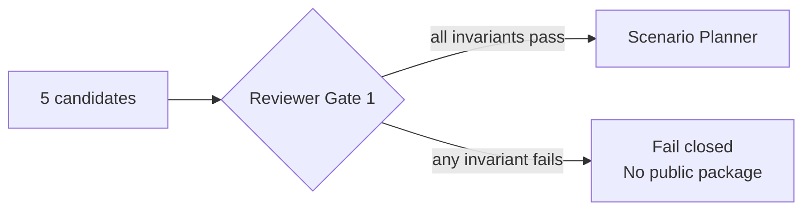

---

## 19. Scenario planner and execution states

### 19.1 Plan A

Plan A is the Phase-1 recommended scenario. Size, max-cluster, min-cluster and auto-stop candidates with status `ACTIONABLE` or `TEST_REQUIRED` become plan steps, ordered by:

```text
priority = base_savings_365 * confidence_score / risk
risk     = plan_risk_hitl_change     (ACTIONABLE: human approval)
         | plan_risk_canary_change   (TEST_REQUIRED: A/B canary)
key      = (group, -round(priority, 2), knob_rank)
group    = 0 if base_savings_365 > 0
           1 if base_savings_365 is unavailable (a canary prices it)
           2 if base_savings_365 <= 0 (guardrail or performance fix)
knob_rank: warehouse_size, max_clusters, min_clusters, auto_stop_minutes
```

`base_savings_365` is the candidate's independent base savings (total when the AWS line is known, DBU otherwise) and `confidence_score` its score (section 16). The sorted list is scheduled so that no step precedes a step that invalidates it (15.8): at each position the planner takes the highest-ranked remaining step whose invalidators are all placed. Steps that another plan step invalidates (always pending re-evaluation) then come after every ready step, in value order, so what can be applied now is listed before what waits, and the last pending step's running savings equal the contingent savings of the scenario.

### 19.2 Invalidation behavior

If an upstream step invalidates a downstream knob, the downstream step remains visible but receives:

```text
execution_state = PENDING_REEVALUATION
gate = RE_ANALYZE_AFTER_UPSTREAM_CANARY
```

**Pricing of pending steps.** The stateful bundle estimator prices a plan as two chains over the same
evolving cost/resource state:

- the **authoritative** chain applies only steps that are not `PENDING_REEVALUATION`. Their evidence has not been
  invalidated by an upstream change. A pending step's effect is *skipped*, so a later ready step is priced on the state
  without it. This chain defines scenario `savings_365d`/`estimated_cost_365d`, the package economics and the envelope;
- the **contingent** chain applies every step using pre-change evidence. It is published as `contingent_*` scenario
  economics and as per-step `projected_economics` with `pricing_basis = CONTINGENT_PENDING_REEVALUATION`, a big-picture
  upside that must be regenerated after the upstream step is applied and remeasured. It never feeds package economics.

If a chain cannot be priced (for example a migration with no target SQL price) its economics are null,
never zero. A pending step that cannot be priced does not affect the authoritative chain. Phase 1 has no apply API:
"re-validation on application" means the next publisher run after an upstream step is applied produces fresh
authoritative economics for the next knob.

### 19.3 Step state machine

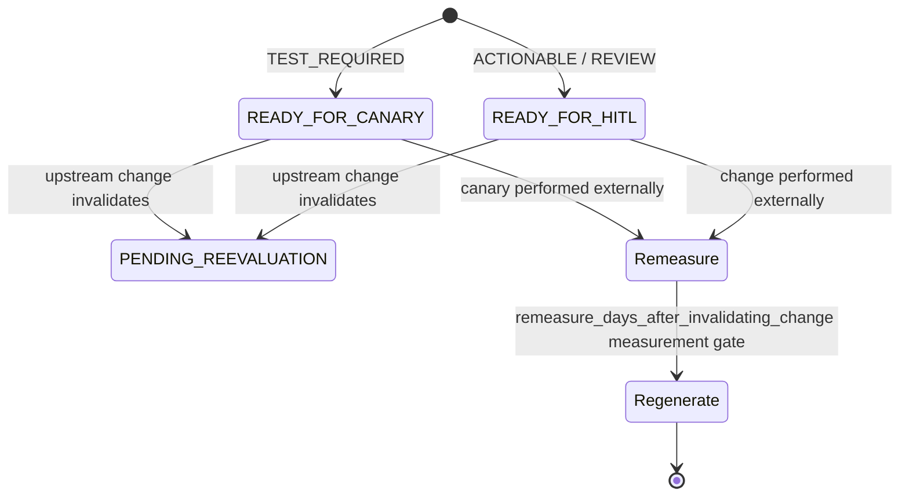

`READY_FOR_HITL` is the planner's internal state for a step that needs human approval but no canary. When the package is built it maps to the public `READY` execution state (`READY_FOR_CANARY`, `PENDING_REEVALUATION` and `BLOCKED` map to themselves; an unmapped state is an error, never a silent `READY`).

### 19.4 Plan B

Plan B contains at most one warehouse-type migration candidate. It is an alternative branch and cannot absorb current-type tuning candidates.

Compatibility checks may include:

- region/Serverless availability: `aws_region_serverless_availability` passes only when the workspace has run a Serverless warehouse in the collected history (`system.compute.warehouses`), otherwise it is `UNKNOWN` and needs human confirmation; a region label alone never passes because no verified per-region list is used,
- observed Serverless or Pro/Classic workspace capability,
- workspace enablement from optional read-only API,
- external legacy Hive metastore workspace configuration,
- S3 access-policy unknown/HITL status,
- legacy Hive metastore references observed in SQL history,
- regional AWS price registry for Pro/Classic target.

Plan B is named after, and its checks run against, the type the migration was evaluated for: the recommended type, or the type a value gate held (a held migration has no steps and is named "Plan B — Pro migration experiment", for example). When no migration was evaluated (not enough evidence) Plan B is "Plan B — Migration not evaluated", has no steps and no checks, and its compatibility status is `UNKNOWN`; it is never checked against the warehouse's own type.

The package maps the checks to a public compatibility status (`reporter-json-contract.md`, Compatibility): a migration whose every check is `PASS` is `COMPATIBLE` and gets no compatibility-validation step; any `UNKNOWN`, `REVIEW` or `PASS_WITH_LIMITATION` check gives `REQUIRES_VALIDATION`, which adds that step; a `FAIL` gives `INCOMPATIBLE`. A Plan B without a migration step is never `COMPATIBLE`, so its scenario ID cannot equal an empty Plan A's (Plan A is always `COMPATIBLE`).

Phase 1 always keeps Plan B as `ALTERNATIVE`.

---

## 20. Stateful bundle estimator

The bundle estimator is the only component allowed to combine candidate effects into a scenario-level portfolio range.

### 20.1 Tracks

Three deterministic tracks are maintained:

```text
low-cost / optimistic
base
high-cost / conservative
```

Each track carries:

- DBU cost,
- AWS cost when available,
- remaining resource cluster-minutes,
- the floor (min clusters) the track has reached.

The floor is kept per track because a min-cluster cut is realized differently on each: all of its reduction on the optimistic track, the base share on the base track and none on the conservative track (`min_cluster_realization_optimistic`, `_base`, `_conservative`), and each track's floor moves by its own realized share. A later step reads the floor of the track it prices, so a plan that cuts the floor and then changes auto-stop does not credit the conservative track with a floor it never reached.

### 20.2 Effect types

| Bundle effect | Behavior |
|---|---|
| `no_cost_change` | state unchanged |
| `multiplicative_cost_factor` | multiply evolving DBU/AWS cost; optionally resource runtime |
| `min_cluster_reduction` | remove realized cluster-minutes from remaining state |
| `idle_cluster_minute_reduction` | remove realized idle cluster-minutes from remaining state |
| `migration_cost_override` | replace evolving state with migration counterfactual |
| `requires_canary` | withhold portfolio economics and return `REQUIRES_CANARY` |
| `estimate_withheld` | withhold portfolio economics with the status the effect carries (`REQUIRES_COST_HISTORY` or `UNAVAILABLE`, chosen from the DBU baseline blocker, 11.4) |

### 20.3 Double-count prevention

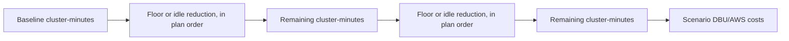

Min-cluster and auto-stop do not both claim the same original capacity minute, in either order. The auto-stop effect is the net cluster-minutes (gain minus loss) measured at the floor the candidate saw, scaled by that track's current floor. When a lowering auto-stop is applied first (a raise removes no idle time), the chain records the wall-clock idle minutes it removed, and a later min-cluster reduction removes only `max(0, removable_floor_minutes − removed_idle_minutes × (current_min − target_min))`: a stopped warehouse has no floor cluster to remove.

### 20.4 Scenario estimate statuses

Priced estimates:

- `NO_CHANGE`
- `MODELED_RANGE`
- `PROVISIONAL_MODELED_RANGE`
- `PRE_CANARY_MODELED_RANGE`

Withheld estimates (every range null; the public package reports them as `UNAVAILABLE`):

- `REQUIRES_CANARY`
- `REQUIRES_COST_MODEL`
- `REQUIRES_COST_HISTORY`
- `UNAVAILABLE`

The codes that explain each withheld status: [`docs/reference/blocker-codes.md`](../reference/blocker-codes.md) (Not blockers, internal withheld-estimate statuses).

---

## 21. Reviewer Gate 2 — scenario invariants

`Reviewer.review_scenarios()` validates:

- recommended scenario ID exists,
- exactly one internal scenario is marked recommended,
- scenario and step confidence are within `[0,1]`,
- every plan step references a real candidate,
- no duplicate candidate in a scenario,
- step knob/current/recommended config exactly equal candidate contract,
- step confidence exactly equals candidate confidence,
- invalidated downstream steps are `PENDING_REEVALUATION`,
- no step precedes a step that invalidates it,
- a step's pricing basis matches its execution state (`PENDING_REEVALUATION` ⇔ contingent),
- authoritative scenario savings equal the last authoritative step's running savings, and contingent savings equal the last pending step's,
- every scenario range is ordered,
- Plan A contains no warehouse-type migration,
- Plan B contains no more than one step.

Only after reviewer gate 2 may the public contract adapter run.

---

## 22. Public Reporter JSON Contract v1.3.0

The public JSON package is the canonical output. One file equals one warehouse/current-epoch assessment.

### 22.1 Top-level hierarchy

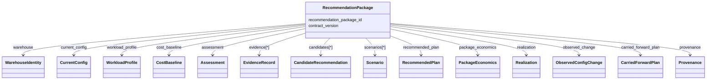

### 22.2 Stable top-level sections

Top-level keys and their order: [`docs/contracts/reporter-json-contract.md`](../contracts/reporter-json-contract.md) section 1. Stable keys are not omitted to represent missing information.

### 22.3 Null semantics

`null` means unavailable, unknown or not measured; `0` is a known numeric zero; `[]` is a known empty collection (contract section 2). These meanings must survive JSON-to-workbook projection.

### 22.4 Public candidate identity

The public `candidate_id` is content-addressed; its hash inputs are in [`docs/contracts/reporter-json-contract.md`](../contracts/reporter-json-contract.md) section 3 (Candidate hash inputs). Public IDs come only from the `make_*` helpers in `contracts/reporter_contract.py` and are 24 hex characters; `publisher.py` keeps internal 16-hex join keys (`epoch_id`, `finding_id`, `recommendation_id`, `scenario_id`) that never reach packages, and a test pins that packages ignore them.

### 22.5 Technique IDs

Stable technique IDs and their mapping to knobs: [`docs/reference/technique-catalog.md`](../reference/technique-catalog.md).

### 22.6 Deterministic content IDs

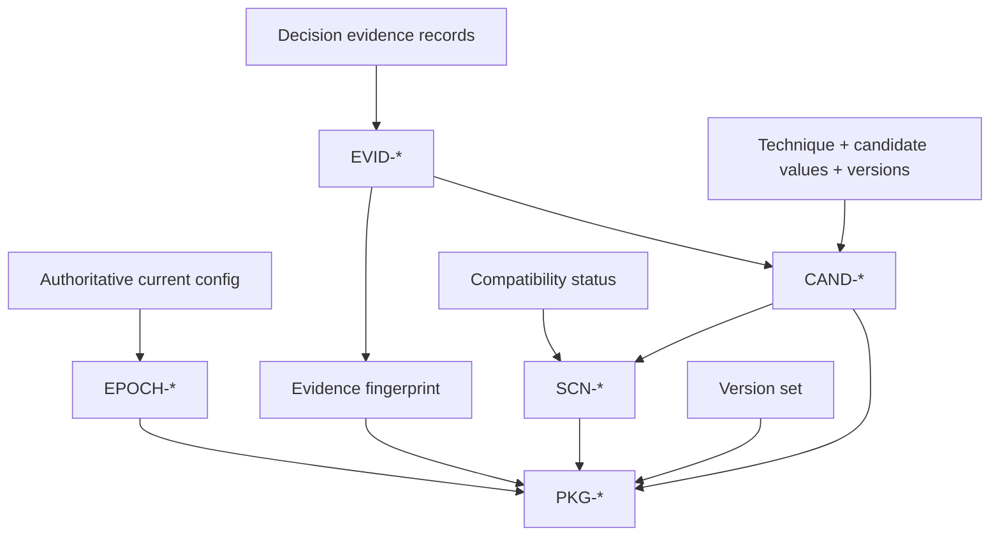

Canonical hash rules and the inputs of each ID: contract section 3 (Identity model).

### 22.7 Package hash payload

The inputs of `recommendation_package_id` and the volatile metadata it excludes: [`docs/contracts/reporter-json-contract.md`](../contracts/reporter-json-contract.md) section 3 (Package hash inputs).

---

## 23. Evidence registry

Evidence is declared once and referenced by candidates/scenarios.

An `EvidenceRecord` includes:

- deterministic `evidence_id`,
- metric,
- value,
- unit,
- source,
- source field,
- epoch scope,
- observation window,
- threshold,
- comparator,
- interpretation.

Interpretation prose is excluded from the evidence fingerprint; decision-relevant values and source semantics are included.

Shared cost evidence (`actual_dbu_cost_365d`, `forward_dbu_cost_365d`, `forward_aws_cost_365d`, `cost_history_days`) is declared once per package and referenced by every candidate. The package also carries `billing_correction_dbu_share_365d` (unit `ratio`, source `system.billing.usage`, source field `record_type`, window `trailing_365d`): retracted DBU per originally billed DBU. It is package evidence only: no candidate references it, so it does not enter candidate IDs, and no decision, confidence or economics reads it. When the current channel is `PREVIEW` the package also carries a `warehouse_channel` record (unit `state`, source `system.compute.warehouses`, window `current_epoch`) whose interpretation is the informational Preview note; it is package evidence only, like the billing-correction share.

Candidate findings become evidence records, including evidence-only findings that no decision reads: on the size candidate `decision_queries_30` (the sample the size gates use), `p95_compilation_ms_30` and `p95_result_fetch_ms_30`; on the warehouse-type candidate `billed_sql_tiers`.

The package validator recomputes the evidence fingerprint before accepting the package.

---

## 24. Package economics

### 24.1 Economic layers

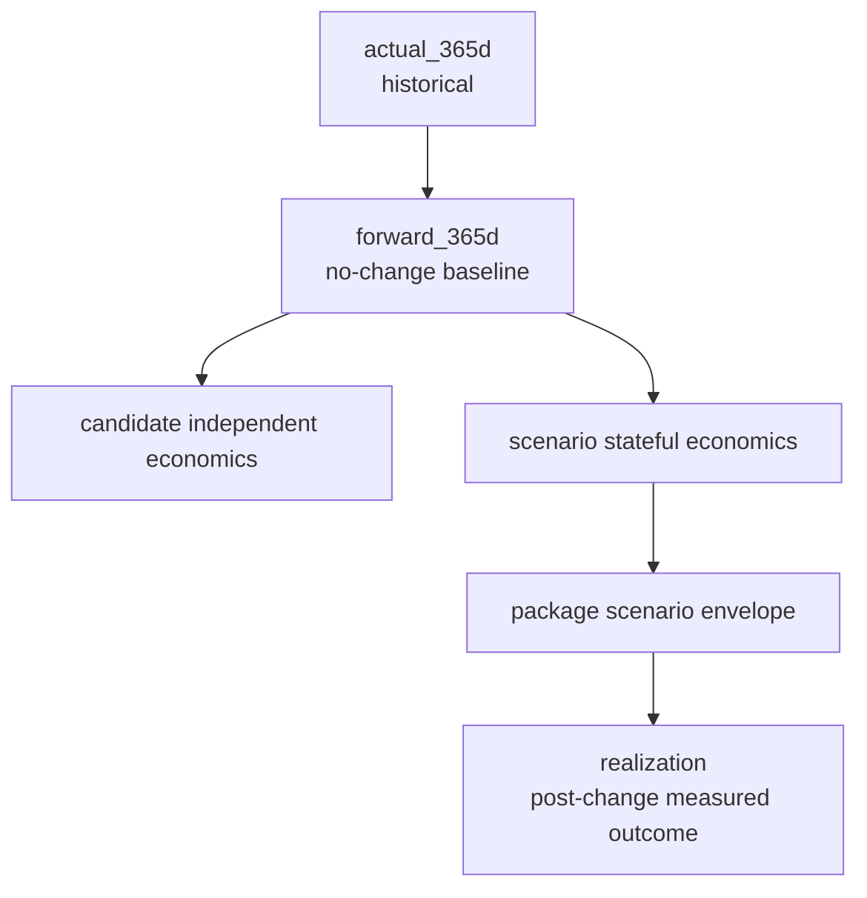

### 24.2 Package scenario envelope

Only economically assessable scenarios are included. Blocked/unavailable scenarios are explicitly excluded with reason codes ([`docs/reference/blocker-codes.md`](../reference/blocker-codes.md), Scenario and planner; fields: [`docs/contracts/reporter-json-contract.md`](../contracts/reporter-json-contract.md) section 15).

Package savings semantics:

```text
low  = minimum LOW savings bound across included scenarios
base = BASE savings of the recommended scenario
high = maximum HIGH savings bound across included scenarios
```

Package future cost range is derived from the common forward total baseline:

```text
cost.low  = baseline - savings.high
cost.base = baseline - savings.base
cost.high = baseline - savings.low
```

Negative savings are valid and mean **cost increase**. The JSON preserves the signed value; the workbook presents it as a negative number with an explicit impact type (27.4).

---

## 25. Public semantic validation

Before a package is emitted it must pass:

1. dataclass field validation,
2. epoch ID recomputation,
3. evidence ID recomputation,
4. evidence fingerprint recomputation,
5. candidate ID recomputation,
6. scenario ID recomputation,
7. candidate/evidence/scenario reference integrity,
8. recommended-scenario uniqueness,
9. package-envelope derivation checks,
10. package currency consistency,
11. assessment count reconciliation,
12. realization reference validation,
13. package ID recomputation,
14. optional full package hash validation,
15. JSON Schema Draft 2020-12 validation.

Failure is fatal for publication of that run/package. The contract-level list of validations: [`docs/contracts/reporter-json-contract.md`](../contracts/reporter-json-contract.md) section 18.

---

## 26. Realization contract

Phase 1 emits an initialized `realization` section (`status = NOT_APPLIED`, no records, zero aggregates; initial state: [`docs/contracts/reporter-json-contract.md`](../contracts/reporter-json-contract.md) section 16) even though the publisher does not yet ingest applied-change measurements.

Future `REAL-*` records reference the immutable package/scenario/candidate identity and capture applied config, validation window, observed cost, realized savings, rollback, and learning codes.

Realization never changes the original `PKG-*` identity.

---

## 27. Workbook Contract v1.4.0

The workbook is generated from already-validated `RecommendationPackage` objects.

### 27.1 Sheet grains

Sheets, grains and the sheet list: [`docs/contracts/workbook-contract.md`](../contracts/workbook-contract.md).

### 27.2 Projection architecture

```mermaid
flowchart LR
    P[RecommendationPackage[]] --> PROJ[contracts/workbook_contract.py]
    PROJ --> E[Executive rows]
    PROJ --> W[Warehouse rows]
    PROJ --> S[Scenario rows]
    PROJ --> C[Candidate rows]
    E --> R[workbook_reporter.py]
    W --> R
    S --> R
    C --> R
    R --> X[workbook.xlsx]
```

### 27.3 Contract-owned columns

Exact ordered columns and column groups live in `contracts/workbook_contract.py`; the renderer must not maintain a separate column list. Column groups per sheet: [`docs/contracts/workbook-contract.md`](../contracts/workbook-contract.md). Tests pin the column counts from the contract declarations.

### 27.4 Presentation rules

Presentation rules (title and header rows, frozen identity columns, number formats, explicit states for blanks, text IDs, audit JSON at the right edge, no formulas, hidden sheets or macros): [`docs/contracts/workbook-contract.md`](../contracts/workbook-contract.md).

A cost increase is a negative annual-impact number (shown in red parentheses) with Impact Type `COST_INCREASE`; the sign is never flipped.

The workbook must not alter the underlying JSON economics.

---

## 28. Packaging and output directory

`package_locked_contract()` writes one `packages/<workspace>__<warehouse>.json` per package, `workbook.xlsx` (omitted only with `--no-workbook`), `evidence.json` and `manifest.json` into the output directory; the logger writes `publisher.log` there (29.1). Output tree: [`README.md`](../../README.md) (Output directory).

### 28.1 Package filenames

Filenames are operational locators only. They are not content identities and are excluded from hashes. In a file name every character other than alphanumerics, `-`, `_` and `.` becomes `_`.

### 28.2 Manifest

The manifest records `publisher_version`, `reporter_contract_version`, `workbook_contract_version`, `generated_at` (the latest package `generated_at`), `package_count`, one `packages[]` entry per package (`recommendation_package_id`, `workspace_id`, `warehouse_id`, `warehouse_name`, `epoch_id`, `package_hash_full_sha256`, relative `path`), `workbook_status` (`GENERATED` or `SKIPPED`), `workbook_file` (null when skipped) and `evidence_file`. It also lists warehouses excluded by the supported-type gate (`excluded_warehouse_count`, `excluded_warehouses` with reason code `UNSUPPORTED_WAREHOUSE_TYPE`) and a `canonical_json_semantics` note. It is not itself a Reporter JSON Contract package.

### 28.3 Replay evidence

`evidence.json` serializes normalized evidence for deterministic replay as a versioned envelope (`evidence_format_version` 1.0.0) validated against `schema/evidence.schema.json` on write and on load; any other version, or a bare list, is rejected (`docs/contracts/evidence-format.md`). Multi-file replay rejects conflicting modeled evidence, epochs, daily cost records, or billing features for the same workspace/warehouse identity.

---

## 29. Logging and sensitive-data handling

### 29.1 Log destination

`publisher.log` is always created under the chosen output directory.

### 29.2 Logged categories

- publisher/version start,
- auth/execution target metadata,
- compatibility mode/status,
- collector query labels and aggregate counts,
- pipeline batches/warehouse identities,
- package validation and IDs,
- final package/candidate/scenario counts.

### 29.3 Must not be logged/published

- OAuth access tokens,
- secrets,
- raw data-access configuration values,
- raw SQL statement text,
- unbounded query/event rows.

Statement text is used only through collector aggregates such as visibility percentage or legacy metastore-reference counts.

---

## 30. Failure behavior

The product follows fail-closed semantics for decisions and publication.

| Failure | Behavior |
|---|---|
| mixed billing currencies | reject aggregation |
| missing current epoch | reject warehouse evidence |
| conflicting replay evidence | terminate replay |
| invalid candidate invariant | no scenario/public package |
| invalid scenario invariant | no public package |
| missing AWS price region | live run with a supported Pro/Classic warehouse: stops after collection, before writing packages, unless `--allow-missing-aws-price`; then (and in replay) DBU may remain assessable and AWS/total become unavailable (`AWS_PRICE_REGION_NOT_IN_REGISTRY`, no default-region fallback) |
| missing migration cost source | migration economics unavailable; no fabricated value |
| optional compatibility API unavailable | explicit HITL fallback |
| unsupported future warehouse type | fail closed per warehouse before optimization; recorded in manifest exclusions |
| workbook generation failure | JSON packages remain canonical; run surfaces reporting error |

---

## 31. Scale and memory behavior

### 31.1 Source-side reduction

All expensive query/event/billing aggregation executes in Databricks SQL; Python receives per-warehouse/per-epoch aggregates. Scale strategy: [`hld.md`](hld.md) sections 9.1 and 17.1.

### 31.2 Downstream batching

`evaluate_warehouses()` (called by `build_recommendation_packages()`) processes supported warehouses in `--batch-size` batches ordered by workspace, warehouse name and warehouse ID. Batching controls local decision work; it does not change source query semantics, decisions or IDs. Design: [`hld.md`](hld.md) section 17.2.

### 31.3 Multi-region merge

Replay/multi-region normalized evidence merges on:

```text
(workspace_id, warehouse_id)
```

The merge requires equivalent modeled values for duplicate identities and unions compatible epochs/daily cost/features. Conflicting evidence fails closed. Topology: [`hld.md`](hld.md) section 9.

---

## 32. Test design and seams

### 32.1 Test layers

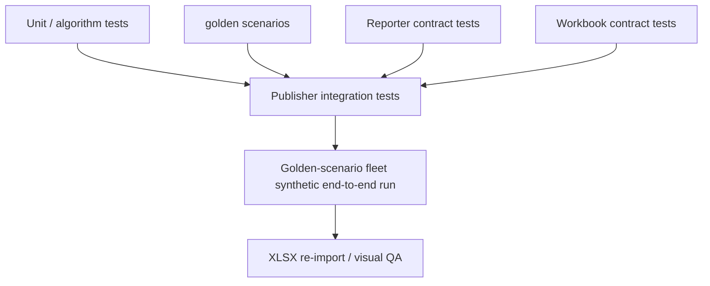

### 32.2 Current regression baseline

The full regression suite is the validation baseline; reproduce the results with the commands in `CLAUDE.md`.

### 32.3 Golden scenarios

Golden fixtures are normalized evidence plus an `expect` block. The fixture list, the assertion DSL and the scenario catalog: `tests/golden/README.md`, the docstring of `tests/test_golden_scenarios.py` and `docs/proposals/golden-scenarios.md`.

Test layers: algorithm and integration tests (`tests/test_publisher.py`, `tests/test_resource_window.py`, `tests/test_config_epochs_sql.py`), golden-scenario tests, Reporter contract and package-integration tests (`tests/test_reporter_contract.py`, `tests/test_locked_reporter_integration.py`), replay-evidence format tests (`tests/test_evidence_format.py`), demo-fleet tests (`tests/test_demo_fleet.py`), workbook contract tests (`tests/test_workbook_contract.py`) and documentation guards (`tests/test_docs.py`).

### 32.4 Required contract assertions

Tests verify:

- one candidate per active knob,
- deterministic IDs and hashes,
- public JSON schema/semantic validation,
- scenario confidence propagation,
- scenario dependency/invalidation behavior,
- current-epoch boundaries (evidence from older epochs never satisfies a current safety threshold),
- unavailable evidence stays null and fails closed (it is never read as zero),
- package economics envelope,
- exact workbook column set/order,
- sheet grains,
- no blank semantic workbook cells,
- signed numeric impact cells with no decorated money strings,
- no Excel business formulas,
- output generation from the simulated demo fleet.

---

## 33. Maintainability rules

1. **All decision thresholds live in `Thresholds`.** Do not introduce hidden constants inside optimizer methods.
2. **Analyzer observes; optimizer decides; estimator prices.** Do not collapse those responsibilities.
3. **Candidate estimates remain independent.** Do not sum them outside `StatefulBundleEstimator`.
4. **Public contract dataclasses are frozen and versioned.** Breaking field semantics require a new contract version.
5. **Workbook columns are contract-owned.** Renderer code cannot invent/drop columns.
6. **New warehouse types fail closed.** A new type requires explicit analyzer/optimizer/estimator/golden support.
7. **New techniques require stable `technique_id`.** IDs must be cataloged before publication.
8. **Decision-affecting code changes require version changes and golden-test updates** (`CLAUDE.md`, change loop).

---

## 34. Remaining implementation boundary

### 34.1 Realization ingestion is not implemented

Phase 1 initializes `realization.status = NOT_APPLIED` (26); measured realization is not writable. Open limitation: [`docs/reference/known-limitations.md`](../reference/known-limitations.md).

### 34.2 Compatibility API remains optional evidence

The read-only workspace compatibility API is intentionally non-authoritative and has a deterministic fallback (8.3). Any future dependency on it for a hard optimization decision requires a separately approved source contract. See [`docs/reference/known-limitations.md`](../reference/known-limitations.md).

### 34.3 Threshold calibration

Thresholds are conservative policy defaults ([`docs/reference/thresholds.md`](../reference/thresholds.md)). Live testing should calibrate them only through versioned policy changes backed by golden/regression evidence.

---

## 35. Technical acceptance criteria

The LLD is satisfied by an implementation when all of the following hold:

1. Only supported warehouse types can enter active optimization logic.
2. Exactly five candidate decisions are produced for every supported warehouse package.
3. All active recommendation evidence is current-epoch scoped.
4. Analyzer, optimizer, candidate estimator, bundle estimator, and reviewer responsibilities remain separated.
5. Candidate savings cannot be added to form scenario or package savings.
6. Plan A order (value key, then invalidation precedence) is deterministic.
7. Plan B remains an isolated migration experiment under Phase-1 policy.
8. Candidate, scenario, evidence, epoch, realization, and package IDs are reproducible from documented hash inputs.
9. Every emitted JSON package passes dataclass semantic validation and JSON Schema v1.3.0.
10. Package economics are traceable to included scenario bounds.
11. Unknown costs are null/unavailable, never silently converted to zero.
12. Workbook generation is a pure projection of validated packages.
13. Workbook sheet/column contracts are controlled from `workbook_contract.py` and regression-tested.
14. Live, replay, and synthetic execution paths converge on the same deterministic decision pipeline.
15. Logs and output artifacts do not contain access tokens or raw SQL text.
16. Golden scenarios and full regression suite remain green after any decision-affecting change.

---

## 36. Document relationships

Document ownership and precedence: `docs/README.md`.

The locked Reporter and Workbook contract documents remain normative for their field-level semantics. This LLD defines how the current publisher produces and consumes those contracts.
