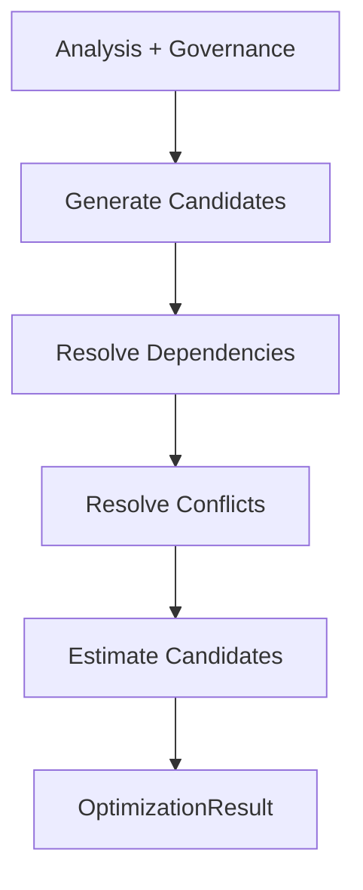
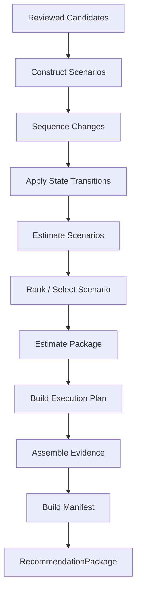
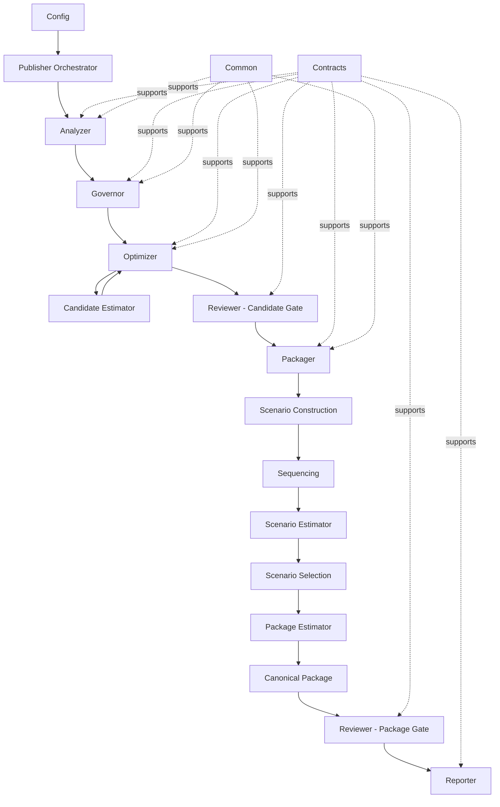
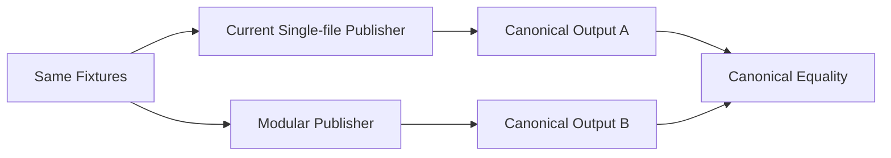
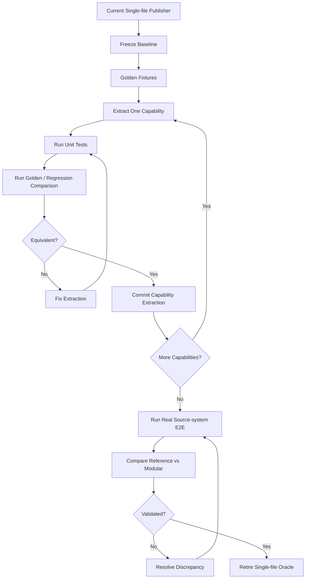

# Repository Reorganization Design

## 1. Purpose

This document defines the target repository structure and implementation plan for modularizing the current single-file `publisher.py` implementation without changing its externally observable behavior.

The design is intentionally aligned to the product's domain capabilities rather than generic technical layers.

The top-level Publisher orchestration model is:

```text
Analyzer → Governor → Optimizer → Reviewer → Packager → Reviewer → Reporter
```

Supporting capabilities such as configuration, contracts, common utilities, estimation, collection, scenario construction, sequencing, and output formatting remain internal to the appropriate domain boundary.

The primary design goal is:

> Keep `publisher.py` as the deterministic orchestration facade while extracting independently testable domain capabilities underneath it.

This is a structural refactor, not an algorithm redesign.

---

## 2. Design Principles

### 2.1 Orchestrate capabilities, not implementation details

`publisher.py` should know only the major domain capabilities:

- Analyzer
- Governor
- Optimizer
- Reviewer
- Packager
- Reporter

It should not directly orchestrate:

- collectors
- SQL execution
- normalization
- epochs
- candidate estimators
- dependency graphs
- conflicts
- scenarios
- sequencing
- state transitions
- scenario estimators
- package estimators
- manifests
- evidence serialization
- workbook rendering
- JSON formatting

Those details belong behind capability boundaries.

---

### 2.2 Preserve deterministic behavior

The modular implementation must preserve the current deterministic behavior.

For the same:

- source inputs
- configuration
- policies
- pricing inputs
- algorithm versions

the modular implementation must produce the same canonical outputs as the current single-file implementation, excluding intentionally non-deterministic metadata such as execution timestamps where applicable.

The initial refactor must therefore be behavior-preserving.

---

### 2.3 Extract around business capabilities

Files and packages should be created around cohesive business responsibilities, not around arbitrary code size or individual helper functions.

Prefer:

```text
optimizer/
    techniques/
        size.py
```

over:

```text
calculate_target_size.py
calculate_size_headroom.py
calculate_size_savings.py
```

unless those functions become independently significant components later.

---

### 2.4 Keep infrastructure subordinate to the domain

The following are supporting infrastructure rather than Publisher pipeline stages:

- `config`
- `contracts`
- `common`

They support all capabilities but are not orchestrated as business stages.

---

### 2.5 Use explicit contracts between capabilities

Do not pass a large mutable dictionary through the full pipeline.

Each capability should receive and return an explicit typed contract.

Conceptually:

```text
PublisherRequest
      ↓
AnalysisResult
      ↓
GovernanceResult
      ↓
OptimizationResult
      ↓
CandidateReviewResult
      ↓
RecommendationPackage
      ↓
PackageReviewResult
      ↓
ReportContract
```

---

## 3. Target Repository Structure

```text
repo/
├── pyproject.toml
├── README.md
├── CLAUDE.md
├── databricks.yml
│
├── src/
│   └── publisher/
│       ├── __init__.py
│       ├── publisher.py
│       │
│       ├── config/
│       │   ├── __init__.py
│       │   ├── settings.py
│       │   ├── defaults.py
│       │   ├── versions.py
│       │   └── loader.py
│       │
│       ├── contracts/
│       │   ├── __init__.py
│       │   ├── request.py
│       │   ├── source.py
│       │   ├── analysis.py
│       │   ├── governance.py
│       │   ├── candidate.py
│       │   ├── scenario.py
│       │   ├── package.py
│       │   ├── review.py
│       │   └── report.py
│       │
│       ├── analyzer/
│       │   ├── __init__.py
│       │   ├── analyzer.py
│       │   ├── normalizer.py
│       │   ├── epochs.py
│       │   ├── metrics.py
│       │   ├── findings.py
│       │   ├── blockers.py
│       │   │
│       │   └── collector/
│       │       ├── __init__.py
│       │       ├── collector.py
│       │       ├── sql_executor.py
│       │       ├── warehouses.py
│       │       ├── billing.py
│       │       ├── pricing.py
│       │       └── queries/
│       │           ├── ...
│       │
│       ├── governor/
│       │   ├── __init__.py
│       │   ├── governor.py
│       │   ├── policy.py
│       │   ├── thresholds.py
│       │   ├── eligibility.py
│       │   ├── exclusions.py
│       │   ├── compatibility.py
│       │   └── constraints.py
│       │
│       ├── optimizer/
│       │   ├── __init__.py
│       │   ├── optimizer.py
│       │   ├── dependencies.py
│       │   ├── conflicts.py
│       │   │
│       │   ├── techniques/
│       │   │   ├── size.py
│       │   │   ├── scaling.py
│       │   │   ├── autostop.py
│       │   │   ├── photon.py
│       │   │   └── serverless.py
│       │   │
│       │   └── estimator/
│       │       ├── candidate.py
│       │       ├── cost.py
│       │       ├── savings.py
│       │       └── runtime.py
│       │
│       ├── reviewer/
│       │   ├── __init__.py
│       │   ├── reviewer.py
│       │   ├── candidate.py
│       │   ├── scenario.py
│       │   ├── package.py
│       │   ├── safety.py
│       │   └── consistency.py
│       │
│       ├── packager/
│       │   ├── __init__.py
│       │   ├── packager.py
│       │   ├── scenarios.py
│       │   ├── sequencing.py
│       │   ├── execution_plan.py
│       │   ├── selection.py
│       │   ├── evidence.py
│       │   ├── manifest.py
│       │   │
│       │   └── estimator/
│       │       ├── scenario.py
│       │       ├── package.py
│       │       ├── state_transition.py
│       │       └── reconciliation.py
│       │
│       ├── reporter/
│       │   ├── __init__.py
│       │   ├── reporter.py
│       │   ├── json_reporter.py
│       │   ├── workbook_reporter.py
│       │   ├── markdown_reporter.py
│       │   └── csv_reporter.py
│       │
│       └── common/
│           ├── __init__.py
│           ├── logging.py
│           ├── errors.py
│           ├── ids.py
│           ├── hashing.py
│           ├── money.py
│           ├── time.py
│           └── utils.py
│
├── tests/
│   ├── unit/
│   │   ├── analyzer/
│   │   ├── governor/
│   │   ├── optimizer/
│   │   ├── reviewer/
│   │   ├── packager/
│   │   ├── reporter/
│   │   └── contracts/
│   │
│   ├── component/
│   │   ├── test_analyzer_governor.py
│   │   ├── test_governor_optimizer.py
│   │   ├── test_optimizer_candidate_estimation.py
│   │   ├── test_candidate_review.py
│   │   ├── test_packager_scenarios.py
│   │   ├── test_scenario_estimation.py
│   │   ├── test_package_estimation.py
│   │   └── test_final_review.py
│   │
│   ├── integration/
│   │   ├── test_collector_sql.py
│   │   ├── test_serverless_warehouse.py
│   │   └── test_publisher_e2e.py
│   │
│   ├── golden/
│   │   ├── cases/
│   │   ├── expected/
│   │   └── test_golden_publisher.py
│   │
│   ├── regression/
│   │   ├── test_single_file_compatibility.py
│   │   └── test_output_contract_compatibility.py
│   │
│   └── fixtures/
│       ├── source/
│       ├── policies/
│       ├── pricing/
│       ├── candidates/
│       ├── scenarios/
│       └── expected/
│
├── scripts/
│   ├── run_publisher.py
│   ├── run_demo.py
│   ├── compare_single_file.py
│   ├── validate_contracts.py
│   └── update_goldens.py
│
├── docs/
├── examples/
└── pricing/
```

---

## 4. Capability Responsibilities

### 4.1 Analyzer

The Analyzer answers:

> What is happening?

It owns the complete transformation from source evidence to analytical evidence.

Responsibilities:

- acquire source data
- execute collector SQL
- normalize source data
- resolve effective configuration
- establish analysis epoch / regime
- derive metrics
- compute statistical features required for deterministic analysis
- generate signals
- generate findings
- identify evidence-level blockers
- preserve source provenance

The Collector is intentionally nested inside Analyzer because collection is part of producing the analysis contract.

Conceptually:


---

### 4.2 Governor

The Governor answers:

> Given the available evidence, what are we allowed to do?

Responsibilities:

- policy evaluation
- threshold resolution
- exclusions
- eligibility
- compatibility checks
- capability checks
- constraints
- policy-derived blockers
- governance evidence

The Governor must not generate recommendations.

It governs what the Optimizer may consider.

---

### 4.3 Optimizer

The Optimizer answers:

> What should we change?

Responsibilities:

- generate optimization candidates
- apply technique-specific deterministic rules
- resolve candidate-level dependencies
- detect conflicts
- identify invalidations
- estimate each candidate
- produce authoritative candidate recommendations

Candidate estimation belongs inside the Optimizer boundary because a candidate is incomplete until its expected impact is known.

Structure:

```text
optimizer/
├── optimizer.py
├── dependencies.py
├── conflicts.py
├── techniques/
│   └── ...
└── estimator/
    ├── candidate.py
    ├── cost.py
    ├── savings.py
    └── runtime.py
```

---

## 5. Estimation Model

Estimation occurs at three distinct levels.

### 5.1 Candidate Estimate

Owned by:

```text
optimizer/estimator/
```

Answers:

> What is the expected effect of this one candidate change?

Examples:

- current cost
- predicted candidate cost
- candidate savings
- runtime impact
- resource impact
- candidate confidence inputs

Candidate estimates are evaluated from the appropriate baseline defined by the candidate model.

They are not automatically additive.

---

### 5.2 Scenario Estimate

Owned by:

```text
packager/estimator/scenario.py
```

Answers:

> What is the expected impact of applying this ordered set of compatible changes?

Scenario estimation is stateful.

Example:

```text
Initial annual cost = $100K

Size change
$100K → $80K

Scaling change against updated state
$80K → $70K

Scenario savings = $30K
```

It is incorrect to assume:

```text
candidate savings A + candidate savings B = scenario savings
```

unless the estimator explicitly proves the candidates are independently additive.

---

### 5.3 Package Estimate

Owned by:

```text
packager/estimator/package.py
```

Answers:

> What is the authoritative economic impact of the final published recommendation package?

Responsibilities include:

- select the authoritative recommended scenario economics
- prevent double counting across alternatives
- distinguish selected recommendations from alternatives
- distinguish quantified recommendations from `TEST_REQUIRED`
- reconcile aggregate values
- publish canonical baseline, predicted cost, savings, and savings percentage

The package estimate is the authoritative estimate for the final publication contract.

---

### 5.4 Estimation Authority

```text
CandidateEstimate
    = authoritative for one candidate

ScenarioEstimate
    = authoritative for one scenario

PackageEstimate
    = authoritative for the final published package
```

---

## 6. Reviewer

Reviewer remains one top-level capability with multiple review gates.

It answers:

> Is this recommendation defensible, internally consistent, and safe to publish?

Structure:

```text
reviewer/
├── reviewer.py
├── candidate.py
├── scenario.py
├── package.py
├── safety.py
└── consistency.py
```

### Candidate Review

Runs after Optimizer.

Checks may include:

- missing evidence
- policy violations
- unsupported transitions
- contradictory recommendations
- invalid dependency states
- candidate estimate consistency
- excessive runtime impact
- insufficient confidence
- required human validation

### Scenario / Package Review

Runs after Packager.

Checks may include:

- dependency ordering
- invalidation behavior
- bundle economics
- double counting
- package reconciliation
- authoritative recommendation uniqueness
- execution safety
- evidence completeness
- report contract consistency

Publisher sees Reviewer as one capability even though Reviewer contains multiple internal gates.

---

## 7. Packager

Packager answers:

> How should accepted recommendations be combined, sequenced, estimated, and represented as the canonical recommendation package?

Responsibilities:

- construct valid scenarios
- sequence dependent changes
- resolve ordering
- build execution plans
- apply state transitions
- estimate scenarios
- rank/select scenarios
- estimate the final package
- assemble evidence
- assemble manifest
- construct the canonical package contract

Packager must not independently invent optimization decisions.

It consumes accepted candidates produced by Optimizer and reviewed by Reviewer.

Structure:

```text
packager/
├── packager.py
├── scenarios.py
├── sequencing.py
├── execution_plan.py
├── selection.py
├── evidence.py
├── manifest.py
└── estimator/
    ├── scenario.py
    ├── package.py
    ├── state_transition.py
    └── reconciliation.py
```

---

## 8. Reporter

Reporter answers:

> How should the canonical package be communicated?

Responsibilities:

- JSON rendering
- workbook rendering
- Markdown rendering
- CSV rendering
- output persistence where required

Reporter must not:

- recalculate savings
- modify recommendations
- reinterpret policy
- change scenario selection
- perform optimization logic

The canonical package must already contain authoritative business semantics before Reporter receives it.

---

## 9. Config, Contracts, and Common

These are supporting infrastructure.

### Config

Owns:

- settings
- defaults
- version identifiers
- configuration loading
- feature flags where required
- execution configuration

### Contracts

Owns typed boundaries such as:

- `PublisherRequest`
- `SourceEvidence`
- `AnalysisResult`
- `GovernanceResult`
- `CandidateRecommendation`
- `CandidateEstimate`
- `OptimizationResult`
- `CandidateReviewResult`
- `Scenario`
- `ScenarioEstimate`
- `PackageEstimate`
- `RecommendationPackage`
- `PackageReviewResult`
- `ReportContract`

### Common

Owns only genuinely shared utilities:

- deterministic ID generation
- hashing
- time helpers
- money utilities
- logging helpers
- shared errors

Business-specific functions must remain in their capability package rather than migrating into `common`.

---

## 10. Publisher Orchestration

`publisher.py` is the deterministic application orchestrator.

Its responsibility is orchestration only.

Target shape:

```python
def publish(request: PublisherRequest) -> ReportContract:
    context = build_context(request)

    analysis = analyzer.run(
        context=context,
    )

    governance = governor.run(
        context=context,
        analysis=analysis,
    )

    optimization = optimizer.run(
        context=context,
        analysis=analysis,
        governance=governance,
    )

    reviewed_candidates = reviewer.review_candidates(
        context=context,
        analysis=analysis,
        governance=governance,
        optimization=optimization,
    )

    package = packager.run(
        context=context,
        analysis=analysis,
        governance=governance,
        candidates=reviewed_candidates,
    )

    reviewed_package = reviewer.review_package(
        context=context,
        analysis=analysis,
        governance=governance,
        package=package,
    )

    report = reporter.run(
        context=context,
        package=reviewed_package,
    )

    return report
```

### Publisher must not contain

- SQL
- policy thresholds
- sizing formulas
- candidate generation rules
- savings formulas
- scenario construction
- dependency graph logic
- state transition logic
- review rules
- rendering details

---

## 11. Internal Capability Orchestration

### Optimizer

`optimizer.run()` may internally orchestrate:



Conceptually:

```python
def run(context, analysis, governance):
    candidates = generate_candidates(...)
    candidates = resolve_dependencies(candidates)
    candidates = resolve_conflicts(candidates)
    estimates = candidate_estimator.estimate(...)
    return OptimizationResult(...)
```

---

### Packager

`packager.run()` may internally orchestrate:



This complexity remains hidden from `publisher.py`.

---

## 12. End-to-End Architecture



---

## 13. Test Architecture

The test suite should mirror the architecture.

### 13.1 Unit Tests

Test individual deterministic responsibilities.

Examples:

```text
tests/unit/publisher/analyzer/
tests/unit/publisher/governor/
tests/unit/publisher/optimizer/
tests/unit/publisher/reviewer/
tests/unit/publisher/packager/
tests/unit/publisher/reporter/
tests/unit/publisher/contracts/
```

Unit tests should generally avoid external systems.

---

### 13.2 Component Tests

Test capability boundaries.

Examples:

- Analyzer → Governor
- Governor → Optimizer
- Optimizer → Candidate Estimator
- Optimizer → Reviewer
- Reviewed Candidates → Packager
- Scenario → Scenario Estimator
- Package → Package Estimator
- Package → Final Reviewer

---

### 13.3 Golden Tests

Golden tests protect deterministic end-to-end behavior.

Recommended fixture shape:

```text
tests/golden/publisher/cases/CASE-001/
├── source/
├── pricing/
├── policy/
├── expected/
│   └── recommendation.json
└── case.yaml
```

Run:

```text
fixture inputs
      ↓
publisher
      ↓
canonical output
      ↓
compare against expected
```

Intentional non-deterministic fields should be normalized before comparison.

---

### 13.4 Regression / Compatibility Tests

During migration, retain the current single-file implementation as the comparison oracle until the modular implementation is proven equivalent.



The comparison must include:

- recommendation status
- blockers
- candidate decisions
- candidate estimates
- scenarios
- scenario estimates
- package estimates
- execution plan
- evidence
- final canonical report

---

### 13.5 Integration Tests

Integration tests validate source-system boundaries.

Examples:

- execute collector SQL against a configured SQL warehouse
- validate returned schemas
- validate pricing lookup
- validate full E2E Publisher execution against source systems
- compare system-run output with equivalent fixture-driven local execution

---

## 14. Implementation Plan

The reorganization should be incremental.

Do not perform a big-bang rewrite.

### Phase 0 — Establish the Behavioral Baseline

Before moving logic:

1. Freeze a known-good copy of the current single-file `publisher.py`.
2. Select representative test fixtures.
3. Persist canonical JSON output for those fixtures.
4. Add deterministic normalization for timestamps / run IDs where required.
5. Create a comparison script.
6. Add regression tests that execute the current implementation.

Exit criteria:

- current implementation reproducibly passes the baseline suite
- expected outputs are stored
- regression comparison is automated

---

### Phase 1 — Extract Contracts

Extract typed contracts without moving algorithms.

Priority contracts:

1. request
2. analysis
3. governance
4. candidate
5. estimate
6. review
7. scenario
8. package
9. report

Replace internal untyped dictionaries incrementally.

Exit criteria:

- single-file Publisher still behaves identically
- contract validation tests pass
- canonical output unchanged

---

### Phase 2 — Extract Config and Common

Move:

- configuration loading
- defaults
- version identifiers
- deterministic IDs
- hashing
- money helpers
- logging
- shared errors

Do not move domain logic into `common`.

Exit criteria:

- baseline compatibility passes
- no behavior change

---

### Phase 3 — Extract Analyzer

Move in this order:

1. collector
2. SQL execution
3. normalization
4. epoch/regime logic
5. derived metrics
6. findings
7. blockers
8. `analyzer.run()`

`publisher.py` should call only `analyzer.run()`.

Exit criteria:

- Analyzer unit tests pass
- collector integration tests pass
- baseline compatibility passes

---

### Phase 4 — Extract Governor

Move:

1. policy parsing/resolution
2. thresholds
3. eligibility
4. exclusions
5. compatibility
6. constraints
7. `governor.run()`

Exit criteria:

- policy decisions identical
- blockers identical
- baseline compatibility passes

---

### Phase 5 — Extract Optimizer and Candidate Estimation

Move:

1. technique implementations
2. candidate generation
3. dependency rules
4. conflict rules
5. candidate cost estimation
6. candidate savings estimation
7. candidate runtime estimation
8. `optimizer.run()`

Candidate Estimator stays inside Optimizer.

Exit criteria:

- candidate recommendations identical
- candidate estimates identical
- dependency/conflict outcomes identical
- baseline compatibility passes

---

### Phase 6 — Extract Reviewer Candidate Gate

Move:

- candidate validation
- policy consistency
- estimate consistency
- safety rules
- candidate-level review outcomes

Expose:

```python
reviewer.review_candidates(...)
```

Exit criteria:

- candidate review outcomes identical
- baseline compatibility passes

---

### Phase 7 — Extract Packager

Move:

1. scenario construction
2. scenario sequencing
3. state transition logic
4. scenario estimation
5. scenario ranking/selection
6. package estimation
7. execution plan
8. evidence assembly
9. manifest creation
10. `packager.run()`

Exit criteria:

- scenarios identical
- scenario estimates identical
- selected scenario identical
- package economics identical
- execution plans identical
- baseline compatibility passes

---

### Phase 8 — Extract Reviewer Package Gate

Move:

- scenario consistency checks
- package reconciliation
- double-count prevention checks
- execution safety checks
- evidence completeness
- canonical contract checks

Expose:

```python
reviewer.review_package(...)
```

Exit criteria:

- final review outcomes identical
- baseline compatibility passes

---

### Phase 9 — Extract Reporter

Move:

- JSON rendering
- workbook generation
- Markdown generation
- CSV generation

Reporter consumes canonical package data and does not calculate business semantics.

Exit criteria:

- output formats equivalent
- canonical JSON identical
- workbook checks pass
- baseline compatibility passes

---

### Phase 10 — Reduce `publisher.py` to Orchestration

At the end of extraction, `publisher.py` should contain approximately:

```text
build context
→ analyzer.run
→ governor.run
→ optimizer.run
→ reviewer.review_candidates
→ packager.run
→ reviewer.review_package
→ reporter.run
→ return ReportContract
```

Exit criteria:

- no embedded SQL
- no embedded optimizer rules
- no embedded estimation math
- no embedded scenario logic
- no embedded rendering logic
- full unit/component/integration/golden suite passes

---

### Phase 11 — Retire the Single-file Compatibility Oracle

Do not delete the original reference immediately.

Retire it only after:

- representative real source-system runs have passed
- golden tests are stable
- modular and reference outputs match for agreed validation cases
- no unresolved discrepancies remain
- code review is complete
- release evidence is captured

The old implementation can then be archived or removed according to repository policy.

---

## 15. Should We Reorganize Now or Wait for Real Runs?

### Recommendation

Proceed with the reorganization now, but only through a controlled behavior-preserving refactor.

Do not wait for every real-world run before beginning.

However, do not remove the single-file implementation as the comparison oracle until representative real runs have validated the modular implementation.

This gives the best balance.

### Why act now

The current single-file implementation has already accumulated clear domain boundaries:

- Analyzer
- Governor
- Optimizer
- Reviewer
- Packager
- Reporter

Continuing to add new behavior into one file will:

- increase refactor cost
- increase accidental coupling
- make targeted testing harder
- make regression diagnosis harder
- increase merge conflicts
- make later Publisher/Realizer alignment harder

The architecture is sufficiently understood to extract these responsibilities now.

### Why retain the single-file implementation temporarily

Real source-system runs still provide valuable evidence for:

- unexpected source schemas
- missing identifiers
- unusual warehouse configurations
- billing edge cases
- pricing gaps
- dependency interactions
- scenario edge cases
- report contract assumptions

Therefore the single-file implementation should remain available during the migration as a behavioral reference.

The strategy is:

```text
Do not choose:

A. Wait for all real runs, then modularize
or
B. Modularize and immediately delete the proven implementation

Choose:

C. Modularize now + preserve current implementation as an oracle
   + validate both against fixtures and representative real runs
```

---

## 16. Recommended Migration Operating Model



---

## 17. Implementation Rules

During the refactor:

1. No algorithm changes unless explicitly approved separately.
2. No threshold changes.
3. No policy changes.
4. No schema changes unless required for typed contracts and proven equivalent.
5. No recommendation behavior changes.
6. No new optimization technique introduced during extraction.
7. No estimation formula changes.
8. No scenario ranking changes.
9. No report semantic changes.
10. Every extraction must pass the regression suite before proceeding.

If a design defect is discovered during extraction:

- document it
- create a separate change item
- complete the structural move first where possible
- implement the behavioral correction independently with its own tests and review

This avoids mixing refactoring and behavioral changes.

---

## 18. Suggested First Implementation Slice

The first implementation slice should be small enough to prove the reorganization method.

Recommended slice:

```text
contracts/
config/
common/
analyzer/
```

Sequence:

1. establish baseline fixtures and golden outputs
2. extract contracts
3. extract config/common
4. extract Analyzer including Collector
5. reduce Publisher's analysis portion to `analyzer.run()`
6. run complete compatibility suite
7. perform one real source-system validation

This demonstrates:

- package layout
- typed contracts
- facade convention
- compatibility methodology
- unit/component/integration test structure

before extracting recommendation logic.

---

## 19. Definition of Done for the Reorganization

The reorganization is complete when:

### Architecture

- `publisher.py` orchestrates only top-level capabilities
- Analyzer owns collection and analytical evidence
- Governor owns policy/governance
- Optimizer owns candidates and candidate estimation
- Reviewer owns candidate and package gates
- Packager owns scenarios, sequencing, scenario estimation, package estimation, execution planning, evidence and manifest
- Reporter owns output rendering only

### Contracts

- capability boundaries use typed contracts
- no broad mutable pipeline dictionary is required
- contracts are versionable and testable

### Testing

- unit tests exist per capability
- component tests cover major capability boundaries
- golden tests cover deterministic end-to-end outputs
- integration tests validate source-system interaction
- compatibility tests prove parity with the original implementation during migration

### Quality

- full test suite passes
- real source-system validation passes
- no unexplained output divergence exists
- code review is complete
- release evidence is captured

### Cleanup

- single-file reference implementation is retired only after equivalence is proven
- README and architecture documentation reflect the modular design
- scripts use the new Publisher facade

---

## 20. Final Target

The final design should feel like:

```text
publisher.py
    |
    +-- Analyzer
    +-- Governor
    +-- Optimizer
    +-- Reviewer
    +-- Packager
    +-- Reviewer
    +-- Reporter
```

while internally supporting:

```text
Analyzer
    └── Collector

Optimizer
    └── Candidate Estimator

Packager
    ├── Scenario Construction
    ├── Sequencing
    ├── Scenario Estimator
    └── Package Estimator
```

This keeps the top-level architecture stable and understandable while allowing the lower-level algorithms and contracts to evolve independently.

The intended result is not a framework or microservice architecture.

It remains:

> one deterministic Publisher, implemented as a set of cohesive, independently testable domain capabilities.

---

## 21. Implementation Decisions (approved 2026-10-05)

These decisions bind the phases above where the generic plan meets the existing repository.

### 21.1 Layout and naming

- The code moves to the `src/publisher/` package exactly as in section 3. The root `publisher.py` is removed in Phase 1: the single file first moves unchanged to `src/publisher/publisher.py`, then shrinks phase by phase. A root module and a package both named `publisher` cannot coexist.
- The CLI is the `publisher` console command (also `python -m publisher`) in `src/publisher/cli/`, an adapter in front of `publisher.publish` (see section 21.6), with `scripts/run_publisher.py` and `scripts/run_demo.py` as thin wrappers. Setup becomes `pip install -e .`; `pyproject.toml` declares the package and the `pyyaml` dependency already in `requirements.txt`.
- `tools/` is merged into `scripts/` (section 3); every command in `CLAUDE.md`, `README.md`, `docs/` and `.claude/skills/` is updated in the phase that changes it, including the live-run commands in `docs/proposals/publisher/real-data-run.md`.
- The public Reporter JSON and Workbook contracts (today `contracts/reporter_contract.py`, `contracts/reporter_schema.py`, `contracts/workbook_contract.py`) merge into `src/publisher/contracts/` together with the internal typed boundaries. The committed JSON Schema in `schema/` and every serialized package stay byte-identical; only module paths change.

### 21.2 Domain constraints that override the generic structure

- Photon and the warehouse channel are observation-only. There is no `optimizer/techniques/photon.py`; Photon observation lives in the Analyzer.
- The doc's `techniques/serverless.py` is `techniques/migration.py`: warehouse-type migration runs in both directions. `scaling.py` holds the max- and min-cluster techniques; `size.py` and `autostop.py` as named.
- The collector keeps the doc's `collector.py`, `sql_executor.py`, `billing.py`, `pricing.py` and `queries/` and adds `workspace_api.py` (read-only REST and OAuth), `replay.py` (evidence files) and `demo.py` (the simulated demo fleet). The Analyzer adds `forecast.py` (the no-change baseline Modeler, which the collector needs) and `calibration.py` (workspace-level rates over supported warehouses).
- The Governor has `governor.py`, `eligibility.py` (the supported-type exclusions), `constraints.py` (the live AWS price-registry guard) and `compatibility.py` (the migration compatibility gate, called by the scenario planner). There is no separate `policy.py`, `thresholds.py` or `exclusions.py`: thresholds are fixed in the run context before the Analyzer runs, and exclusions are the eligibility result.
- The Optimizer keeps one technique module per active knob (`size.py`, `scaling.py` for max and min clusters, `autostop.py`, `migration.py`) and `conflicts.py` (the canary-rollback rule that holds conflicting cuts). There is no `dependencies.py`: each technique sets its own dependencies and invalidations on its decision. The candidate estimator splits into `candidate.py`, `cost.py` and `savings.py`; there is no `runtime.py`, because the runtime slowdown is part of the size cost factors.
- Capabilities run stage by stage across the fleet (all eligible warehouses are optimized, then reviewed and planned), so the run log groups lines by stage; packages, evidence, manifest and workbook are unchanged.
- The Reviewer keeps each gate as one fail-fast sequence of checks in its own module (`candidate.py`, `scenario.py`, mixed into `Reviewer`); there is no separate `safety.py` or `consistency.py`, because splitting a gate's checks would reorder which violation is reported first. The plan-step pricing-basis labels move to `contracts/scenario.py`, where the scenario gate and the bundle estimator both read them.
- The Packager has `scenarios.py` (the planner, which also chooses the recommended scenario inside one method), `sequencing.py` (plan order and the rollback and canary notes), `execution_plan.py`, `selection.py` (the package's overall status), `evidence.py`, `packager.py`, and `estimator/scenario.py`, `state_transition.py` and `package.py`. It adds `adapter.py`, which maps internal results onto the public contract types. There is no `estimator/reconciliation.py`: billed-versus-modeled reconciliation is part of candidate cost estimation (`optimizer/estimator/cost.py`). Packager output is `PackagingResult` (internal scenarios plus the frozen public packages, in the same order).
- The package gate (`reviewer.review_package`) is the scenario gate plus report-contract consistency (`package.validate()` and the committed schema) for each frozen package. It adds no new rule: the same checks already run when the package is built and immediately before it is written, which stays the write-order guarantee.
- The Reporter has `reporter.py` (`run`), `json_reporter.py` (the existing writer of packages, `evidence.json`, the workbook and the manifest, which keeps the write-order guarantee in one function) and `workbook_reporter.py`. The manifest is assembled by `packager/manifest.py` and written by the Reporter.
- `publisher.py` holds `build_context`, `publish` (the section 10 orchestration), `demo_fleet_size`, and two evidence-in-hand entry points (`evaluate_warehouses`, `build_recommendation_packages`) that tests and replay tooling call on the same capability functions. Argument parsing and the CLI summary live in the CLI adapter (section 21.6). Tests import names from the capability modules; the facade re-exports nothing.
- Test layout: `tests/unit/publisher/<capability>/`, `tests/component/publisher/`, `tests/integration/publisher/` (live checks, skipped without a Databricks profile), `tests/golden/publisher/` (case folders, the legacy expectation cases and the demo-fleet signatures), `tests/regression/publisher/` and `tests/fixtures/publisher/expected/`. The `fixtures/source`, `policies`, `pricing`, `candidates` and `scenarios` folders are not created: each golden case folder carries its own source, and no fixture overrides prices or policy. `tests/test_docs.py` stays at the top level as the repository-wide doc guard, with shared fixtures in `tests/publisher_case.py` and `tests/evidence_helpers.py`.
- The internal analysis boundary is `FleetAnalysis` (with one `WarehouseAnalysis` per supported warehouse), because the name `AnalysisResult` already denotes the per-knob result.
- Markdown and CSV reporters and `databricks.yml` are not created: they are new features, which section 17 excludes from a structural refactor.
- The Analyzer fails closed on unsupported warehouse types: `analyzer.run()` never calibrates or analyzes them, using the same `SUPPORTED_WAREHOUSE_TYPES` check, so findings never reach an unknown type even though the Analyzer runs before the Governor (approved 2026-10-05). Governor records those exclusions and owns threshold and policy resolution, the AWS region price guard and migration compatibility evaluation.
- The Governor is the policy engine: `Thresholds` lives in `governor/thresholds.py` because it changes what is recommended, even though the Analyzer, Optimizer and Packager import it (approved 2026-10-05). `config/` holds application settings (versions, repository paths, request loading) and constants (`config/defaults.py`: sizes, published DBU per cluster-hour, AWS topology, the active knobs, the supported warehouse types and the Databricks product constants). The cost profiles, including the nonprod tag that selects the aggressive profile, are Governor policy (`governor/cost_profiles.py`), which the Analyzer applies once per run.
- The second Reviewer gate runs after the Packager assembles the package. The Reviewer only raises, so moving it does not change outputs; the package write order (assemble, ID and hash, semantic `validate()`, schema validation, sorted JSON, write) is unchanged.
- No component version bump: the refactor is not decision-affecting.

### 21.3 Oracle and tests

- The single-file oracle is the git tag `reorg-oracle-2.10.0` on the last single-file commit, plus stored normalized canonical outputs. `scripts/compare_single_file.py` re-runs the tag in a temporary worktree when a diff needs diagnosis. No in-tree copy of the old `publisher.py` is kept.
- The test suite takes the section 3 layout in full: golden fixtures become `tests/golden/publisher/cases/<CASE>/` folders (`source/`, `pricing/`, `policy/`, `expected/recommendation.json`, `case.yaml` holding the assertion block), and tests live under `unit/`, `component/`, `integration/`, `golden/`, `regression/` and `fixtures/`. Each extraction phase relocates the existing tests that target its capability; Phase 10 relocates the rest.
- Integration tests against a live SQL warehouse skip unless a Databricks profile is configured.
- Phase 11 retires the single-file oracle once fixture-based parity is proven 1:1 (zero canonical-output diffs over the demo fleet and every golden case, and every single-file function accounted for in a new module). The real source-system run in `docs/proposals/publisher/real-data-run.md` then runs on the reorganized code; this replaces the section 14 Phase 11 and section 15 condition that real runs precede retirement.

### 21.4 Execution

- One worktree and branch per phase (`.worktrees/reorg-pN`, `reorg/pN`), `/code-review low` before each merge to `master`, nothing pushed. All phases run in one session, with mechanical moves delegated to subagents.
- Every phase exits with: compile check, the full unit suite, the regression comparison against the oracle, the demo regenerated and the workbook validator passing.
- A design defect found during extraction is recorded as a separate change item and never fixed inside a structural phase (section 17).

### 21.5 Outcome

All phases are complete and the single-file oracle is retired: 245 of its 246 top-level definitions live in the capability packages under the same name (`optimize_warehouse` is the composition of the Optimizer, the candidate gate, planning and the scenario gate), and the reorganized code reproduces the oracle's canonical outputs exactly. The parity record and its evidence are in [`docs/proposals/publisher/repo-reorg-parity.md`](../../proposals/publisher/repo-reorg-parity.md). The real source-system run in `docs/proposals/publisher/real-data-run.md` runs on the reorganized code.

### 21.6 CLI adapter (approved 2026-10-05)

- The CLI sits outside the domain packages as an adapter: `src/publisher/cli/` (`main.py` dispatches subcommands, `publish.py` runs one publisher run), installed as the `publisher` console command and also reachable as `python -m publisher` and `scripts/run_publisher.py`. `publisher publish [options]` is the canonical form; options without a subcommand go to `publish`, so earlier commands keep working.
- Dependency direction: CLI -> `publisher.publish` -> Analyzer -> Governor -> Optimizer -> Reviewer -> Packager -> Reviewer -> Reporter. The CLI imports only the facade, `contracts`, `config` and `common`, never a capability package; a test enforces it.
- The CLI parses and validates its own arguments, builds the `PublisherRequest`, configures logging, calls `publish`, prints the summary and maps exit codes. Every option of the single-file CLI is unchanged (names, defaults, environment variables, choices, help); a test compares the option table with a snapshot taken from the single-file release.
- The core raises `PublisherError` (`common/errors.py`) instead of exiting the process; the CLI prints its message and exits with status 2 (the single-file CLI exited with status 1 for the same messages).
- `--mode` names where a run executes and accepts only `local` today; `PublisherRequest.execution_mode` carries it and `config/loader.py` resolves it, so a Databricks Asset Bundle mode is added there with its adapters, not in the CLI.

