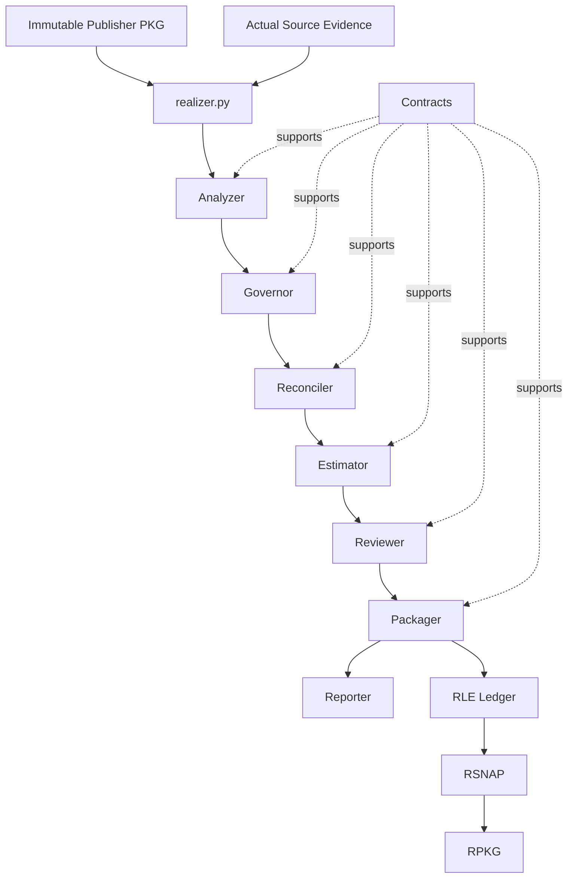
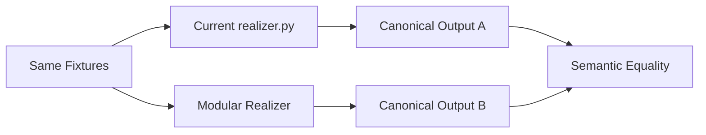

# Realizer Repository Reorganization Design — Phase 1

## 1. Purpose

This document defines the target repository structure and implementation plan for modularizing the current single-file `realizer.py` implementation while preserving its deterministic realization semantics.

The design is intentionally scoped to **Phase 1 only**.

The goal is to move from one large implementation file to a small number of cohesive domain capabilities without over-fragmenting the codebase.

The target Realizer orchestration is:

```text
Analyzer
   ↓
Governor
   ↓
Reconciler
   ↓
Estimator
   ↓
Reviewer
   ↓
Packager
   ↓
Reporter
```

Supporting concerns such as configuration, contracts, shared utilities, collectors, ledger construction, and output rendering remain internal to the appropriate capability boundary.

The primary design goal is:

> Keep `realizer.py` as the deterministic orchestration facade while extracting a small number of cohesive, independently testable domain capabilities underneath it.

This is a structural refactor, not an algorithm redesign.

---

# 2. Realizer Responsibility

The Realizer is not a second Optimizer.

Its job is to determine what actually happened after a recommendation package was published.

The responsibility boundary is:

```text
Publisher
    determines what should change
    produces immutable recommendation package

Realizer
    observes what actually changed
    reconciles expected vs actual
    validates the outcome
    calculates realized value
    maintains realization history
```

Realizer must not:

- create a new optimization recommendation
- silently change target configuration
- mutate the original recommendation package
- reinterpret drift as a new recommendation
- regenerate invalidated downstream targets
- retrospectively modify Publisher economics

If observed state requires re-optimization, Realizer should emit the appropriate lifecycle result and allow Publisher to create a new recommendation package.

---

# 3. Realization Lineage

The core lineage model remains:

```text
PKG   = immutable recommendation package produced by Publisher
RPKG  = realization package associated 1:1 with one PKG
RLE   = append-only realization ledger event
RSNAP = derived current realization snapshot
```

Conceptually:

```text
PKG-001
   │
   └── RPKG-001
         │
         ├── RLE-001
         ├── RLE-002
         ├── RLE-003
         └── ...
                │
                ▼
             RSNAP
```

A new realization event does not create a new RPKG.

A genuinely new recommendation package creates a new realization lineage.

---

# 4. Design Principles

## 4.1 Orchestrate capabilities, not sub-steps

`realizer.py` should know only about:

- Analyzer
- Governor
- Reconciler
- Estimator
- Reviewer
- Packager
- Reporter

It should not directly orchestrate:

- SQL execution
- config-diff implementation
- plan-step matching
- lifecycle transition tables
- overlap calculations
- annualization formulas
- ledger folding
- snapshot derivation
- workbook rendering

Those stay behind capability boundaries.

---

## 4.2 Preserve deterministic behavior

For the same:

- immutable PKG
- normalized actual evidence
- ordered realization history
- pricing/cost inputs
- policy version
- estimator version

the Realizer should produce the same:

- lifecycle state
- plan/step state
- attribution result
- realized savings
- validation result
- blockers
- ledger events
- snapshot
- realization package

---

## 4.3 Avoid tiny-file architecture

The code should be modular, but not fragmented.

Use this rule:

> Split by cohesive behavior, not by noun.

A separate file is justified when the logic:

- is substantial,
- changes independently,
- has a distinct contract,
- or benefits materially from isolated testing.

Do not create one file simply because a concept exists in the architecture.

Start broader and split only when complexity makes it worthwhile.

---

## 4.4 Use explicit contracts between capabilities

Avoid passing a large mutable dictionary through the entire pipeline.

Preferred conceptual flow:

```text
RealizationRequest
      ↓
RealizationAnalysis
      ↓
GovernanceResult
      ↓
ReconciliationResult
      ↓
RealizationEstimate
      ↓
ReviewResult
      ↓
RealizationPackage
      ↓
ReportContract
```

---

# 5. Target Phase 1 Repository Structure

```text
repo/
├── pyproject.toml
├── README.md
├── CLAUDE.md
│
├── src/
│   ├── publisher/
│   │   └── ...
│   │
│   └── realizer/
│       ├── __init__.py
│       ├── realizer.py
│       │
│       ├── config/
│       │   ├── __init__.py
│       │   ├── settings.py
│       │   └── loader.py
│       │
│       ├── contracts/
│       │   ├── __init__.py
│       │   ├── request.py
│       │   ├── analysis.py
│       │   ├── reconciliation.py
│       │   ├── realization.py
│       │   └── report.py
│       │
│       ├── analyzer/
│       │   ├── __init__.py
│       │   ├── analyzer.py
│       │   ├── analysis.py
│       │   │
│       │   └── collector/
│       │       ├── __init__.py
│       │       ├── collector.py
│       │       └── queries/
│       │           └── ...
│       │
│       ├── governor/
│       │   ├── __init__.py
│       │   ├── governor.py
│       │   └── policy.py
│       │
│       ├── reconciler/
│       │   ├── __init__.py
│       │   ├── reconciler.py
│       │   ├── matching.py
│       │   └── lifecycle.py
│       │
│       ├── estimator/
│       │   ├── __init__.py
│       │   ├── estimator.py
│       │   ├── economics.py
│       │   └── attribution.py
│       │
│       ├── reviewer/
│       │   ├── __init__.py
│       │   ├── reviewer.py
│       │   ├── validation.py
│       │   └── economics.py
│       │
│       ├── packager/
│       │   ├── __init__.py
│       │   ├── packager.py
│       │   ├── ledger.py
│       │   └── snapshot.py
│       │
│       ├── reporter/
│       │   ├── __init__.py
│       │   ├── reporter.py
│       │   └── workbook.py
│       │
│       └── common/
│           ├── __init__.py
│           ├── logging.py
│           ├── errors.py
│           └── utils.py
│
├── tests/
│   ├── unit/
│   │   └── realizer/
│   │       ├── analyzer/
│   │       ├── governor/
│   │       ├── reconciler/
│   │       ├── estimator/
│   │       ├── reviewer/
│   │       ├── packager/
│   │       ├── reporter/
│   │       └── contracts/
│   │
│   ├── component/
│   │   └── realizer/
│   │       ├── test_analyzer_governor.py
│   │       ├── test_reconciliation.py
│   │       ├── test_realization_estimation.py
│   │       ├── test_validation.py
│   │       └── test_ledger_snapshot.py
│   │
│   ├── integration/
│   │   └── realizer/
│   │       ├── test_source_collection.py
│   │       └── test_realizer_e2e.py
│   │
│   ├── golden/
│   │   └── realizer/
│   │       ├── cases/
│   │       ├── expected/
│   │       └── test_golden_realization.py
│   │
│   ├── regression/
│   │   └── realizer/
│   │       ├── test_single_file_compatibility.py
│   │       └── test_contract_compatibility.py
│   │
│   └── fixtures/
│       └── realizer/
│           ├── packages/
│           ├── observations/
│           ├── ledger/
│           ├── pricing/
│           ├── policies/
│           └── expected/
│
├── scripts/
│   ├── run_realizer.py
│   ├── compare_realizer_single_file.py
│   ├── validate_realizer_contracts.py
│   └── update_realizer_goldens.py
│
├── docs/
└── examples/
```

This structure keeps the top-level capability boundaries intact while avoiding dozens of narrowly scoped implementation files.

---

# 6. Capability Responsibilities

## 6.1 Analyzer

The Analyzer answers:

> What actually happened?

It owns the transformation from actual source evidence into normalized realization evidence.

Responsibilities:

- collect current warehouse configuration
- collect billing/cost evidence
- collect relevant performance/runtime evidence
- collect execution/configuration events
- normalize source evidence
- compare actual configuration with expected configuration
- derive cost and performance metrics
- detect drift evidence
- detect rollback evidence
- emit findings
- preserve source provenance

Recommended internal structure:

```text
analyzer/
├── analyzer.py
├── analysis.py
└── collector/
    ├── collector.py
    └── queries/
```

`analysis.py` may initially contain:

- normalization
- config comparison
- performance derivation
- cost derivation
- drift evidence
- rollback evidence
- findings

Split these later only if the file becomes materially difficult to maintain.

---

# 7. Governor

The Governor answers:

> Given the available evidence and policy, what conclusions are permitted?

Responsibilities:

- evidence sufficiency
- realization eligibility
- stabilization windows
- validation thresholds
- attribution rules
- minimum-confidence rules
- lifecycle transition constraints
- fail-closed conditions

Recommended structure:

```text
governor/
├── governor.py
└── policy.py
```

`policy.py` owns the cohesive policy logic rather than creating separate files for every individual policy concept.

The Governor does not:

- reconcile plan state
- calculate realized savings
- generate ledger events

---

# 8. Reconciler

The Reconciler answers:

> How does observed actual state relate to the published recommendation plan and its lifecycle?

This is a first-class Realizer capability.

Recommended structure:

```text
reconciler/
├── reconciler.py
├── matching.py
└── lifecycle.py
```

## 8.1 `matching.py`

Owns:

- PKG/RPKG lineage matching
- expected-vs-actual configuration matching
- plan matching
- step matching
- partial-application detection
- ordered-plan progress

## 8.2 `lifecycle.py`

Owns:

- lifecycle state machine
- invalidation
- `PENDING_REEVALUATION`
- rollback
- drift
- supersession
- out-of-order application behavior
- transition validation

The Reconciler does not create new optimization targets.

---

# 9. Estimator

Estimator is a top-level Realizer capability because realized-value measurement is a primary Realizer outcome.

It answers:

> Given the reconciled implementation state and valid evidence, what value has actually been realized?

Recommended structure:

```text
estimator/
├── estimator.py
├── economics.py
└── attribution.py
```

## 9.1 `economics.py`

Owns:

- baseline resolution
- actual-cost calculation
- step realization
- plan realization
- package realization
- annualization where permitted
- expected-vs-realized economics

## 9.2 `attribution.py`

Owns:

- attribution rules
- overlap handling
- double-count prevention
- lineage-aware attribution
- confidence/evidence quality related to attribution

---

# 10. Realization Estimation Levels

Realization estimation occurs at three levels.

## 10.1 Step Realization

Answers:

> What realized effect can be attributed to this applied plan step?

Useful for:

- diagnostics
- explainability
- validation
- progress tracking

Step values are not automatically additive.

---

## 10.2 Plan Realization

Answers:

> What realized effect can be attributed to the actual executed plan path?

This calculation must respect:

- actual execution order
- dependencies
- partial application
- invalidations
- rollback
- validation windows

---

## 10.3 Package Realization

Answers:

> What is the authoritative realized value for this RPKG at this point in time?

Package realization must:

- prevent double counting
- exclude inactive alternatives
- exclude invalidated steps
- account for partial realization
- respect validation state
- reconcile actual cost with valid baseline
- expose expected versus realized value

Authority:

```text
Step realization
    = diagnostic authority for one applied step

Plan realization
    = authority for one executed plan path

Package realization
    = authoritative realized value for the RPKG snapshot
```

---

# 11. Reviewer

Reviewer answers:

> Is this realization outcome defensible, safe, and internally consistent?

Recommended structure:

```text
reviewer/
├── reviewer.py
├── validation.py
└── economics.py
```

## 11.1 `validation.py`

Owns:

- evidence completeness
- observation window completeness
- lifecycle validity
- performance guardrails
- safety validation
- rollback validation
- drift validation

## 11.2 `economics.py`

Owns:

- baseline validation
- actual-cost reconciliation
- attribution validation
- overlap checks
- no-double-count checks
- annualization validation
- expected-vs-realized consistency

The Reviewer validates authoritative upstream results; it does not recalculate them independently.

---

# 12. Packager

Packager answers:

> How should reviewed realization facts be represented in the canonical realization lineage?

Recommended structure:

```text
packager/
├── packager.py
├── ledger.py
└── snapshot.py
```

## 12.1 `ledger.py`

Owns:

- realization event creation
- append-only event semantics
- event ordering
- duplicate-event protection
- event identity

## 12.2 `snapshot.py`

Owns:

- deterministic ledger folding
- RSNAP derivation
- current RPKG representation
- realization summary construction

Packager does not recompute economics.

---

# 13. Reporter

Reporter answers:

> How should the canonical realization state be communicated?

Recommended structure:

```text
reporter/
├── reporter.py
└── workbook.py
```

`reporter.py` may own:

- canonical JSON
- JSONL ledger output
- CSV/Markdown projection where needed

`workbook.py` remains separate because workbook construction usually contains enough presentation-specific logic to justify its own module.

Reporter must not:

- calculate realized savings
- infer lifecycle state
- modify ledger state
- reinterpret validation outcomes

---

# 14. Config, Contracts, and Common

These are supporting concerns rather than pipeline stages.

## Config

```text
config/
├── settings.py
└── loader.py
```

Owns:

- execution settings
- defaults
- version identifiers
- configuration loading

Keep version constants in `settings.py` initially unless they become large enough to justify a dedicated file.

---

## Contracts

Recommended starting structure:

```text
contracts/
├── request.py
├── analysis.py
├── reconciliation.py
├── realization.py
└── report.py
```

Avoid one contract file per small data type.

Example grouping:

### `request.py`

- `RealizationRequest`
- source selectors
- execution parameters

### `analysis.py`

- normalized observation
- analysis findings
- actual-state evidence

### `reconciliation.py`

- plan/step state
- lifecycle result
- invalidation state
- drift/rollback state

### `realization.py`

- realization estimate
- RLE
- RSNAP
- RPKG
- review result

### `report.py`

- external RealizationEnvelope / report contract

Split these only as the contract set grows.

---

## Common

Recommended:

```text
common/
├── logging.py
├── errors.py
└── utils.py
```

Do not create `ids.py`, `hashing.py`, `money.py`, `time.py`, etc. until those helpers are substantial enough to warrant standalone modules.

---

# 15. `realizer.py` Orchestration

`realizer.py` should become intentionally simple.

Target conceptual implementation:

```python
def realize(request: RealizationRequest) -> RealizationEnvelope:
    context = build_context(request)

    analysis = analyzer.run(
        context=context,
        package=request.package,
    )

    governance = governor.run(
        context=context,
        package=request.package,
        analysis=analysis,
    )

    reconciliation = reconciler.run(
        context=context,
        package=request.package,
        analysis=analysis,
        governance=governance,
    )

    estimate = estimator.run(
        context=context,
        package=request.package,
        analysis=analysis,
        governance=governance,
        reconciliation=reconciliation,
    )

    reviewed = reviewer.run(
        context=context,
        package=request.package,
        analysis=analysis,
        governance=governance,
        reconciliation=reconciliation,
        estimate=estimate,
    )

    realization = packager.run(
        context=context,
        package=request.package,
        reviewed=reviewed,
    )

    report = reporter.run(
        context=context,
        realization=realization,
    )

    return report
```

The exact names may match the current public contract, but the abstraction level should remain this high.

---

# 16. What `realizer.py` Must Not Contain

After the refactor, `realizer.py` should contain no:

- SQL text
- source-specific collection code
- config-diff formulas
- lifecycle transition implementation
- realized-savings formulas
- overlap algorithms
- validation thresholds
- ledger folding logic
- workbook formatting
- JSON formatting details

It orchestrates capabilities only.

---

# 17. End-to-End Architecture



---

# 18. Core Lifecycle Scenarios

The modular design must preserve the existing Realizer semantics for at least the following scenarios.

## 18.1 No recommendation applied

```text
PKG exists
→ target state not observed
→ remains pending / not applied
→ realized savings = 0
```

---

## 18.2 Single-step recommendation fully applied

```text
expected target observed
→ APPLIED
→ VALIDATING
→ validation passes
→ realized value measured
→ REALIZED
```

---

## 18.3 Multi-step plan partially applied

```text
Plan:
Step 1
Step 2 depends on Step 1
Step 3 depends on Step 2

Observed:
Step 1 applied
Step 2 missing
Step 3 changed

Result:
partial-plan semantics
dependency reconciliation
downstream invalidation / reevaluation as defined
```

Realizer must not assume the original complete plan was implemented.

---

## 18.4 Dependency invalidation

Where the Publisher package defines dependency/invalidation behavior, Realizer must reconcile observed implementation against it.

Invalidated downstream steps may become:

```text
PENDING_REEVALUATION
```

according to the current lifecycle contract.

Realizer does not regenerate replacement targets.

---

## 18.5 Validation failure

```text
change applied
→ cost improves
→ performance validation fails
→ VALIDATION_FAILED
```

Savings must not be reported as fully realized if policy requires successful validation.

---

## 18.6 Configuration drift

```text
recommendation applied
→ later unrelated/manual change
→ DRIFTED
→ realization becomes invalid or requires reevaluation
```

Drift does not become a new recommendation baseline.

---

## 18.7 Rollback

```text
change applied
→ validation fails / operator rolls back
→ rollback detected
→ realization status updated
→ realization window reconciled
```

---

## 18.8 Superseded package

```text
PKG-001 → RPKG-001
PKG-002 → RPKG-002
```

The Realizer preserves both lineages.

The older lineage may become `SUPERSEDED` according to the existing lifecycle contract.

---

## 18.9 Overlapping savings

Realizer must prevent double counting across:

- dependent plan steps
- overlapping observation windows
- old and new package lineages
- multiple savings mechanisms affecting the same cost base

The authoritative package realization must be derived from deterministic attribution, not from independent summation.

---

# 19. RPKG, RLE, and RSNAP

## RPKG

One realization lineage per immutable Publisher package.

```text
PKG-001 1 ───── 1 RPKG-001
```

---

## RLE

Append-only realization facts.

Examples may include:

```text
PACKAGE_REGISTERED
STEP_APPLIED
PARTIAL_APPLICATION_DETECTED
VALIDATION_STARTED
VALIDATION_PASSED
VALIDATION_FAILED
REALIZATION_MEASURED
DRIFT_DETECTED
ROLLBACK_DETECTED
PLAN_INVALIDATED
PENDING_REEVALUATION
SUPERSEDED
```

Use the existing canonical event vocabulary.

---

## RSNAP

Derived current realization state.

Invariant:

```text
same PKG
+ same ordered RLE history
+ same normalized evidence
+ same policy/estimator versions
=
same RSNAP
```

This invariant should be tested explicitly.

---

# 20. Idempotency

Repeated processing of identical evidence must not create duplicate realization value or duplicate state-changing events.

Required behavior:

```text
same evidence
+ same prior realization state
→ no duplicate semantic RLE
```

New evidence may create a new event.

Reprocessing identical evidence should remain idempotent.

---

# 21. Test Architecture

The test suite should mirror the capability architecture but remain practical.

## 21.1 Unit Tests

Test cohesive behaviors.

Examples:

```text
Analyzer
- config comparison
- cost derivation
- performance derivation
- drift evidence
- rollback evidence

Governor
- evidence sufficiency
- policy thresholds
- validation windows

Reconciler
- step matching
- plan matching
- lifecycle transitions
- invalidation
- drift/rollback/supersession

Estimator
- baseline
- actual cost
- step realization
- plan realization
- package realization
- overlap attribution

Reviewer
- validation
- economics consistency

Packager
- event creation
- ledger folding
- snapshot derivation
```

---

## 21.2 Component Tests

Recommended:

```text
Analyzer → Governor
Analyzer + PKG → Reconciler
Reconciler → Estimator
Estimator → Reviewer
Reviewer → Packager
RLE history → RSNAP
```

---

## 21.3 Golden Tests

Golden realization cases should include at minimum:

1. no recommendation applied
2. single step applied
3. full multi-step plan applied
4. partially applied plan
5. out-of-order application
6. dependency invalidation
7. `PENDING_REEVALUATION`
8. successful validation
9. failed validation
10. rollback
11. drift
12. superseded package
13. overlapping savings
14. insufficient evidence
15. missing cost data
16. pricing unavailable
17. duplicate input/idempotency
18. replay of identical event history
19. late-arriving observation

---

## 21.4 Regression / Compatibility Tests

Keep the current single-file implementation as the behavioral oracle during migration.



Comparison should cover:

- lifecycle state
- blockers
- plan/step status
- realized economics
- attribution
- review result
- RLE sequence
- RSNAP
- RPKG
- canonical report

---

## 21.5 Integration Tests

Phase 1 integration scope:

- collector SQL execution
- source schema validation
- pricing/cost input integration
- full Realizer E2E run against configured source systems
- comparison against equivalent local fixtures where practical

---

# 22. Implementation Plan

The reorganization should be incremental.

Do not perform a big-bang rewrite.

---

## Phase 0 — Freeze Current Behavior

Before moving logic:

1. preserve a known-good copy of the current `realizer.py`
2. select representative PKG fixtures
3. capture representative actual-state evidence
4. persist current canonical outputs
5. normalize intentionally variable fields
6. create a comparison script
7. add regression tests against the current implementation

Exit criteria:

- repeatable current behavior
- golden fixtures exist
- compatibility runner is automated

---

## Phase 1 — Extract Contracts

Extract the grouped contract files:

```text
request.py
analysis.py
reconciliation.py
realization.py
report.py
```

Do not move algorithms yet.

Exit criteria:

- current Realizer behavior remains unchanged
- contract validation passes
- canonical outputs remain equivalent

---

## Phase 2 — Extract Config and Common

Move:

- configuration loading
- settings/defaults
- version identifiers
- logging
- shared errors
- deterministic utility helpers

Do not move domain logic into `common`.

Exit criteria:

- compatibility suite passes
- no semantic change

---

## Phase 3 — Extract Analyzer + Collector

Move:

1. collector logic
2. source SQL
3. normalization
4. config comparison
5. performance metrics
6. cost metrics
7. drift/rollback evidence
8. findings
9. `analyzer.run()`

At the end:

```text
realizer.py
    ↓
analyzer.run()
```

Exit criteria:

- Analyzer unit tests pass
- collector integration tests pass
- compatibility suite passes

---

## Phase 4 — Extract Governor

Move:

- evidence sufficiency
- realization eligibility
- validation windows
- thresholds
- attribution policy
- transition constraints
- fail-closed rules
- `governor.run()`

Exit criteria:

- policy decisions match current behavior
- compatibility suite passes

---

## Phase 5 — Extract Reconciler

Move:

### Matching

- lineage matching
- expected-vs-actual matching
- plan matching
- step matching
- partial application

### Lifecycle

- state machine
- invalidation
- `PENDING_REEVALUATION`
- rollback
- drift
- supersession
- out-of-order behavior

Expose:

```python
reconciler.run(...)
```

Exit criteria:

- lifecycle results identical
- golden lifecycle scenarios pass
- compatibility suite passes

This is one of the highest-risk extraction phases and should be handled carefully.

---

## Phase 6 — Extract Estimator

Move:

### Economics

- baseline
- actual cost
- step realization
- plan realization
- package realization
- annualization

### Attribution

- attribution
- overlap prevention
- lineage-aware savings
- confidence/evidence quality

Expose:

```python
estimator.run(...)
```

Exit criteria:

- realized economics identical
- no-double-count invariants pass
- compatibility suite passes

---

## Phase 7 — Extract Reviewer

Move:

### Validation

- evidence review
- lifecycle validation
- performance/safety validation
- rollback/drift validation

### Economics

- baseline consistency
- actual-cost reconciliation
- attribution checks
- overlap checks
- annualization checks

Expose:

```python
reviewer.run(...)
```

Exit criteria:

- review outcomes identical
- failed-validation behavior preserved
- compatibility suite passes

---

## Phase 8 — Extract Packager

Move:

### Ledger

- event creation
- append semantics
- event identity
- event ordering
- idempotency

### Snapshot

- ledger folding
- RSNAP derivation
- RPKG representation

Expose:

```python
packager.run(...)
```

Exit criteria:

- RLE sequence equivalent
- replay invariant passes
- RSNAP equivalent
- RPKG lineage equivalent
- compatibility suite passes

---

## Phase 9 — Extract Reporter

Move:

- canonical JSON
- JSONL
- workbook
- other Phase 1 projections if already supported

Exit criteria:

- canonical report equivalent
- workbook remains projection-only
- compatibility suite passes

---

## Phase 10 — Reduce `realizer.py` to Orchestration

Final `realizer.py` should be approximately:

```text
build context
→ analyzer.run
→ governor.run
→ reconciler.run
→ estimator.run
→ reviewer.run
→ packager.run
→ reporter.run
```

Exit criteria:

- no SQL in `realizer.py`
- no lifecycle logic in `realizer.py`
- no realized-savings formulas in `realizer.py`
- no ledger folding in `realizer.py`
- no rendering logic in `realizer.py`
- full Phase 1 suite passes

---

## Phase 11 — Retire Single-File Compatibility Oracle

Do not immediately delete the original implementation.

Retire it only after:

- representative real source-system runs pass
- golden tests are stable
- modular/reference outputs match
- no unresolved discrepancies remain
- code review is complete
- release evidence is captured

---

# 23. Recommended First Implementation Slice

The first slice should prove the extraction pattern without immediately touching lifecycle or economic logic.

Recommended slice:

```text
contracts/
config/
common/
analyzer/
```

Sequence:

1. freeze current behavior
2. create golden realization fixtures
3. extract grouped contracts
4. extract config/common
5. extract Analyzer + Collector
6. replace analysis logic in `realizer.py` with `analyzer.run()`
7. run complete compatibility suite
8. execute one representative real source-system case

Only after this slice is stable should Reconciler and Estimator extraction begin.

---

# 24. Implementation Rules

During the refactor:

1. no realization formula changes
2. no lifecycle state changes
3. no attribution-rule changes
4. no validation-threshold changes
5. no lineage changes
6. no event-order changes
7. no snapshot-folding changes
8. no overlap-rule changes
9. no Publisher behavior changes
10. every extraction must pass compatibility tests before proceeding

If a defect is discovered:

- document it separately
- avoid mixing the fix into the structural move where possible
- complete behavior-preserving extraction first
- implement semantic corrections as separately reviewed changes

---

# 25. Definition of Done

## Architecture

- `realizer.py` orchestrates top-level capabilities only
- Analyzer owns actual-state evidence
- Governor owns realization policy
- Reconciler owns expected-vs-actual lifecycle reconciliation
- Estimator owns realized-value measurement
- Reviewer owns validation
- Packager owns RLE/RSNAP/RPKG construction
- Reporter owns projections only

## Maintainability

- no unnecessary one-function files
- each module owns a cohesive body of behavior
- capability internals can be split later if complexity warrants it

## Determinism

- same inputs reproduce same realization result
- RLE replay reproduces RSNAP
- duplicate evidence is idempotent

## Lifecycle

Golden coverage exists for:

- full application
- partial application
- invalidation
- reevaluation
- successful validation
- validation failure
- drift
- rollback
- supersession
- overlap

## Economics

- no independent summation where economics overlap
- authoritative package realized value exists
- expected vs realized values reconcile
- annualization is policy controlled

## Quality

- unit tests pass
- component tests pass
- golden tests pass
- integration tests pass
- compatibility tests pass
- code review completes
- release evidence is captured

---

# 26. Final Target

The final Realizer architecture should feel like:

```text
realizer.py
    |
    +-- Analyzer
    +-- Governor
    +-- Reconciler
    +-- Estimator
    +-- Reviewer
    +-- Packager
    +-- Reporter
```

with internally cohesive modules:

```text
Analyzer
    ├── analysis
    └── collector

Reconciler
    ├── matching
    └── lifecycle

Estimator
    ├── economics
    └── attribution

Reviewer
    ├── validation
    └── economics

Packager
    ├── ledger
    └── snapshot
```

The intended result is:

> one deterministic Realizer, modular enough to test and evolve safely, but not fragmented into dozens of tiny files.

---

# 27. Outcome and decisions

All phases are complete and the single-file oracle is retired. The parity record and its evidence are in [`repo-reorg-parity.md`](../../proposals/realizer/repo-reorg-parity.md).

## 27.1 Oracle retirement (decided with the owner)

- The single-file Realizer is the git tag `realizer-reorg-oracle-1.0.0` on the last single-file commit, plus the stored canonical outputs (`tests/fixtures/realizer/expected/` for the 41 scenarios and `tests/fixtures/realizer/expectations/` for the unit-level results). `scripts/compare_realizer_with_ref.py --ref realizer-reorg-oracle-1.0.0` re-runs it in a temporary worktree when a diff needs diagnosis. No in-tree copy is kept, as for the Publisher (the single-file oracle decision in [`../repo-reorg-design.md`](../repo-reorg-design.md) section 21.3).
- Phase 11 retires the oracle on 1:1 fixture parity. This replaces the Phase 11 condition above that representative real source-system runs pass first. The real-run condition has two blockers that a behavior-preserving reorganization cannot remove: the Realizer accepts only Publisher packages with `contract_version` 1.0.0 while the Publisher emits a later one, and there is no live collector. Adapting the Realizer to the current contract and adding a collector are semantic changes, so a real source-system run is open.
- Section 22's other retirement criteria are met: golden tests are stable, modular and reference outputs match, no discrepancy is unresolved, release evidence is the parity record.

## 27.2 Where things went

- The Realizer product documents (PRD, context, HLD, LLD, the four contracts, golden scenarios, release plan, release evidence, readiness review) moved from the oracle folder into the type-first documentation folders under `docs/<type>/realizer/`, content kept, with a note naming `src/realizer`; the release records are marked frozen at v1.0.0. The two reorganization documents moved beside them. The documentation map is `docs/README.md`.
- The two committed JSON Schemas moved to `schema/` (`realization-package.schema.json`, `realization-ledger-entry.schema.json`), next to the Publisher's.
- The oracle's examples were not kept: `tests/fixtures/realizer/` already holds them byte for byte. Its README, release status, version file, requirements, pricing registry, frozen Publisher-1.0.0 contract copies and the `.xlsx` renderer were dropped; the workbook projection is `src/realizer/contracts/report.py`.

## 27.3 Tests

- The suites follow the layout of section 5: `tests/golden/realizer/` (GR-001..GR-040), `tests/component/realizer/` (the core suite), the contract and workbook-projection suites in `tests/unit/realizer/contracts` and `tests/unit/realizer/reporter`, and the stored baseline, determinism and subprocess determinism in `tests/regression/realizer/`. They run the modular engine only.
- Results that used to be compared with the oracle (grids, malformed-input exceptions, failed-run and crash-window trees, lazy behavior, replay cuts, the CLI) are stored expectations (`tests/realizer_expect.py`) generated once from the oracle and rebuilt, from the engine and with an approved-change note, by `scripts/update_realizer_goldens.py`.
- Tests import from the capability modules. The facade `src/realizer/realizer.py` holds `build_context`, `realize_request`, `realize` and the CLI's pass-throughs, and no compatibility re-exports.

## 27.4 Not done, on purpose

The section 10 step, plan and package realization levels and the section 11 reviewer checks were not invented: the single-file release has neither, and adding them is new behavior (section 24). Integration tests against a live source need the collector and are open with it. The definition of done in section 25 is checked item by item in the parity record.
