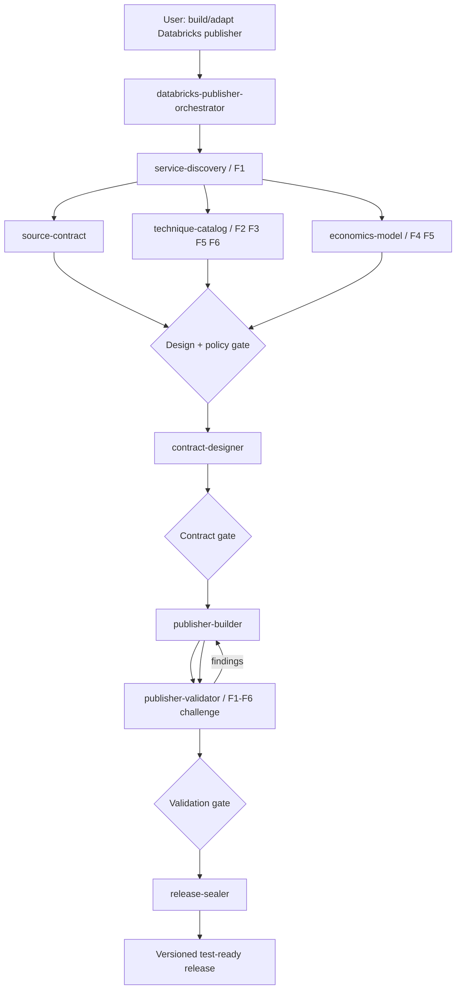
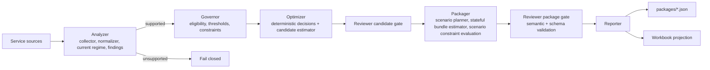

# Databricks Publisher Skill System

**Status:** Implemented. The suite version is declared in `.claude/skills/suite.yaml`.
**Reference exemplar:** the SQL Warehouse publisher in this repository.
**Purpose:** Reusable skill suite for designing, building, validating, and sealing deterministic `publisher.py` optimization engines for other Databricks services.

## Start

Copy `.claude/skills/` into the target repo and invoke the orchestrator, for example:

> Use the Databricks publisher orchestrator to build a deterministic job-cluster compute optimization publisher. Start with discovery and stop at the first approval gate.

Validate the skill package with `python scripts/validate_skill_suite.py`; it checks the skills `.claude/skills/suite.yaml` lists, so a general-purpose skill folder beside them (such as `brainstorm`) is not a suite member and is not checked. The suite also ships deterministic validators for source, optimization policy, technique, economics, contract, golden-manifest, and release artifacts.

## Expected lifecycle

`Discovery/System Model → Source Contract → Optimization Policy + Technique Catalog → Economics → Contract Lock → publisher.py → Independent Validation → Release Seal`

Independent research can run in parallel, but contract-dependent implementation stages stay sequential.

## Thinking framework

Every publisher must pass a six-axis optimization thinking framework. It is encoded in artifacts, templates, validators, implementation rules, and evals rather than left as advisory prose. The authoritative description is `.claude/skills/databricks-publisher-orchestrator/references/optimization-thinking-framework.md`.

1. **F1 First Principles** — model demand, resource state, pressure, performance/reliability, consumption and cost before choosing knobs.
2. **F2 Causal Mechanism** — require observation → mechanism → intervention → expected direct effect + falsifiers.
3. **F3 Constraints-First Optimization** — evaluate hard/validation/soft constraints before economic value.
4. **F4 Counterfactual** — model the isolated proposed state and uncertainty honestly.
5. **F5 Second-Order Effects** — dependencies, invalidations, feedback, migrations, new bottlenecks and remeasurement.
6. **F6 Validation & Learning** — canary/HITL, success criteria, rollback, realization and future calibration.

## Design goals

1. Reuse architectural patterns without copying SQL-Warehouse domain assumptions.
2. Keep research/advice separate from implementation and independent validation.
3. Treat approved artifacts as the cross-skill API.
4. Make deterministic/runtime semantics explicit before coding.
5. Make causal assumptions and optimization constraints explicit before estimating savings.
6. Use progressive disclosure: short `SKILL.md`, targeted `references/`, deterministic `scripts/`, output `assets/`, and executable/inspectable eval cases.
7. Fail closed when source, constraints, economics, or resource semantics are unresolved.
8. Preserve Git worktree/release gates and never auto-advance to another service/epic.

## Skill topology



## Ten skills

| Skill | Pattern | Owns |
|---|---|---|
| `databricks-publisher-orchestrator` | Orchestrator | gates, worktree flow, artifact registry, framework enforcement |
| `databricks-service-discovery` | Read-only research advisor | service profile, first-principles system model, resource identity/types |
| `databricks-source-contract` | Source/provenance advisor | evidence/source contract including causal/constraint/validation signals |
| `databricks-technique-catalog` | Challenger/policy advisor | optimization policy, causal techniques, constraints, second-order graph |
| `databricks-economics-model` | Economics specialist | actual/baseline/candidate/scenario/package/realization counterfactuals |
| `databricks-contract-designer` | Contract architect | dataclasses/enums, constraint semantics, JSON Schema, deterministic IDs, workbook grains |
| `databricks-publisher-builder` | Builder | single-`publisher.py` core, deterministic constraints/optimizer/estimators/reviewers/reporters |
| `databricks-publisher-validator` | Independent verifier | F1-F6 adversarial/golden/synthetic/determinism/economics/contract/E2E challenge |
| `databricks-release-sealer` | Release gate | stale-code/docs/security/framework/clean-ZIP/release evidence |
| `databricks-golden-miner` | Validation and learning (F6) | live pattern mining: registry coverage, gaps, behaviour mismatches, contradicted row premises, demo-fleet drift and real-data answers, turned into gated golden-scenario proposals |

`databricks-golden-miner` works on a built publisher, not on the design lifecycle. Its preflight requires the Databricks CLI with an OAuth profile and read access to the system tables. It then collects through the publisher's own live run and mines the run with a deterministic script (`references/signature-catalog.yaml` maps registry rows to evidence features). Each proposal is approved separately in chat; the skill never rewrites an existing golden baseline. When live evidence contradicts an assumption a row rests on, the row text can be corrected after approval. Changing the publisher setting behind it is a separate, versioned decision change. A live case commits the warehouse's evidence as collected, including real identities, owner emails, tags and costs.

Outside the suite, `teach-me` (`.claude/skills/teach-me/`) builds and refreshes the engineering field guide `docs/guide/shared/inframate-guide.html`: one offline HTML page that explains both products with diagrams, worked examples recomputed from a golden case, and explorers for the package, RPKG, ledger and measurement JSON. Its generator imports versions, thresholds, profiles, constants, CLI flags and contract tables from the code and the reference documents at build time, and fingerprints the sources each chapter cites, so `/teach-me refresh` rewrites only the chapters whose code changed. It also fingerprints each chapter's owning documents (a change there is flagged for review) and requires every file under `src/` and `schema/` to belong to a chapter or to an ignore list with a reason. `tests/test_docs.py` checks both the guide's citations and that coverage.

## Cross-skill artifact protocol

```text
artifacts/databricks/<service-id>/
├── registry.yaml
├── discovery/
│   ├── service-profile.yaml
│   ├── system-model.yaml
│   ├── service-context.md
│   └── open-decisions.yaml
├── sources/
│   └── ...
├── catalog/
│   ├── optimization-policy.yaml
│   ├── technique-catalog.yaml
│   └── dependency-graph.yaml
├── economics/
│   └── economics-contract.yaml
├── contracts/
│   └── ...
├── tests/
│   └── ...
└── release/
    └── release-evidence.yaml
```

Approved artifacts are authoritative handoffs. An upstream semantic change invalidates dependent approvals/release evidence.

## Constraints-first decision order

The service policy is lexicographic:

```text
hard constraints / safety / compatibility
        ↓
evidence sufficiency + supported type
        ↓
required performance/reliability guardrails
        ↓
primary optimization objective
        ↓
secondary objectives / effort / stability
```

Known post-change hard constraint violations block. Unknown required constraints do not silently pass. A safe empirical canary may convert uncertainty to `TEST_REQUIRED` if the approved policy says so.

## Generic resource contract

Reusable publishers use a generic top-level model:

```text
recommendation_package_id
contract_version
resource
current_config
workload_profile
cost_baseline
assessment
evidence
candidates
scenarios
recommended_plan
package_economics
realization
provenance
```

The generic contract never assumes `warehouse_id`, `warehouse_size`, or SQL Warehouse-specific knobs. Service adapters extend `resource.attributes` and service-specific typed contracts.

## Runtime reference architecture



These are the capabilities of the SQL Warehouse exemplar (`src/publisher/`, one package per capability, with `publish()` in `src/publisher/publisher.py` calling each once, in order). A new service may start as a single `publisher.py` core for fast iteration and early validation, but keeps the same capability boundaries so it can be split without redesign. Locked public contracts/reporters may remain separate modules.

LLMs are permitted for discovery, challenge, explanation, and development assistance. They are not the authoritative runtime recommendation engine.

## Evaluation model

Each skill includes:
- 10 positive trigger prompts;
- 10 negative/non-trigger prompts;
- at least 3 functional eval cases with assertions.

The orchestrator adds cross-service control/adaptation tests for SQL Warehouse, Job Cluster, and Lakeflow/DLT. Static structure and resource integrity are validated by `scripts/validate_skill_suite.py`. The functional prompts are intended for with-skill vs baseline model evaluation in an environment that can execute such model evals.

## Reference exemplar rule

The SQL Warehouse publisher is an exemplar of architecture and release discipline, not a template to search/replace. New services must rediscover resource identity, first-principles system model, constraints, source authority, technique causality, cost model, and supported types before contract lock.
