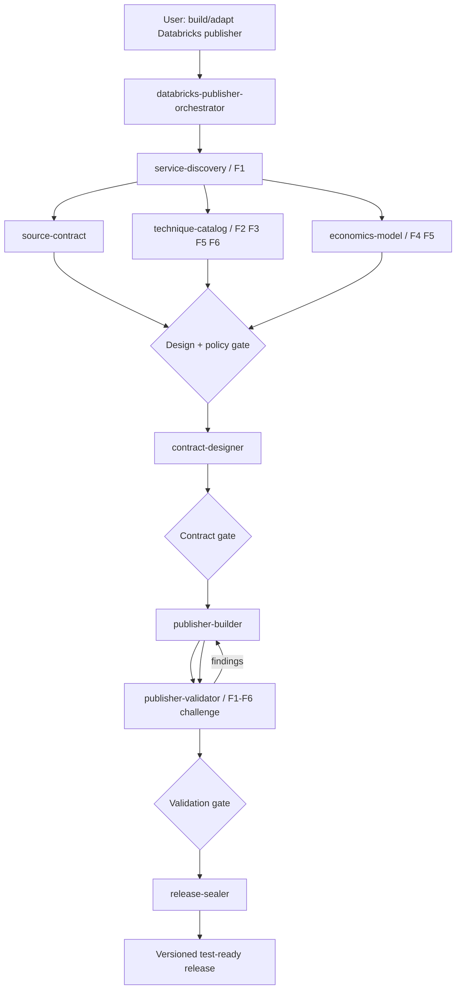
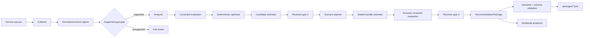

# Databricks Publisher Skill System — v1.1.0

**Status:** Approved design / implemented  
**Reference exemplar:** SQL Warehouse Publisher v2.7.0  
**Purpose:** Reusable skill suite for designing, building, validating, and sealing deterministic `publisher.py` optimization engines for other Databricks services.

## v1.1.0 change

v1.1.0 formalizes a six-axis optimization thinking framework across the existing nine skills. The framework is encoded in artifacts, templates, validators, implementation rules, and evals rather than left as advisory prose.

1. **F1 First Principles** — model demand, resource state, pressure, performance/reliability, consumption and cost before choosing knobs.
2. **F2 Causal Mechanism** — require observation → mechanism → intervention → expected direct effect + falsifiers.
3. **F3 Constraints-First Optimization** — evaluate hard/validation/soft constraints before economic value.
4. **F4 Counterfactual** — model the isolated proposed state and uncertainty honestly.
5. **F5 Second-Order Effects** — dependencies, invalidations, feedback, migrations, new bottlenecks and remeasurement.
6. **F6 Validation & Learning** — canary/HITL, success criteria, rollback, realization and future calibration.

## Design goals

1. Reuse architectural patterns without copying SQL-Warehouse domain assumptions.
2. Keep research/advice separate from implementation and independent validation.
3. Treat approved artifacts as the cross-skill API.
4. Make deterministic/runtime semantics explicit before coding.
5. Make causal assumptions and optimization constraints explicit before estimating savings.
6. Use progressive disclosure: short `SKILL.md`, targeted `references/`, deterministic `scripts/`, output `assets/`, and executable/inspectable eval cases.
7. Fail closed when source, constraints, economics, or resource semantics are unresolved.
8. Preserve Git worktree/release gates and never auto-advance to another service/epic.

## Skill topology



## Nine skills

| Skill | Pattern | Owns |
|---|---|---|
| `databricks-publisher-orchestrator` | Orchestrator | gates, worktree flow, artifact registry, framework enforcement |
| `databricks-service-discovery` | Read-only research advisor | service profile, first-principles system model, resource identity/types |
| `databricks-source-contract` | Source/provenance advisor | evidence/source contract including causal/constraint/validation signals |
| `databricks-technique-catalog` | Challenger/policy advisor | optimization policy, causal techniques, constraints, second-order graph |
| `databricks-economics-model` | Economics specialist | actual/baseline/candidate/scenario/package/realization counterfactuals |
| `databricks-contract-designer` | Contract architect | dataclasses/enums, constraint semantics, JSON Schema, deterministic IDs, workbook grains |
| `databricks-publisher-builder` | Builder | single-`publisher.py` core, deterministic constraints/optimizer/estimators/reviewers/reporters |
| `databricks-publisher-validator` | Independent verifier | F1-F6 adversarial/golden/synthetic/determinism/economics/contract/E2E challenge |
| `databricks-release-sealer` | Release gate | stale-code/docs/security/framework/clean-ZIP/release evidence |

## Cross-skill artifact protocol

```text
artifacts/databricks/<service-id>/
├── registry.yaml
├── discovery/
│   ├── service-profile.yaml
│   ├── system-model.yaml
│   ├── service-context.md
│   └── open-decisions.yaml
├── sources/
│   └── ...
├── catalog/
│   ├── optimization-policy.yaml
│   ├── technique-catalog.yaml
│   └── dependency-graph.yaml
├── economics/
│   └── economics-contract.yaml
├── contracts/
│   └── ...
├── tests/
│   └── ...
└── release/
    └── release-evidence.yaml
```

Approved artifacts are authoritative handoffs. An upstream semantic change invalidates dependent approvals/release evidence.

## Constraints-first decision order

The service policy is lexicographic:

```text
hard constraints / safety / compatibility
        ↓
evidence sufficiency + supported type
        ↓
required performance/reliability guardrails
        ↓
primary optimization objective
        ↓
secondary objectives / effort / stability
```

Known post-change hard constraint violations block. Unknown required constraints do not silently pass. A safe empirical canary may convert uncertainty to `TEST_REQUIRED` if the approved policy says so.

## Generic resource contract

Reusable publishers use a generic top-level model:

```text
recommendation_package_id
contract_version
resource
current_config
workload_profile
cost_baseline
assessment
evidence
candidates
scenarios
recommended_plan
package_economics
realization
provenance
```

The generic contract never assumes `warehouse_id`, `warehouse_size`, or SQL Warehouse-specific knobs. Service adapters extend `resource.attributes` and service-specific typed contracts.

## Runtime reference architecture



The single `publisher.py` core remains the default fast-iteration implementation shape. Locked public contracts/reporters may remain separate modules.

LLMs are permitted for discovery, challenge, explanation, and development assistance. They are not the authoritative runtime recommendation engine.

## Evaluation model

Each skill includes:
- 10 positive trigger prompts;
- 10 negative/non-trigger prompts;
- at least 3 functional eval cases with assertions.

v1.1.0 contains 180 trigger/non-trigger cases and 39 functional cases, plus cross-service control/adaptation tests for SQL Warehouse, Job Cluster, and Lakeflow/DLT. Static structure and resource integrity are validated by `tools/validate_skill_suite.py`. The functional prompts are intended for with-skill vs baseline model evaluation in an environment that can execute such model evals.

## Reference exemplar rule

SQL Warehouse v2.7.0 is an exemplar of architecture and release discipline, not a template to search/replace. New services must rediscover resource identity, first-principles system model, constraints, source authority, technique causality, cost model, and supported types before contract lock.
